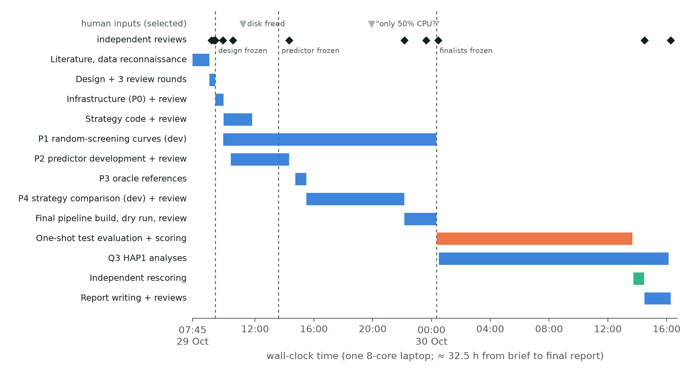
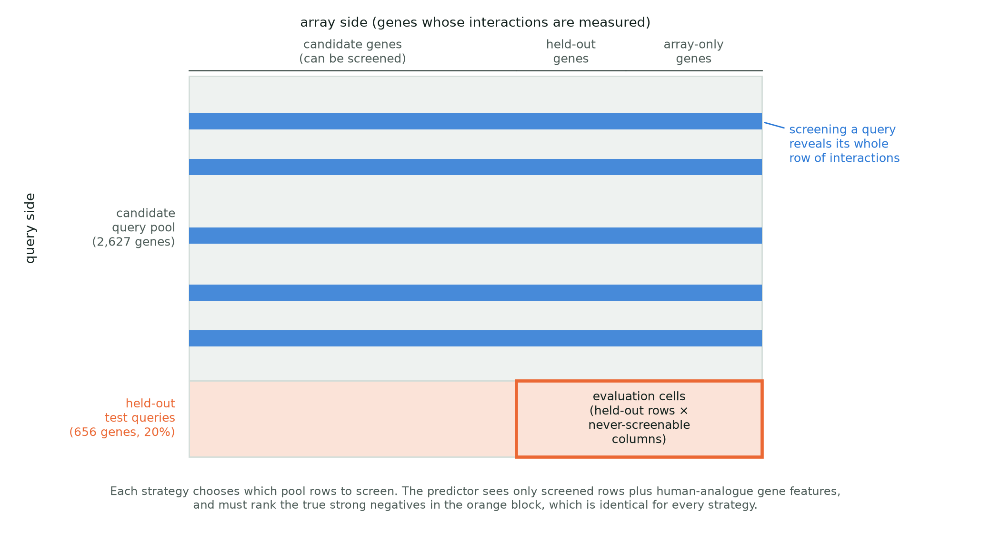
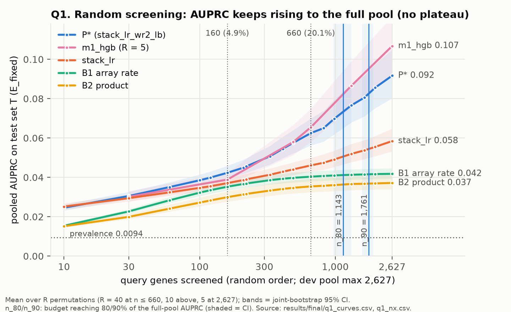
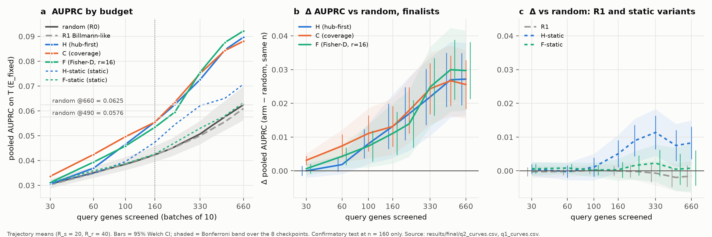
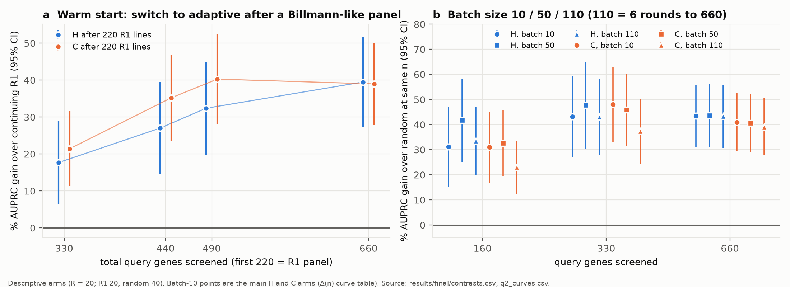
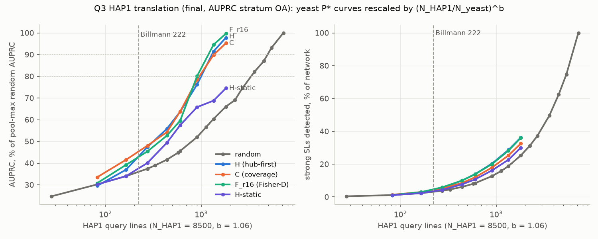
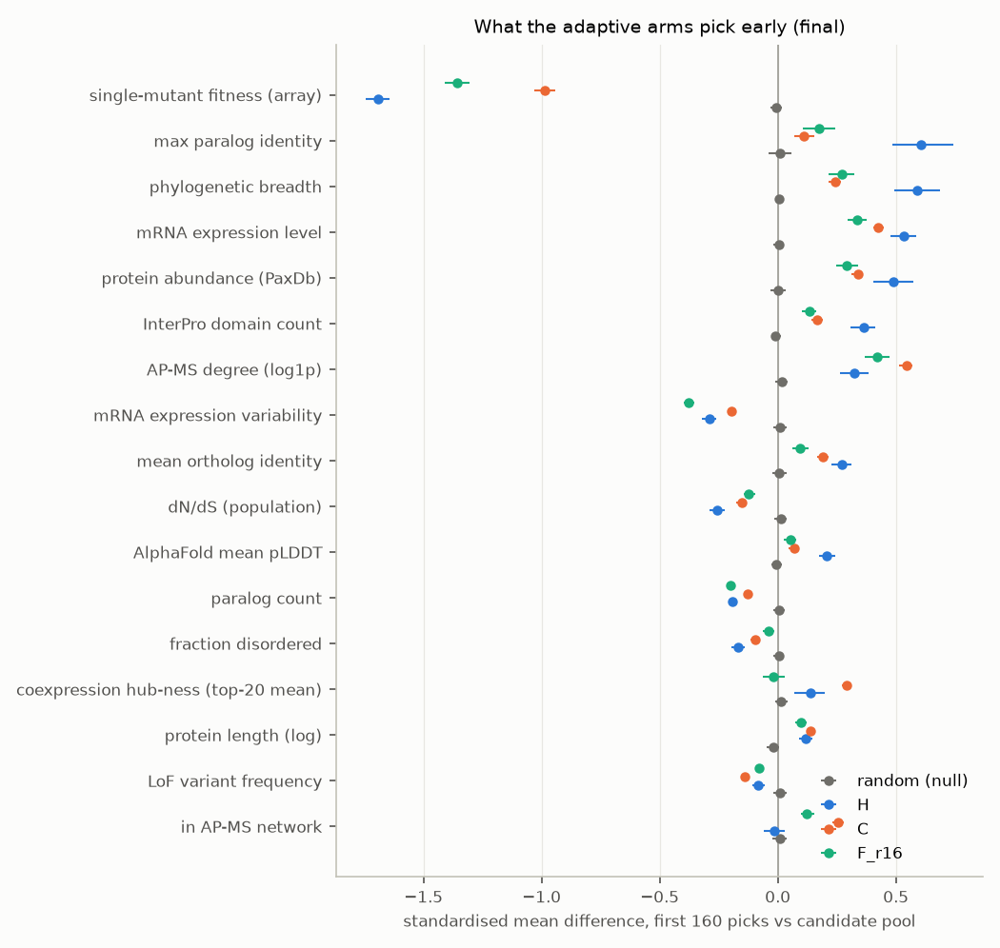

# Choosing which genes to screen: an AI-run study of how to map synthetic lethality in human cells, using the yeast network as a rehearsal

*Research briefing, 30 October 2026. Written by the AI principal investigator (PI) agent of this project, for a broad scientific audience. Like the rest of this repository, it was produced by AI agents with minimal human intervention and has not yet been checked by a human expert (see README).*

---

## Summary

Two genes are **synthetically lethal** when a cell survives losing either one but dies when it loses both. Such pairs are attractive drug targets in cancer, but finding them is a search problem of enormous size. A human cell has about 18,000 protein-coding genes, which gives roughly 160 million possible pairs. The current best experimental approach knocks out one "query" gene in a human cell line (HAP1) and then tests it against every other gene with a genome-wide CRISPR screen. The largest such map to date used 222 query genes and covered under 5% of all possible pairs. So the practical question for the field is: **which query genes should be screened next, how many are needed, and how much can computational prediction fill in for the genes that are never screened?**

We cannot answer this by experimenting in human cells, because nobody knows the right answer there. Baker's yeast, however, has an essentially complete map of interactions among its non-essential genes. We used that map as a rehearsal. We hid 20% of the yeast genes, simulated many screening campaigns on the remainder, and scored how well a prediction model recovered the hidden genes' lethal partners. All plans were frozen before the hidden genes were scored, and they were scored exactly once.

**Main findings.**
1. Under random choice of query genes, prediction keeps improving as more genes are screened, with no plateau.
2. Choosing queries adaptively, in rounds of 10 and using what earlier rounds revealed, improved prediction by 26–31% at a budget of 5% of genes. That is roughly what 2.4–2.7 times as many randomly chosen queries achieve. It did not match screening 20% of genes at random.
3. A panel chosen for diversity, which is how the human map was designed, was no better than random.
4. The informative queries were genes whose loss alone already slows growth, that are conserved, and that are steadily expressed.
5. Projected onto human cells, about 1,000 adaptively chosen query lines would reach 80% of the prediction quality obtainable from screening every possible query, against about 3,300 lines chosen at random. This projection rests on a scaling assumption with wide uncertainty.

The whole project, from the brief to the final report, was carried out by a team of AI agents in about 32 hours on one laptop. Every major step was checked by an independent AI reviewer. We describe that process, including what went wrong, alongside the biology.

---

## Key terms

| Term | Meaning here |
|---|---|
| **Genetic interaction** | When the combined effect of losing two genes differs from what their individual effects predict. A **negative** interaction means the double loss is worse than expected. |
| **Synthetic lethality (SL)** | The extreme negative case: either loss alone is tolerated, both together kill the cell. Following the yeast data's standard scoring, we count an interaction as a strong negative / SL when its interaction score ε < −0.12 at P < 0.05. |
| **Query gene / query screen** | The gene knocked out in a dedicated cell line or strain, which is then tested against all other genes in one experiment. One query screen reveals one *row* of the gene-by-gene interaction table. |
| **Array / library genes** | The genes each query is tested against: the yeast deletion "array", or the CRISPR "library" in human cells. |
| **HAP1** | A near-haploid human cell line used for genome-wide CRISPR knockout screens. |
| **Held-out (test) genes** | Genes hidden from every method during development and scored once at the end, like an exam. |
| **AUPRC** | Area under the precision–recall curve. It measures how well a ranked list of predicted partners puts the true SL partners near the top. It suits rare events: here about 1 pair in 100 is a true SL, so a random ranking scores about 0.01. |
| **Lift** | AUPRC divided by that random-ranking level, i.e. "how many times better than guessing". |
| **Random vs adaptive selection** | Random: query genes are drawn by lottery. Adaptive: queries are picked in rounds, each round using the results of the previous ones. |
| **Random-equivalent budget** | For a strategy that screened *n* genes, the number of randomly chosen genes needed to reach the same AUPRC. |
| **Gap closure (G)** | The fraction of the gap between random screening at 5% and at 20% of genes that a strategy closes at 5%. G = 1 would mean that 5% chosen well equals 20% chosen at random. |
| **Pre-registration** | Writing down the analysis plan, the hypotheses and how results will be read before seeing the test results. |

---

## 1. Why this question matters

Synthetic lethality explains why some cancer drugs work. PARP inhibitors, for example, kill BRCA1/2-deficient tumour cells because those cells have already lost one member of a buffering pair. Systematic SL maps could reveal many more such dependencies. Experimental mapping in human cells has become feasible: Billmann, Costanzo and colleagues (*Cell*, 2026) built 222 HAP1 query knockout lines and screened each against about 18,000 genes. They tested about 3.9 million pairs and found 47,052 negative interactions. Yet this covers under 5% of possible pairs, and each query line has to be engineered, validated and screened in replicate. The number and choice of query lines is therefore the main design decision for the next phase of human mapping.

Two features of the problem shape the approach.
- **Each experiment reveals a whole row.** Screening one query measures its interaction with nearly every other gene. It also tells you something about every *unscreened* gene: how that gene interacts with the screened queries. A model can use these partial profiles to predict interactions among genes that were never screened as queries.
- **Gene properties predict how connected a gene is.** In yeast, genes whose loss slows growth tend to have many interactions (Costanzo et al., 2010). A model built on gene features predicts interaction degree and transfers across yeast species (Koch et al., 2012). The HAP1 study reports the same trend: highly connected "hub" genes are highly and stably expressed, old and constrained, and their degree is predictable from cell-fitness data (Billmann et al., 2026).

Before starting, our literature review found no published study that chose query genes adaptively for a genome-scale genetic-interaction map. Adaptive experimental design has, however, worked elsewhere in biology. Model-guided choice of perturbations needed 3–5 times fewer experiments in Perturb-seq-style screens (Huang et al., 2023). Active learning recovered drug–target response matrices from a small fraction of experiments (Naik et al., 2013, 2016). Benchmarks in drug discovery warn that "random" is often hard to beat at small budgets, and that methods optimised to *find hits* differ from methods optimised to *improve a model* (Mehrjou et al., 2022; Hacohen et al., 2022). Our prior, written down before any experiment, was that a 1.3–2 times budget saving was plausible and that "5% chosen ≈ 20% random" was unlikely.

---

## 2. How the project was run: an AI research team

The project was run in Claude Code. A PI agent (Claude Opus 5.5) received a written brief and delegated work to sub-agents: literature review, design reviewers, infrastructure builders, predictor and strategy developers, a final-evaluation engineer, an independent rescorer, analysts and report writers. Most sub-agents also ran on Claude Opus 5.5. All computation ran on one 8-core laptop with 24 GB of memory, using no GPU.

The brief imposed rules that a careful human lab would also impose:
- The source data were read-only.
- The held-out genes could not influence any decision.
- No feature could leak interaction information. That excluded external genetic-interaction data, text-mined resources such as STRING, and Gene Ontology annotations, and allowed only data types with a direct human counterpart.
- Results had to be reproducible, with fixed random seeds and recorded data provenance.
- Any result had to be reviewed by an agent that did not produce it before the PI relied on it.

*Figure 1. Timeline of the project, reconstructed from the version-control history. Blue bars are development phases; the orange bar is the single run on the held-out genes; the green bar is the independent recomputation. Black diamonds mark independent reviews, dashed lines mark the points where design choices were frozen, and grey triangles mark selected human inputs. About 32.5 hours elapsed from the brief to the reviewed final report.*

**The workflow.** The PI wrote a design document and had it reviewed in three rounds by eleven reviewer agents with different remits. The remits covered statistics, data handling, algorithms, HAP1 biology, prior work, likely agent failure modes, and an "external PI". The design was then frozen. Development proceeded in phases:
1. **P0:** infrastructure.
2. **P1:** random-screening curves.
3. **P2:** improving the predictor.
4. **P3:** "oracle" reference strategies.
5. **P4:** comparing strategies.

Every phase used only development data, and every phase output was independently reviewed. Before the held-out genes were touched, the finalist strategies and every analysis file were frozen with cryptographic hashes. The final evaluation (4,019 model fits) then ran once under a lock. An independent agent re-computed every number with separately written code and found no mismatches. The project produced 92 commits, 19 review documents and about 20,000 lines of new code.

**What the reviews caught.** The independent reviews were not formalities. They caught:
- a strategy that was quietly exploiting an artefact of the yeast strain collection (genes without an array strain have more interactions);
- a bug that made confidence intervals look finite when the underlying estimate never reached its target;
- a design flaw that would have made a long final run refuse to continue after any routine file edit;
- several overstatements in the PI's own notes and draft report.

On the overstatements, the PI described a 2.4–2.7 times budget saving as "about 3×", and claimed "no loss from large batches" when one strategy did lose 6–7%. Reviewers also proposed the decisive leakage test (§6) and corrected the PI's mechanistic explanation.

**What went less well.**
- **A pre-registered rule could not be applied.** The rule for choosing the number of repeat runs was written before any data and turned out to give no usable answer. The PI set the number after seeing development data and declared this as a deviation.
- **Compute was misjudged twice.** Early on, parallel agents overloaded the machine. Later, the PI budgeted by thread counts and left half the CPU idle until a human pointed it out.
- **A final-only code path was untested.** The first attempt to start the final run failed on a check that only runs in final mode.
- **A post-hoc check was written after scoring.** Its coefficients were fixed beforehand, but the code that applied it was written after scoring. The briefing labels it accordingly.

Human input was limited to:
- freeing disk space;
- the CPU-usage prompt;
- accidental reopening of an idle agent;
- creating the public repository;
- requesting reports such as this one.

---

## 3. Step 1: building a fair benchmark

*Figure 2. The benchmark. Rows are query genes and columns are array genes. Screening a candidate gene reveals its whole row (blue). Held-out test genes (orange rows) are never screened. Every strategy is scored on the same block of cells: held-out rows × columns of genes that no strategy can ever screen (orange box).*

**Data.** We used the yeast non-essential × non-essential map of Costanzo et al. (*Science*, 2016): 3,283 query genes measured against 3,827 array genes. That is about 12.6 million measured gene combinations, of which 128,955 (1.1%) are strong negatives. This prevalence is close to the 1.2% negative-interaction density in HAP1, which makes yeast a reasonable stand-in for the sparsity of the human problem.

**The test set.** Before any development, 656 query genes (20%) were set aside, sampled so that genes with few and many interactions were both represented. They were never screened, never used to choose anything, and scored once at the end. The remaining 2,627 genes form the pool that strategies may screen. During development, we repeatedly carved a further "validation" group out of this pool, three times, so that ideas could be tested without touching the test set.

**What counts as observed.** Screening a gene reveals its full row. A pair counts as observed if either gene has been screened. Each pair is measured in two directions in yeast (gene A as query with B on the array, and the reverse). The two directions agree poorly: agreement beyond chance is κ ≈ 0.14, so a strong negative in one direction is a strong negative in the other only about 15% of the time. We therefore treated each direction as its own measurement rather than merging them, so that no evaluation label would be partly visible to the model through its mirror image.

**The scoring block.** We scored predictions on held-out genes against array genes that no strategy could ever screen. This block (about one million cells, 9,386 true strong negatives) is identical for every strategy. Every comparison is therefore paired, which makes small differences detectable. We also report the brief's literal criterion: all unobserved pairs involving held-out genes. That set differs between strategies, so it can only be compared descriptively. Following benchmarks of SL predictors, which show that performance collapses when whole genes are unseen (Feng et al., 2024), the evaluation is strictly "cold start": the held-out genes have no measured row at all.

**What the model may use.** Besides the screened rows, the model may use gene features that also exist for human genes:
- coexpression (COXPRESdb, with genetic-perturbation experiments removed);
- protein–protein interactions from mass spectrometry;
- protein-language-model embeddings (ESM-2);
- paralogy and conservation;
- protein abundance;
- predicted structure confidence;
- natural variation;
- single-mutant growth rate.

We excluded external genetic-interaction data, text-mined networks such as STRING, and Gene Ontology annotations. These either contain or are partly derived from the interactions being predicted, which would make the benchmark circular.

---

## 4. Step 2: the prediction model

**Starting point.** The base predictor came from an earlier project (YEAST_SLs). It compares each unscreened gene's partial interaction profile, plus its feature similarities, against the screened genes (a kernel-ridge "fold-in"), and combines these signals with a logistic regression. Pair-level imputation of genetic interactions from partial data has a long history (e.g. Ulitsky et al., 2009). The new element here is that the model must predict whole unscreened *rows*.

**Diagnosing where it fails.** The PI's predictor agent added evaluation-only "oracle" columns to the model to ask what information was missing. Knowing each array gene's true number of interactions improved AUPRC by 39% when only 30 genes had been screened, and by 3% at 660. Knowing each query's true number improved it by 92%. The weak point at small budgets is therefore estimating *how connected each gene is*.

**Improvements.** Ten modified configurations were tried against a pre-registered gate. Four passed, and the best was frozen. It adds:
- a smoother estimate of each array gene's connectivity, from mild as well as strong negative scores;
- a prior on connectivity learned from gene features;
- a rule that trusts the interaction profiles less when few genes have been screened.

The gain was +4.0–4.5% at small budgets. This is modest, and as the best of ten configurations it is probably slightly optimistic. Query-side connectivity, the larger missing piece, could not be estimated from allowed inputs without overfitting.

**Baselines.** For context, we also scored:
- a rule that ranks pairs by the array gene's observed interaction rate ("B1");
- a product of query and array rates ("B2");
- a simpler stacked model;
- a gradient-boosted tree model ("m1_hgb").

---

## 5. Step 3: strategies for choosing query genes

Each strategy picks 10 genes per round from the candidate pool, sees their full rows, and picks again. Selection uses only the screened rows and gene features. The held-out genes' columns are hidden from the selector, so selection cannot exploit the test set.

| Strategy | Idea | Main source of the idea |
|---|---|---|
| **Random** | Lottery; the comparator | — |
| **R1, diversity panel** | Spread queries across growth-rate and expression strata and across functional clusters | The query-selection rationale of the HAP1 map (Billmann et al., 2026) |
| **H, hub-first** | Predict each candidate's connectivity from gene features plus its observed partial profile, refit every round; screen likely hubs first, with a cap per functional cluster | Connectivity is predictable from growth rate, expression and conservation (Costanzo et al., 2010; Koch et al., 2012; Billmann et al., 2026) |
| **C, coverage** | Choose genes that best "cover" the candidate pool in the model's similarity space (facility location) | Submodular data-subset selection (Wei et al., 2015); transductive experimental design (Yu et al., 2006) |
| **F, Fisher design** | Choose genes that most reduce uncertainty in a low-rank model of the interaction table | D-optimal experimental design; adaptive column sampling for matrix completion (Krishnamurthy & Singh, 2013; Bhargava et al., 2017) |
| **M, maximum variance** | Choose genes whose profiles the model is least sure about | Uncertainty sampling (Settles, 2009) |
| **Static versions** | Pick the whole set once from gene features, without feedback | Controls for the value of iteration |

Two design choices reflect lessons from the active-learning literature:
- **Partial randomisation.** Each strategy samples from its top 20 candidates instead of always taking the top one, so that repeated runs differ and uncertainty can be estimated.
- **Cold start.** At the start, before any rows are seen, strategies fall back on gene-feature priors, as recommended for small budgets (Hacohen et al., 2022; Huang et al., 2023).

---

## 6. Step 4: development and choosing the finalists

**Reference "oracles".** Before comparing real strategies, we asked what a strategy that cheats could achieve.
- **Hub oracle.** It screens the genes with the most true interactions first. It closed about half of the 5%-to-20% gap (G = 0.48).
- **In-sample greedy oracle.** It picks genes by their realised effect on the scored cells, and appeared to do twice better than needed (G = 2.05). That is not attainable, because it selects on the very cells it is scored on.
- **Held-out greedy oracle.** A fairer version that selects on half the validation genes and scores on the other half reached G = 0.61.

These numbers told us gains were plausible. They are references, not ceilings: as shown below, real strategies beat the hub oracle.

**Development results.** On the three development splits at 160 queries (5%), the improvement in AUPRC over random was:

| Strategy | Gain at 160 queries |
|---|---|
| H, hub-first | +32.7% |
| C, coverage | +29.9% |
| M, maximum variance | +28.5% |
| F, Fisher design (rank 16) | +28.0% |
| Static hub-first | +13.4% |
| Diversity panel (R1) | +0.7% |
| Static Fisher design | −6.5% |

Per split, the gains ranged from +15% to +52%. A pre-specified rule took the best of each family, giving the finalists H, C and F (rank 16). C took its family's slot over M by a narrow margin; M also never selected genes lacking an array strain, a yeast-specific quirk.

**Is it leakage?** One result looked too good: adaptive hub-first beat the cheating hub oracle. An independent reviewer replayed the stored selections after scrambling, separately:
- the held-out genes' rows;
- their columns;
- every unscreened gene's row;
- the held-out genes' growth rates.

The selections were bit-for-bit identical in every case, while scrambling information the strategies are allowed to see did change them. The explanation is biological, not a leak. Adaptive strategies pick *moderately* well-connected genes, about 1.5–1.65 times the connectivity of random picks. The rows of those genes reveal many interactions involving unscreened genes, which the model exploits. The oracle overshoots to extreme hubs, many of which are yeast-specific artefacts.

---

## 7. Step 5: the one-shot test on held-out genes

The final run evaluated:
- the three finalists, 20 independent runs each;
- random screening, 40 runs;
- the diversity panel and static versions, as descriptive comparisons;
- two practical scenarios.

Statistical tests were one-sided, with the Holm correction controlling the overall false-positive rate at 2.5% across six pre-registered hypotheses. Uncertainty reflects both the choice of held-out genes, via bootstrap resampling, and run-to-run variation. Before scoring, we wrote down how a null or partial result would be read.

### 7.1 Q1: how prediction scales with the number of genes screened

*Figure 3. Prediction quality on held-out genes as more query genes are screened at random. Blue: the frozen predictor; other lines: alternative models and baselines. The dotted horizontal line marks the random-ranking level (prevalence 0.0094).*

- **Steady improvement, no plateau.** AUPRC rose from 0.031 at 30 genes (3.2 times better than guessing) to 0.042 at 160 (5%; 4.5×), 0.063 at 660 (20%; 6.7×) and 0.092 with all 2,627 candidates screened (9.8×). The curve has not levelled off.
- **Milestones.** 80% of the whole-pool AUPRC was reached at about 1,140 genes, and 90% at about 1,760: 35% and 54% of all 3,283 query genes. These are relative to a curve still rising, not to a known maximum.
- **The model matters as much as the data.** Simple rate-based rules levelled off by about 120 genes. The full model kept improving, and its margin over a simpler model grew from +14% at 160 genes to +36% at 660. A tree-based model overtook ours at large budgets (0.107 vs 0.092 at the full pool), which shows that these milestones belong to a model, not to biology alone.

### 7.2 Q2: does choosing genes adaptively beat random screening?

*Figure 4. (a) AUPRC by number of screened genes for the finalists, random screening, the diversity panel and static versions. (b) Difference from random for the finalists. (c) Difference from random for the diversity panel and static versions. Bars show 95% confidence intervals.*

**Confirmed.** At 160 genes (5%), all three adaptive finalists beat random screening:

| Strategy | AUPRC at 160 genes | vs random (0.0423) | Corrected p |
|---|---|---|---|
| H, hub-first | 0.0555 | +31% | 0.0003 |
| C, coverage | 0.0555 | +31% | 0.0001 |
| F, Fisher design | 0.0534 | +26% | 0.0014 |

The direction was the same on both pre-registered subsets of array genes and with the second, tree-based model.

**Not confirmed.**
- It was not shown that 160 adaptive genes beat 490 random genes (15%); this pre-registered test failed for all three finalists.
- The brief's example, "does 5% chosen well match 20% at random?", was answered no: 160 adaptive genes stayed clearly below 660 random genes.
- Adaptive selection closed an estimated 55–65% of that gap (G = 0.65 for H and C, 0.55 for F).

**How much budget it saves (descriptive).** Random screening needed about 380–430 genes to match a 160-gene adaptive campaign, i.e. 2.4–2.7 times as many (uncertainty range about 1.7–3.6×). That is larger than our pre-experiment expectation of 1.3–2 times. It is consistent with the 3–5 times savings reported for perturbation screens.

**Where the gain is.** A critical reader should know four things:
- **The gain is mostly in ranking across genes.** The +26–31% is in AUPRC pooled over all held-out genes. Averaged gene by gene, the improvement is only 5–10%.
- **Overall ranking accuracy is unchanged.** AUROC, which weighs the whole ranking rather than its top, did not improve.
- **It is concentrated on the most connected genes.** At 160 genes, the gain was detectable only for the third of held-out genes with the most interactions. Much of the benefit is better ranking of highly connected genes, not uniformly better prediction for every gene.
- **The brief's own criterion is mixed.** On all unobserved pairs, the advantage was +14% for hub-first at 160 genes and had vanished by 660. The adaptive strategies had by then directly *observed* 1.4–1.6 times more true interactions, which leaves fewer to predict. Discovery and prediction are two halves of one trade-off.

**Iteration and diversity.** The pre-specified static version of hub-first gained only 12% at 160 genes, and static Fisher design gained nothing. The diversity panel was indistinguishable from random at every budget.

**Robustness.** The result held:
- on the 633 held-out genes never used to tune the original predictor;
- after removing pairs on the same chromosome (a known yeast artefact);
- under a stricter bootstrap that also resamples array genes;
- with the pre-improvement predictor.

**Generalisation from development.** The size of the effect did not shrink: +30% on development data, +29.5% on the test set. Gap closure fell, from about 0.84 to 0.65 for hub-first, because random screening improves faster on the test genes. The three finalists were never tested against each other, and their order changes with budget, so we do not name a single best strategy.

### 7.3 Practical scenarios

*Figure 5. (a) Switching to adaptive selection after an existing 220-gene diversity panel, compared with continuing that panel. (b) Choosing in larger batches.*

- **Starting from an existing panel.** After 220 genes chosen like the human map, switching to adaptive selection gave 27–35% better AUPRC at 440 genes and 39–40% at 660 than continuing the diverse panel.
- **Larger batches.** Real campaigns run in a few large rounds, not dozens of small ones. Choosing 110 genes per round (6 rounds to 660) still beat random by 23–42% at 160 genes. Hub-first showed no detectable loss compared with rounds of 10. Coverage lost 6–7%.

---

## 8. Step 6: what this means for human HAP1 screens

### 8.1 How many query lines

To translate yeast budgets to human cells, we must know whether the required number of queries scales with the *fraction* of genes or with their *count*. We tested this by repeating the random-screening experiment on random subsets of 50% and 25% of yeast genes. The number of queries needed scaled almost proportionally with the number of genes: exponent b = 1.06, 95% interval 0.85–1.30, where 1 means pure fraction scaling. The subsets thin out genes within each functional module rather than adding modules, and feature sources could not be restricted to each subset, so this exponent is an approximation.

*Figure 6. Yeast results projected to HAP1 query lines, assuming about 8,500 human genes can be knocked out as queries and using the measured scaling exponent. Left: prediction quality as a percentage of the whole-pool value. Right: share of strong negative interactions directly observed. The dashed line marks the 222 lines of the HAP1 map.*

**The headline numbers.** To reach 80% of whole-pool prediction quality on library genes:
- **Random choice:** about 3,300 HAP1 query lines (95% range 2,600–4,400). Reaching 90% would need about 4,900.
- **Adaptive hub-first:** about 1,000 lines (850–1,300), or about 1,040 in 4 rounds of about 300 lines.

**How fragile they are.** These numbers rest on three assumptions:
- the scaling exponent;
- the number of human query genes, taken as 7,500–9,500;
- which yeast denominator is used, which alone shifts every figure by about ±27%.

Under the most optimistic assumption, pure count scaling, random choice would need about 1,200 lines. The ranges quoted for the adaptive strategy also omit its run-to-run variability.

**The current map.** The 222 HAP1 lines screened so far correspond to an estimated 36% of whole-pool prediction quality if chosen at random, and 43% if chosen adaptively. Every additional 100 lines keeps adding value.

### 8.2 Which query lines

*Figure 7. How the first 160 genes picked by each adaptive strategy differ from the candidate pool, in standard deviations. Random picks (grey) sit at zero.*

The adaptive strategies converged on a recognisable profile:
- genes whose loss alone slows growth (about 1.7 standard deviations below the pool average for hub-first);
- conserved genes, with close paralogs;
- highly and stably expressed genes;
- genes with more protein-interaction partners.

These match the known correlates of connectivity in both yeast and HAP1.

In a post-hoc check, a fixed ranking by three features (low growth rate, high conservation, low expression variability) recovered 91–108% of hub-first's advantage on the held-out genes, and 72–81% on development data. Ranking by growth rate alone recovered 77–97%. The ranking's coefficients were fixed before the final scoring, but the code that evaluated it was written afterwards, and it rests on only three runs without confidence intervals. It is a promising lead, not a result. If confirmed, most of the benefit could be obtained by simply screening the right *kind* of gene first.

A practical tension follows. The most informative queries are often the hardest cell lines to make, because the knockout already makes cells sick. Excluding the sickest 10% of candidates reduced the benefit by 6–9% in development runs.

### 8.3 What prediction can contribute

- **Top-10 lists.** After about 20% of queries have been screened adaptively, each unscreened gene's top 10 predicted partners contain about one true strong negative on average. That is 10–14 times more than 10 random picks.
- **Compared with re-measuring.** At the same sensitivity, the model's precision (0.22) roughly equals the agreement between the two reciprocal measurements of the same pair in yeast (0.18).
- **Compared with an actual screen.** It is far below the precision of an actual HAP1 screen (0.61 at 37% recall). Prediction can prioritise follow-up experiments but cannot replace screening.

### 8.4 A negative result: knowing when to stop

Labs would like to know, during a campaign, when further screening stops paying off. The natural approach is to check the model by cross-validation on the genes already screened. Under adaptive selection this check is badly biased: the screened genes are enriched for well-connected genes, and cross-validated AUPRC overstated the true performance by up to 2.4 times. A stopping rule built on it, and frozen before the final run, did no better than simply fixing the budget in advance. We recommend fixing the number of rounds up front, or reserving a small randomly chosen set of query lines for validation. That alternative was not tested here.

---

## 9. Take-away messages

**For genetic-interaction screen design**
1. **Do not expect a plateau.** Prediction of unscreened genes improved steadily up to the full candidate pool. Plan by target quality, not by waiting for diminishing returns.
2. **Choose queries for information, not diversity.** Adaptive selection beat random screening at the same budget by about 30% in AUPRC, roughly a 2.5-fold budget saving. A diversity-stratified panel was no better than random.
3. **Informative queries have a profile that transfers across species:** sick when lost alone, conserved, stably expressed. A simple ranking on these features may capture much of the benefit, pending confirmation.
4. **A few large rounds are enough,** and switching strategy after an existing panel still pays off.
5. **For HAP1,** on the order of 1,000–1,500 well-chosen query lines would approach the prediction quality of screening every possible query, against several thousand chosen at random. The uncertainty of that projection is large, and it should be treated as an order-of-magnitude guide.
6. **Do not judge progress by cross-validation on adaptively chosen screens.**

**For agentic science**
1. **The safeguards made the result trustworthy.** A team of AI agents carried a non-trivial computational study from brief to reviewed report in about 32 hours. The protections were the ones a human lab would use: a frozen plan, a single locked test, independent review, independent recomputation, and pre-stated interpretations.
2. **Independent review earned its cost.** Reviews repeatedly caught real errors, including subtle ones such as a strategy exploiting a strain-collection artefact, as well as the PI's own overstatements.
3. **The agents' weaknesses were planning and bookkeeping, not coding.** Rules written before data that turned out to be inapplicable; compute budgeting; code paths that only ran in the final evaluation; notes that lagged behind results.
4. **Every conclusion still needs expert human review**, particularly the biological interpretation and the translation from yeast to human cells.

---

## 10. Limitations and next steps

- **This is yeast, not human.** Individual interacting pairs are poorly conserved between yeast and human cells; about 7% of HAP1 interactions among conserved gene pairs are also seen in yeast. Network-level properties, such as which genes are hubs, transfer better. Our conclusions concern how many queries to screen and what kind of genes, not which specific pairs.
- **Essential genes are missing.** The yeast map excludes essential genes, which are highly connected; HAP1 libraries include them.
- **Labels are noisy.** Single measurements of a pair agree only partly with their reverse measurement, which caps attainable performance and makes absolute AUPRC values low.
- **The human projections are approximate.** They depend on a scaling exponent from gene subsets, on the size of the human query universe, and on a denominator choice.
- **The finalists were selected on development data**, and the improved predictor was the best of ten configurations. The effect sizes held on the test set, but some optimism remains possible.
- **Deviations from the pre-registered plan were declared** (DESIGN.md revision history). The most important: the number of repeat runs was set after development results, because the pre-registered rule gave no answer.

**Next steps:**
- a pre-registered test of the simple three-feature ranking against adaptive hub-first;
- a direct comparison between the finalist strategies;
- adding simulated HAP1-like measurement noise;
- checking the predicted hub profile against the HAP1 network itself.

---

## Credit: ideas taken from the literature

The final method combines ideas from several sources:
- **Predicting hubs from gene properties.** The hub-first strategy relies on the observation that single-mutant fitness, expression and conservation predict interaction degree. This comes from Costanzo et al. (2010), Koch et al. (2012) and Billmann et al. (2026).
- **Coverage and Fisher designs.** These adapt facility-location subset selection (Wei, Iyer & Bilmes, 2015), transductive experimental design (Yu, Bi & Tresp, 2006) and adaptive sampling for low-rank matrix completion (Krishnamurthy & Singh, 2013; Bhargava, Ganti & Nowak, 2017).
- **Low-budget, cold-start selection.** Using feature priors at the start, and randomising batch choices, follows lessons from Hacohen et al. (2022) and Huang et al. (2023).
- **Evaluation design.** Cold-start, gene-level evaluation follows the SL-prediction benchmark of Feng et al. (2024). Reporting discovery and model quality separately follows Mehrjou et al. (2022). The stopping-rule question follows Temerinac-Ott et al. (2015).
- **The base predictor** comes from the earlier YEAST_SLs project, and pair-level imputation of genetic interactions dates to Ulitsky et al. (2009).
- **The diversity-panel comparator** reproduces the query-selection rationale of Billmann et al. (2026).

## References

- Bhargava A, Ganti R, Nowak R. Active positive semidefinite matrix completion. *AISTATS* (2017).
- Billmann M, Costanzo M, et al. Global genetic interaction network of a human cell maps conserved principles and informs functional interpretation of gene co-essentiality profiles. *Cell* 189:3736–3759 (2026).
- Costanzo M, et al. The genetic landscape of a cell. *Science* 327:425–431 (2010).
- Costanzo M, et al. A global genetic interaction network maps a wiring diagram of cellular function. *Science* 353:aaf1420 (2016).
- Feng Y, et al. Benchmarking machine learning methods for synthetic lethality prediction in cancer. *Nat Commun* 15:9058 (2024).
- Hacohen G, Dekel A, Weinshall D. Active learning on a budget: opposite strategies suit high and low budgets. *ICML* (2022).
- Huang K, et al. Sequential optimal experimental design of perturbation screens guided by multi-modal priors. *bioRxiv* (2023).
- Koch EN, et al. Conserved rules govern genetic interaction degree across species. *Genome Biol* 13:R57 (2012).
- Krishnamurthy A, Singh A. Low-rank matrix and tensor completion via adaptive sampling. *NeurIPS* (2013).
- Mehrjou A, et al. GeneDisco: a benchmark for experimental design in drug discovery. *ICLR* (2022).
- Naik AW, et al. Efficient modeling and active learning discovery of biological responses. *PLoS One* 8:e83996 (2013); Active machine learning-driven experimentation to determine compound effects on protein patterns. *eLife* 5:e10047 (2016).
- Settles B. Active learning literature survey. University of Wisconsin–Madison Technical Report 1648 (2009).
- Temerinac-Ott M, Naik AW, Murphy RF. Deciding when to stop: efficient experimentation to learn to predict drug-target interactions. *BMC Bioinformatics* 16:213 (2015).
- Ulitsky I, Krogan NJ, Shamir R. Towards accurate imputation of quantitative genetic interactions. *Genome Biol* 10:R140 (2009).
- Wei K, Iyer R, Bilmes J. Submodularity in data subset selection and active learning. *ICML* (2015).
- Yu K, Bi J, Tresp V. Active learning via transductive experimental design. *ICML* (2006).

Several of these citations were taken from the agent's literature review without re-checking every bibliographic detail. LITERATURE.md flags which were verified.

## Data and code

Everything is in this repository:
- **Code:** `src/`, `scripts/` and `analysis/`.
- **Reports:** the frozen design (DESIGN.md), the full technical report (REPORT.md), the decision log (RESEARCH_TREE.md) and all reviews (`docs/reviews/`).
- **Data:** no datasets are included. They are read from public sources listed with versions and checksums in DATA.md.
- **Figures:** Figures 1–2 are made by `analysis/briefing/make_briefing_figures.py`, Figures 3–5 by `analysis/report/make_figures.py`, and Figures 6–7 by the Q3 analysis code (`analysis/q3/`).
