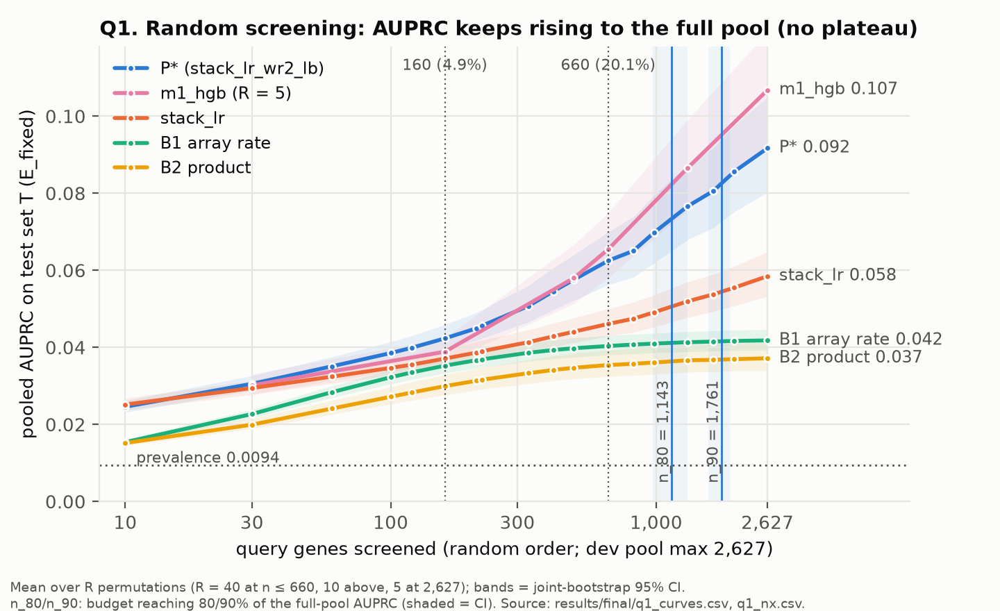
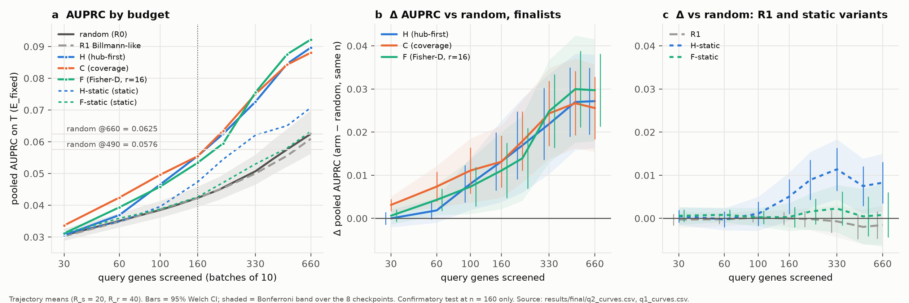
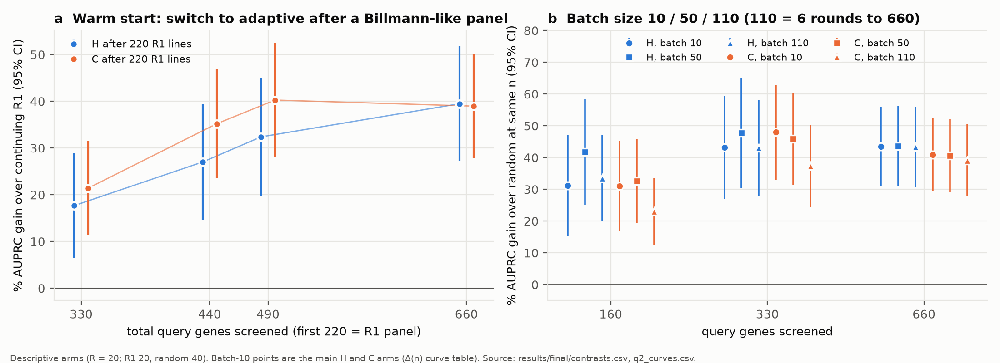
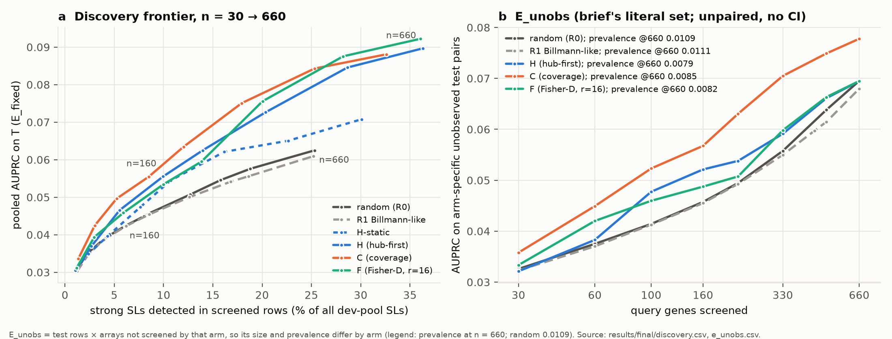

# REPORT — Designing human HAP1 synthetic-lethal screens from the yeast genetic-interaction network

Status: **draft for review**, 2026-10-30. The one-shot test-set evaluation was scored at commit 8c1818a and independently rescored at dad7bf0 with 0 mismatches. Q3 was run on the final outputs at b3be29b.

**Claim labels.** **[C]** = confirmatory (pre-registered family, one-sided, Holm, familywise α = 0.025). **[P]** = pre-specified rule, reported descriptively. **[D]** = descriptive. **[dev]** = development data only, never the test set. Every number is cited to a committed file. `final/` means `results/final/`, and `final/summary.md §X` names a section of that file.

---

## 0. Summary

- **Q1 [D].** Under random query selection, SL prediction for unscreened genes improves steadily, with no plateau. On the held-out test genes, pooled AUPRC with the frozen predictor P* was 0.031 at 30 queries (lift 3.2), 0.042 at 160 (4.9%; lift 4.5), 0.063 at 660 (20%; lift 6.7) and 0.092 with the whole 2,627-gene pool screened (lift 9.8). 80% / 90% of what screening the whole pool gives was reached at n_80 = 1,143 [970, 1,311] and n_90 = 1,761 [1,571, 1,899] queries, i.e. 35% and 54% of all 3,283 queries (`final/summary.md`, Q1 tables).
- **Q2(a) [C].** At a matched budget of 160 queries chosen in batches of 10, all three pre-specified adaptive strategies beat random: AUPRC 0.0555 (H), 0.0555 (C) and 0.0534 (F) vs 0.0423 (+31%, +31%, +26%; Holm p 0.0003 / 0.0001 / 0.0014). The sign was the same on both column strata and with a second predictor (`final/confirmatory.csv`).
- **The brief's example is not met [P].** 160 strategic queries (5%) did not match 660 random queries (20%): s160 − r660 = −0.0070 (H, C) and −0.0091 (F); all CIs exclude 0. Adaptive selection closed an estimated 65% [41–90%] (H), 65% [43–87%] (C) and 55% [29–80%] (F) of the 160 → 660 random gap [D].
- **c1 not shown [C, not rejected].** It was not shown that 160 strategic queries beat 490 random queries (15%) (Holm p = 1.0). This is not evidence of equivalence. Descriptively, random needed 434 [317, 583] (H), 433 [329, 574] (C) and 384 [268, 516] (F) queries to match a 160-query strategy: 2.4–2.7× (ratio CIs ≈ 1.7–3.6×) [D].
- **Where the gain is [D].** The pooled gain (+26–31%) is much larger than the per-query gain (macro AUPRC +5–10%), and AUROC does not improve. At n = 160 the gain is detectable only in the most SL-rich third of test genes. On the brief's literal evaluation set (unobserved pairs, E_unobs) the gain is +14% for H at 160 and vanishes by 660 for H and F. Adaptive arms also observe 1.4–1.6× more SLs directly.
- **Informed selection matters; a Billmann-like panel does not beat random [D].** The pre-specified static versions recovered much less (H-static +12%, F-static +0.7% n.s. at 160). A dev-fitted static three-feature rule (low fitness, conserved, stably expressed), applied post hoc, came close to the adaptive gain (§5.4). A diverse panel stratified on fitness and expression (R1) showed no detectable difference from random at any budget.
- **Practical robustness [D].** After a 220-line Billmann-like panel, switching to adaptive selection gave +27–35% at 440 and +39–40% at 660 over continuing the panel. Batches of 50 or 110 (≤ 6 rounds) still beat random by +23% to +42% at 160. H lost nothing at batch 110; C lost 6–7%.
- **HAP1 query numbers [D; bound].** The universe-subsampling slope is b ≈ 1, i.e. the required number of lines scales with the size of the query universe. Under random selection, reaching 80% of what screening the whole pool gives would take ≈ 3,300 [2,600, 4,400] HAP1 lines (N_HAP1 = 8,500), against an optimistic count-scaling floor of ≈ 1,200. Adaptive hub-first selection reaches the same level with ≈ 1,000 lines (≈ 70% fewer), and in batches of about 300 lines that takes 4 rounds (§5.1–5.2). Billmann's 222 lines correspond to ≈ 81 yeast queries, which gives 36% of the whole-pool AUPRC under random selection and 43% under H (§5.3).
- **Recommended HAP1 strategy (§6).**
  - Prioritise query lines with low single-knockout fitness, high conservation and stable expression.
  - Screen in a few large rounds, re-ranking between rounds with hub-first selection on the screened data.
  - Plan about 1,000–1,500 lines for 80–90% of whole-pool performance, against about 3,300–4,900 at random.
  - Fix the number of rounds in advance rather than stopping on cross-validation of the screened lines.

  A static three-feature rule fixed on dev recovered most of the adaptive gain on T. That result is post-final descriptive and comes from 3 trajectories.
- **What prediction can contribute [D].**
  - After about 20% of queries chosen adaptively, predictions for unscreened genes match the precision of an independent reverse-direction measurement of the same pair (0.22 vs 0.18). That is still far below a HAP1 screen (0.61).
  - Each unscreened gene's top 10 predicted partners contain ≈ 1 true SL, about 10–14× random.
  - Cross-validation on adaptively chosen screened lines strongly overestimates performance (up to +143%), so it should not be used to decide when to stop (§5.5–5.6).

---

## 1. Question and data

**Goal.** Use the complete yeast network to learn how to choose query lines for HAP1 SL screens (Billmann et al., *Cell* 2026: 222 query knockouts against genome-wide TKOv3 libraries; LITERATURE.md §2.1). Q1: how does prediction of unscreened queries' SLs scale with the fraction screened at random? Q2: can a smaller, iteratively chosen set (batches of 10) match a larger random set? Q3: what does this imply for HAP1?

**Network and label.** Costanzo 2016 *Science* Data File S1, NxN (non-essential × non-essential): 3,283 query genes, 3,827 array genes (2,652 on both sides, 1,175 array-only, 631 query-only). Strong SL = ε < −0.12 and P < 0.05. That gives 128,955 positives, prevalence 0.0114 (`results/data_characterisation/summary.md`). Essential genes are absent (limitation, §7). Provenance, versions, checksums and licences are in DATA.md. No data file is committed.

**Observation model and symmetric pairs (DESIGN §3).** Screening gene g reveals its whole query row. A pair {x, y} counts as observed if either gene is screened, on whichever side. The evaluation unit is the directed cell (t, a) with its own measurement. AB and BA are not merged, because the two directions agree weakly: P(BA SL | AB SL) = 0.145, κ = 0.136 (`results/data_characterisation/summary.md`), and merging would change the label. If x is screened and y is not, ε(x, y) is available to the predictor as a feature of cell (y, x). That cell is never a label and is excluded from every evaluation set.

**Test split.** Before any development, 656 test genes T were split off, stratified by strong-SL count (zero stratum plus 10 quantile bins; KS p = 0.999). This left a development pool D of 2,627 genes (`config/split/`, frozen). T was never screened, selected or used for tuning. Dev code cannot load T rows (runtime guard). 633/656 test genes are in the upstream predictor's lockbox (declared; lockbox-only sensitivity in §4.9).

**Evaluation sets.** The primary set **E_fixed** contains T rows × arrays that no strategy can ever screen (A \ D): 999,102 cells, 9,386 positives, prevalence 0.00939 (`final/summary.md` header; `analysis/rescore/out/final/rescore_summary.json`). Because it is identical for every arm, contrasts are paired. Two pre-registered column strata: **E_AO** (array-only columns) and **E_TT** (on-array test-gene columns, the closest analogue of HAP1, where every library gene is a potential query). **E_unobs(S)** is the brief's literal set, test rows × all arrays not screened by that arm. It differs between arms, so it is reported unpaired. Metric: pooled AUPRC (tie-grouped average precision), with macro (per-query) AUPRC, AUROC, precision@k and lift as secondary metrics.

**Feature admissibility (DESIGN §1; `config/feature_provenance.yaml`).** Allowed: coexpression (COXPRESdb, with genetic-perturbation studies removed), AP-MS (Michaelis 2023), ESM-2 protein embeddings, Ensembl paralogs and conservation, PaxDb abundance, AlphaFold, 1002-genomes variation and array single-mutant fitness. Each has a human analogue. Excluded: GI data from any other source, text mining or STRING, GO, genome coordinates (SGA linkage artefact), yeast-only resources such as knockout proteomics, and query-strain fitness of unscreened genes.

---

## 2. Approach

**Predictor P\* = `stack_lr_wr2_lb`.** It is the upstream YEAST_SLs multi-kernel fold-in plus logistic-regression stack (`stack_lr_wr2`; vendored read-only in `third_party/ysl`), with three P2 low-budget changes:
- an array-side dense ε degree feature;
- an empirical-Bayes array-degree prior fitted on admissible gene features;
- an n-dependent GI-kernel weight, w = n/(n+300).

P2 tested 10 configurations on dev; 4 passed the pre-registered gate. P* is the best of these by mean gain, +4.0–4.5% at n ≤ 330 [dev] (`results/p2/summary.md`; review `docs/reviews/p2_predictor_review.md`). On T, P* exceeded the pre-P2 predictor on the same random trajectories by +6.2% at 160 and +1.5% at 660 [D] (`final/summary.md`, "Paired P* − reference").

**Strategies (DESIGN §6.2).**
- **R0:** random, nested prefixes of seeded permutations (the comparator).
- **R1:** Billmann-like, round-robin over fitness × abundance tertiles, spread across 100 k-means clusters.
- **H (hub-first):** ranks candidates by a ridge model of query-side SL degree, fitted on screened rows from n = 30.
- **C (coverage):** facility location over the predictor's kernel.
- **F (Fisher-D, r = 16):** greedy D-optimal design over low-rank row factors.
- **M:** maximum posterior variance.
- **H-static and F-static:** chosen once from prior features, to measure the value of iteration.

Each round picks 10 genes through a **SelectorView**. It shows only screened rows, with T columns and T fitness masked, and no missingness or off-array indicators. Picks are sampled from the top 20 by gain, so that trajectories vary.

**Dev protocol (DESIGN §8).** There were three dev splits (D_val = one inner fold, about 2,100 candidates), evaluated on D_val × never-screenable arrays without test columns. The sequence was: P1 random curves and power pilot → P2 predictor freeze → P3 oracle references → P4 strategies. The shortlist rule kept at most one variant per family, ranked by mean relative Δ(160). It gave **H, C, F_r16** (`results/p4/summary.md`). Every milestone had an independent review (`docs/reviews/`).

**Freeze and one-shot final.**
- `config/finalists.yaml` was frozen at bc449a7, and `config/frozen.yaml` (81 hashed files) at 9694404.
- The final was locked at 9694404 on 2026-10-30 00:22: 4,019 evaluation units, all completed (`final/lock_record.json`).
- R_s = 20 trajectories per strategy and R_r = 40 for random at n ≤ 660 (deviation ii). Random used R = 10 above 660 and R = 5 at the pool maximum (deviation iii).
- Descriptive arms: R1, the static variants, deterministic runs, warm start (220 R1 lines, then adaptive), batch 50/110, m1_hgb (R = 5) and the pre-P2 reference predictor (R = 10).

**Statistics (DESIGN §6.4).**
- **Inference.** One shared stratified query bootstrap (B = 2,000; 11 strata) drives exact weighted AP for every arm.
- **Welch contrasts.** SE² = V_Q + σ²_s/R_s + σ²_r/R_r, one-sided.
- **Confirmatory family.** Six hypotheses with Holm correction: for each finalist, (a) Δ(160) > 0 and (c1) s160 > r490, a budget-scale margin.
- **Brief's example.** s160 − r660, with gap closure G = (s160 − r160)/(r660 − r160).
- **"Matches 20%".** This needs (i) s160 − 0.95·r660 > 0 rejected, (ii) c1 rejected and (iii) G* ≥ 0.5.
- **n_req(n).** The random-equivalent budget, from the isotonic, log-n-interpolated random curve with a joint bootstrap. n_80 and n_90 use the same inversion, anchored on the full-pool AUPRC.
- **Headline rule.** The Δ(160) sign must be the same and positive on E_fixed, E_AO and E_TT, with P* and with m1_hgb.
- **Pre-stated readings.** The readings for a null or partial result were written before scoring (RESEARCH_TREE.md status summary, readings 1–4).

---

## 3. Q1 — Prediction vs fraction screened (random selection)

*Figure 1. Random-screening curves on T for P\* and baselines (`results/report_figs/fig1_q1_scaling.png`).*

| n (fraction of 3,283) | 30 (0.9%) | 160 (4.9%) | 330 | 660 (20.1%) | 1,310 | 2,627 (pool) |
|---|---|---|---|---|---|---|
| P\* AUPRC | 0.0305 | 0.0423 | 0.0507 | 0.0625 | 0.0765 | 0.0917 |
| lift | 3.25 | 4.50 | 5.40 | 6.65 | 8.15 | 9.76 |
| precision at 10% recall | 0.056 | 0.079 | 0.095 | 0.122 | 0.161 | 0.209 |
| SLs seen in screened rows (frac. of pool SLs) | 0.012 | 0.061 | 0.127 | 0.253 | 0.496 | 1.000 |

Source: `final/summary.md`, "Q1 random curves".

- **[D]** With random selection on T, P\* pooled AUPRC rose from 0.031 at 30 queries (lift 3.2) to 0.042 at 160 (4.9%; lift 4.5), 0.063 at 660 (20%; lift 6.7) and 0.092 with the whole 2,627-gene pool screened (lift 9.8), with no plateau.
- **[D]** 80% / 90% of the full-pool AUPRC, i.e. **80% / 90% of what screening the whole pool gives**, was reached at n_80 = 1,143 [970, 1,311] and n_90 = 1,761 [1,571, 1,899]. That is 44% [37–50%] and 67% [60–72%] of the pool, or 35% and 54% of all 3,283 queries (`final/q1_nx.csv`). The anchor curve has not plateaued, so n_80 is **not** 80% of attainable performance.
- **[D] Baselines saturate early.** B1 (array SL rate) has n_80 = 119 [112, 127] and reaches 0.042 at the pool max. B2 (array rate × query propensity) has n_80 = 155 and reaches 0.037. stack_lr has n_80 = 737 [539, 928] and reaches 0.0585 (`final/summary.md`, Q1 n_80/n_90). P\*'s margin over stack_lr widens with n: +14% at 160, +36% at 660 (`final/q1_curves.csv`).
- **[D] Predictor-specific.** m1_hgb exceeds P\* at n ≥ 660 (0.107 vs 0.092 at the pool max, R = 5; n_80 = 1,266). All n_80 / n_90 values are properties of a predictor, not of the network.
- **Dev consistency.** Dev gave n_80 / n_90 = 810 / 1,279, i.e. 0.39 / 0.61 of a pool of about 2,100 (per split 0.38–0.45 for n_80; `results/p1/summary.md`, `results/p1/universe/summary.md`). On T the fractions are 0.44 / 0.67. The absolute numbers differ because the anchors differ (0.080 at about 2,100 on dev vs 0.0917 at 2,627 on T). At matched n the curves agree: 0.060 (dev mean) vs 0.0625 (T) at 660.
- **Scaling with network size [dev; bound].** Universe subsampling gave a slope of log n_80 on log pool size of b = 1.06 [0.85, 1.28] (n_90: 1.06 [0.89, 1.24]). That points to fraction scaling (`results/p1/universe/summary.md`). It is a bound, because external feature stores are not restricted to the sub-universe.
- **Saturating fit.** No saturation is detectable: the fit's exponent sits at its lower bound, so the curve is roughly log-linear for n ≤ 660 (`final/q1_satfit.csv`). Its parameters are not quoted.
- **Runtime** (median fit + predict per evaluation on T; `final/runtime.csv`).
  - P\*: 30–35 s for n ≤ 160, 67 s at 660 and 549 s at 2,627 (peak RSS 7.1 GB).
  - stack_lr: 3.0 s at 160 and 35 s at 2,627.
  - m1_hgb: 322 s at 160 and 1,156 s at 2,627.
  - B1 and B2: under 0.05 s.

  These are wall-clock times on a shared 8-core M2 under concurrent load, so treat them as upper bounds.

---

## 4. Q2 — Strategic iterative selection vs random at matched budgets

### 4.1 Confirmatory result

**[C]** At a matched budget of 160 queries (batches of 10), all three pre-specified adaptive strategies beat random (AUPRC 0.0423). The sign was the same on E_AO, on E_TT and with m1_hgb (headline rule met).

| strategy | AUPRC | Δ [95% CI] | rel. | Holm p |
|---|---|---|---|---|
| H | 0.0555 | 0.0132 [0.0064, 0.0200] | +31% | 0.0003 |
| C | 0.0555 | 0.0131 [0.0071, 0.0191] | +31% | 0.0001 |
| F_r16 | 0.0534 | 0.0111 [0.0047, 0.0175] | +26% | 0.0014 |

Source: `final/confirmatory.csv`; `final/summary.md`, "Headline rule".

**[C, not rejected]** That 160 strategic queries beat 490 random queries (15%) was not shown: Δ = −0.0020 [−0.0069, 0.0028] (H), −0.0021 [−0.0065, 0.0023] (C), −0.0042 [−0.0090, 0.0007] (F_r16); Holm p = 1.0. This is not evidence of equivalence.

Pre-stated reading (2) applies. The claim is limited to "beats random at matched budget"; G and n_req are estimates.

### 4.2 The brief's example (5% vs 20%), gap closure, random-equivalent budget

- **[P] Not met.** 160 strategic queries did not match 660 random queries:
  - s160 − r660 = −0.0070 [−0.0116, −0.0024] (H), −0.0070 [−0.0114, −0.0026] (C) and −0.0091 [−0.0139, −0.0042] (F_r16).
  - The 'matches' criterion failed for all three (p ≥ 0.947), although the comparison was discriminating (G\* = 0.85).
  - Source: `final/summary.md`, "Brief example".
- **[D] Gap closure.** Adaptive selection closed an estimated 65% [41–90%] (H), 65% [43–87%] (C) and 55% [29–80%] (F_r16) of the 160 → 660 random gap.
- **[D] Random-equivalent budget.**
  - At n = 160, random needed 434 [317, 583] (H), 433 [329, 574] (C) and 384 [268, 516] (F_r16) queries for the same AUPRC. That is 2.4–2.7× (ratio CIs ≈ 1.7–3.6×), or about 12–13% of the query set (CI ≈ 8–18%).
  - The ratio is ≈ 1–1.6× at n = 30 and 3.4–3.9× at 330–490 (H, C).
  - At 660 it is right-censored for 11% (H), 4% (C) and 60% (F_r16) of replicates (`final/n_req.csv`).
  - c1 (≥ 3.06×) was not shown, so these ratios are descriptive.

### 4.3 Main Q2 table: E_fixed, E_TT and E_unobs side by side (reading 4)

| | H | C | F_r16 | random |
|---|---|---|---|---|
| E_fixed AUPRC @160 (rel. Δ) | 0.0555 (+31%) [C] | 0.0555 (+31%) [C] | 0.0534 (+26%) [C] | 0.0423 |
| E_AO rel. Δ @160 | +28% | +31% | +25% | — |
| E_TT rel. Δ @160 | +34% | +30% | +27% | — |
| E_TT s160 − r490 [CI] | −0.0050 [−0.0118, 0.0017] | −0.0068 [−0.0128, −0.0008] | −0.0086 [−0.0149, −0.0023] | — |
| E_unobs AUPRC @160 / @660 | 0.052 / 0.069 | 0.057 / 0.078 | 0.049 / 0.069 | 0.046 / 0.070 |
| E_unobs prevalence @660 | 0.0079 | 0.0085 | 0.0082 | 0.0109 |
| SLs observed, × random @160 / @660 | 1.63 / 1.43 | 1.40 / 1.29 | 1.64 / 1.42 | 1 |
| E_fixed rel. Δ @660 | +43.5% | +40.9% | +47.6% | — |

Sources: `final/contrasts.csv` (strata, sensitivity_c1 rows), `final/e_unobs.csv`, `final/discovery.csv`.

- **E_TT [D].** The gain at matched budget is similar on E_TT (+27–34%). However, the random curve rises faster there, so the budget equivalence is weaker: on E_TT, s160 − r490 < 0 with CIs excluding 0 for C and F. Q3 therefore uses stratum-specific n_req, not the E_fixed 2.7×.
- **E_unobs [D].**
  - This is AUPRC on the arm-specific unobserved test pairs (unpaired, no CI): at 160 / 660, H 0.052 / 0.069, C 0.057 / 0.078, F_r16 0.049 / 0.069 and random 0.046 / 0.070.
  - Adaptive arms have already observed 1.3–1.6× more SLs, so their unobserved sets are sparser (prevalence at 660: 0.0079–0.0085 vs 0.0109). Lift is therefore higher at equal AUPRC (H 8.8 vs 6.4).
  - Neither AUPRC nor lift alone is like-for-like.
  - The E_unobs advantage is +14% for H at 160 and vanishes at 660 for H and F. C is the only arm with an E_unobs gain at 660 (+12%).
  - Discovery (SLs observed) and E_unobs prediction are two halves of one trade-off (Figure 3).

### 4.4 Where the gain is

- **[D]** At 160 the pooled gain (+26–31%) exceeds the per-query macro-AUPRC gain: +9.7% (H), +10.0% (C), +4.7% (F).
- **[D]** AUROC is not improved (−0.009 to 0.000) and p@50 is ≈ 0 (`final/discovery.csv`).
- **[D]** By SL-count tertile, the gain is detectable only in the top tertile (+22–24%). Tertiles 1–2 range from −10% (F, tertile 1, n.s.) to +9%, all n.s. (`final/contrasts.csv`, tert rows).
- **[D]** At 660, macro AUPRC is +17–19% and all tertiles gain.
- So at small n, much of the pooled gain is better cross-query ordering (degree/calibration, cf. P2) and top-of-list precision on SL-rich queries. It is **not** a uniform improvement in per-gene prediction. "+31%" always refers to pooled AUPRC.

*Figure 2. (a) AUPRC by budget. (b) Δ vs random for the finalists. (c) Δ vs random for R1 and the static variants. Bars = 95% Welch CI; bands = Bonferroni over 8 checkpoints (`results/report_figs/fig2_q2_strategies.png`).*

### 4.5 Static vs adaptive; R1

- **[D] Iteration.** The static versions recovered much less.
  - H-static gained +11.9% at 160 [0.0010, 0.0090] (−14.7% vs H) and peaked at +22.4% at 330.
  - F-static gained +0.7% n.s. (−20% vs F) (`final/contrasts.csv`, same_arm rows).
  - So the pre-specified static variants capture only part of the gain. A dev-fitted three-feature static rule, evaluated post-final, came close to H (§5.4). Iteration therefore matters relative to these static variants, but most of the gain may be reachable by choosing the right kind of gene.
- **[D] Billmann-like panel.** R1 showed no detectable difference from random at any n: relative Δ −3.4% to +0.5%, all CIs include 0, n_req/n 0.89–1.03 (`final/n_req.csv`). Do not read this as "R1 equals random".

### 4.6 Warm start and batch size

*Figure 4. (a) Gain over continuing an R1 panel after 220 R1 lines. (b) Gain over random at batch 10 / 50 / 110 (`results/report_figs/fig4_warmstart_batch.png`).*

- **[D] Warm start.** After a 220-line R1 panel, switching to adaptive gave +27% (H) and +35% (C) at 440, and +39–40% at 660, over continuing R1 (CIs exclude 0). Against a random continuation the gains were similar (+26% / +35% at 440) (`final/contrasts.csv`, R1_continuation and random_continuation rows).
- **[D] Batch size.**
  - Batches of 50 or 110 (≤ 6 rounds) still beat random at 160 by +23% to +42% (CIs exclude 0).
  - Against batch 10, H showed no loss (b110 +1.8% [−0.0040, 0.0060] at 160).
  - C at b110 lost 6.2% [−0.0064, −0.0004] at 160 and 7.2% at 330, converging by 660 (`final/contrasts.csv`, same_arm_batch10 rows).
  - So batch size causes modest or no loss, not "no loss".

### 4.7 Discovery frontier

*Figure 3. (a) AUPRC vs strong SLs directly observed. (b) E_unobs AUPRC with per-arm prevalence (`results/report_figs/fig3_frontier_eunobs.png`).*

- **[D] SLs observed at 160.** Adaptive arms see 10,340 (H), 8,826 (C) and 10,356 (F) strong SLs in screened rows, against 6,324 for random and 6,421 for R1. That is 10% vs 6% of all pool SLs (`final/discovery.csv`).
- **[D] At 660.** H sees 36% of pool SLs against 25% for random.
- From n = 60 on, the adaptive arms dominate random and R1 on both axes. At n = 30, H sees fewer SLs than random (1,106 vs 1,204).

### 4.8 Mechanism

- **[dev] What adaptive arms pick.** Adaptive arms screen moderately SL-rich genes: 1.5–1.65× random's true query degree (H 64 vs 39 at 160). They find them through array-side signals of the visible columns, and the rows they reveal contain more SLs involving unscreened genes (`results/review_p4/mechanism.csv`; `docs/reviews/p4_review.md` §1).
- **[dev] Hub oracle.** A true-degree hub oracle reveals +283% SLs yet gains less (+18%). It overshoots to extreme hubs, which are often off-array (a yeast strain-collection artefact).
- **[dev] Route of the gain.** B1 refit on the finalists' selections is *worse* than random (−11 to −15% on dev1). The gain therefore runs through each target's own column in screened rows and the GI fold-in kernel, not through array-rate estimates.
- **[D, T] Consistent with this.** On T, the gain is larger on on-array test rows (+35–40%) than on off-array rows (+2–6%, n.s.). The finalists' off-array share (0.18–0.21) matches random's (0.20) (`final/contrasts.csv`; `final/discovery.csv`).
- **No leakage.** Selections were bit-identical under four poisonings of unobservable data, and positive controls changed them (`results/review_p4/poison_replay.jsonl`).
- **Legitimacy.** The pairs that drive the gain involve a screened gene, so they are observed under the brief's rule. Every HAP1 library gene has such a column.

### 4.9 Robustness

- **[D]** The gain held with the reference predictor (+39% H at 160) and with m1_hgb (+34–40%). It held on lockbox rows (+32%), without same-chromosome cells (+33%) and under the two-way bootstrap (CI for (a) excludes 0 for all three).
- **[D]** It is larger on on-array test rows (+35–40%) than on off-array rows (+2–6%, n.s.). The finalists' off-array share (0.18–0.21) matches random's (0.20). Sources: `final/contrasts.csv`, `final/discovery.csv`.
- **[dev]** In a HAP1-feasible pool (bottom fitness decile removed), the strategies lost 6–9% but still beat random. Removing AP-MS from the selector changed AUPRC by about ±2% (`results/p4/summary.md`, Scenarios).
- **Deterministic runs (R = 1) are not interpretable here.** Their CIs omit trajectory variance, and C/F deterministic runs are confounded by off-array avoidance (`final/summary.md` †). No conclusion is drawn from them.
- **No ranking of finalists.** There is no between-finalist test. H ≈ C at 160 (31.2% vs 31.0%), and at 660 the order is F > H > C.

### 4.10 Dev → T shrinkage

| finalist | rel Δ(160) dev mean (per split) → T | G dev → T | rel Δ(660) dev → T |
|---|---|---|---|
| H | +32.7% (19.7, 52.5, 26.0) → +31.2% | 0.84 [0.63, 1.05] → 0.65 [0.41, 0.90] | +28.2% → +43.5% |
| C | +29.9% (19.7, 44.6, 25.6) → +31.0% | 0.77 [0.58, 0.96] → 0.65 [0.43, 0.87] | +22.6% → +40.9% |
| F_r16 | +28.0% (14.7, 44.4, 24.8) → +26.2% | 0.72 [0.49, 0.93] → 0.55 [0.29, 0.80] | +27.1% → +47.6% |

Sources: `results/p4/summary.md` (ranking, Relative Δ(n)); `final/summary.md`.

- **No winner's curse on the effect.** The mean rel Δ(160) was 30.2% on dev and 29.5% on T, and every T value lies inside the dev per-split range.
- **Why G fell by about 20%.** T's random curve is steeper: r660/r160 = 1.48 on T against 1.39 on dev (`results/p1/summary.md`, mean over splits). Budget-scale quantities (G, n_req) depend on the evaluation set's random-curve slope.
- **The gain does not reliably grow with n.** It grew on T (31 → 44% for H) but not on dev (33 → 28%).

### 4.11 Runtime of selection

- **Selection cost [D].** Cumulative selection time per trajectory to 660 queries (66 rounds) was 7 s for H, 45 s for C and 115 s for F (`final/runtime.csv`, select_s_cum_mean). All are negligible next to one P\* fit (35–67 s) or one HAP1 screening round.
- **Final evaluation cost.** The 4,019 units took 38.1 h of summed unit wall time and 35.6 h of summed fit+predict time across all predictors, both computed from `final/runs.csv`. They ran in 12.1 h wall clock with ≤ 6 concurrent jobs (00:22 → 12:29; RESEARCH_TREE.md final block).

---

## 5. Q3 — Implications for HAP1

All Q3 numbers come from `results/q3_final/summary.md`. The T-based numbers are primary; dev is a consistency check (`results/q3_final/dev_vs_final.md`). Code: `analysis/q3/`. The HAP1 constants and their LITERATURE.md sources are in `analysis/q3/hap1_constants.yaml`: N_HAP1 = 7,500–9,500 viable-knockout query genes (8,500 central), 1.34 screens per line (298/222), and Billmann single-screen precision 0.61 / recall 0.37.

**Translation.** n_HAP1 = n_yeast · (N_HAP1 / N_yeast)^b, with N_yeast = 3,283 and the dev universe slope b = 1.06 [0.85, 1.28]. b = 0 (count scaling) and b = 1 (fraction scaling) are shown as bounds. The primary AUPRC stratum is on-array target columns (E_TT), per DESIGN §7.4; E_fixed is a sensitivity.

### 5.1 How many lines with random selection [D; bound]

Random-selection HAP1 lines needed to reach 80% / 90% of what screening the whole pool gives. These are not saturation points, because the curve has no plateau.

| target | N_HAP1 | measured b | b = 0 (count) | b = 1 (fraction) |
|---|---|---|---|---|
| n_80 | 7,500 | 2,908 [2,299, 3,735] | 1,211 | 2,767 |
| n_80 | 8,500 | **3,321 [2,570, 4,374]** | 1,211 | 3,136 |
| n_80 | 9,500 | 3,736 [2,835, 5,039] | 1,211 | 3,505 |
| n_90 | 8,500 | **4,934 [4,110, 5,982]** | 1,796 | 4,651 |

At N_HAP1 = 8,500 that is about 4,460 / 6,620 screens (× 1.34).

**Sensitivities.**
- **Denominator.** N_yeast = 4,458 (Q ∪ A) gives 2,401 lines for n_80. N_yeast = the pool size gives 4,206. The choice of denominator is the largest single lever.
- **Stratum.** E_fixed gives 3,135 lines and on-array rows 3,388.
- **Dev.** Dev gives 2,208 [1,758, 2,871], because its anchor is lower (§3).

**Reading.** The measured b ≈ 1 means the required number of lines scales with the size of the human query universe. Under random selection, reaching 80% of the whole-pool performance would take roughly 2,900–3,700 HAP1 lines, more than ten times Billmann's 222. The b = 0 count bound (≈ 1,200) is the optimistic floor.

### 5.2 How many lines with adaptive selection; rounds [D]

| target (on-array stratum) | arm | HAP1 lines [95% CI] | rounds | lines / round | saving vs random |
|---|---|---|---|---|---|
| n_80 | random | 3,321 [2,570, 4,374] | 1 | — | — |
| n_80 | H (batch 10) | 999 [815, 1,261] | 37 | 27 | 70% |
| n_80 | H (batch 110) | 1,037 [846, 1,309] | 4 | 302 | 69% |
| n_80 | C (batch 110) | 1,159 [945, 1,463] | 4 | 302 | 65% |
| n_90 | random | 4,934 [4,110, 5,982] | 1 | — | — |
| n_90 | H (batch 10) | 1,296 [1,102, 1,531] | 48 | 27 | 74% |
| n_90 | H (batch 110) | 1,438 [1,223, 1,699] | 5 | 302 | 71% |

Source: `results/q3_final/summary.md` §1, "Costs, random vs strategies"; N_HAP1 = 8,500, measured b.

- **How a strategy's budget is defined.** It is the n at which the strategy's own mean curve reaches the random target AUPRC. Its CI propagates the uncertainty in b and in the random-curve n_X, not the trajectory variance of the strategy curve.
- **Static arms.** H-static, F-static and R1 never reach the n_80 target within the 660-query range measured.
- **[D] Stratum-specific random-equivalent budget at n = 160** (on-array stratum; trajectory bootstrap only):
  - H 396 [343, 460] (2.5×), C 368 [324, 420] (2.3×), F 341 [305, 377] (2.1×).
  - In HAP1 terms, 439 adaptively chosen lines ≈ 935–1,087 random lines.
  - The ratio rises to 3.2–3.8× at 330–490 queries. Because c1 was not shown (§4.1), these ratios are descriptive.

### 5.3 Billmann's 222 lines on the curves; marginal returns [D]

- **Where 222 lines sit.** At the measured b, 222 HAP1 lines ≈ 81 yeast queries. At that budget, random selection gives 36% [34, 37] of the pool-max AUPRC and H gives 43% [38, 47]. Strong SLs detected are 3.2% vs 4.4%. A diverse panel like R1 gives the same as random (36%). Under the b = 0 bound (222 = 222 yeast queries), random gives 46% and H 64%.
- **Marginal returns per +100 lines.** These diminish slowly.
  - With H, AUPRC rises by 7.2 percentage points of the pool max at 222 lines, 4.5 at 500, 3.7 at 1,000 and 1.4 at 1,500.
  - Under random selection the gains are 2.7, 2.3, 2.0 and 1.2.
  - Strong SLs detected rise by about 2–2.7% of the network per +100 lines with H, against about 1.3–1.4% with random.

### 5.4 Choice of query lines (human-available features)

- **[D] Profile of the picks.** Compared with the candidate pool (standardised mean differences of the first 160 picks), the adaptive arms pick genes with lower single-mutant fitness (H −1.7 SD, F −1.4, C −1.0). They also pick genes with higher conservation and paralog identity, higher expression and abundance, more AP-MS partners and lower expression variability. Random and R1 picks are indistinguishable from the pool (|SMD| < 0.08). All of these features have human analogues: HAP1 / DepMap single-knockout fitness, expression atlases, orthology, and BioPlex / OpenCell.
- **[D; post-final descriptive] A simple static rule recovers most of the gain.**
  - The rule ranks genes by three features: low single-mutant fitness, low expression variability and high conservation.
  - It was fitted on dev and fixed at bde1622, before the final was scored. It was applied once to T: 3 trajectories, no refitting, no CI. It is not part of the frozen final plan.
  - It reached 0.057 at n = 160, against 0.056 for H and 0.042 for random. That is 108% of H's gain at 160, 92% at 330 and 91% at 660 (partial at 660). The pre-specified H-static recovered only 38%.
  - So the value of the adaptive strategies at these budgets can largely be captured by choosing "sick", conserved, stably expressed genes first. Iteration helps relative to H-static's hub model, but a well-chosen static prior comes close. This finding is descriptive and needs confirmation (§8).

### 5.5 What computational prediction can contribute [D]

- **Against a replicate-like reference.** On on-array target cells, the reciprocal measurement of the same pair (BA → AB) has precision = recall = 0.178 (κ 0.17).
  - P\* after 660 H-selected queries reaches precision 0.224 at that recall. After 660 random queries it reaches 0.115; after 160 H queries, 0.091.
  - So with about 20% of queries screened adaptively, predictions for unscreened genes are about as informative as an independent reverse-direction measurement of the pair.
  - Neither is close to Billmann's HAP1 single-screen precision of 0.61 at recall 0.37: P\* precision at recall 0.37 is ≈ 0.05–0.07.
- **Top-k per unscreened gene.** The 10 top-ranked partners of each unscreened test gene contain 0.93 true strong SLs on average after 160 H queries, and 1.34 after 660. A random pick of 10 gives 0.095, so the enrichment is about 10–14×. 48–54% of genes have at least one true SL in their top 10.
- **Calling thresholds.** Thresholds set by leave-batch-out CV on screened rows over-promise under adaptive selection. A threshold tuned to CV precision 0.20 gave 0.12–0.18 on targets for H (`pred_thresholds.csv`).

### 5.6 Knowing when to stop [D; negative]

- **The online estimator is biased under adaptive selection.** The estimator is leave-batch-out CV AUPRC on screened rows only.
  - It tracks the true held-out AUPRC under random selection (relative bias −15% to +6%).
  - Under H it is strongly inflated (+35% to +143% at n ≤ 220), because H's screened rows are SL-rich.
  - The within-n correlation with the truth is high (Pearson 0.97–0.99 at n ≥ 160).
- **The frozen plateau rule does not beat a fixed budget.** The rule (frozen at 51cae82 before any final output) was applied once:
  - It stopped H at 330, 490 and 490, reaching 85–96% of AUPRC(660).
  - It did not trigger for random (stopped at the cap, 660).
  - Its mean |log₂(n_stop / knee)| was 0.23, against 0.12 for always stopping at n = 490. The 490 comparator is known only in hindsight.
- **Recommendation.** Do not stop on CV performance of screened rows when screening adaptively. Fix the number of rounds in advance (§6), or estimate performance on a small randomly chosen validation set of lines.

### 5.7 Dev vs final for Q3

- **Same conclusions, larger numbers on T.** Dev and T agree on every qualitative Q3 conclusion. The HAP1 line numbers are about 1.5× larger on T, because T's whole-pool anchor is higher: random n_80 is 2,208 HAP1 lines on dev vs 3,321 on T.
- **Savings.** Adaptive savings are 64–71% on dev vs 69–74% on T. H at batch 110 reaches the n_80 target in 3 rounds on dev (805 lines) and 4 rounds on T (1,037 lines) (`results/q3_final/dev_vs_final.md`).

---

## 6. Recommended HAP1 screening strategy

1. **Choose lines by informed priority, not by diversity or at random.** On T, adaptive batch selection beat random at a matched budget [C]. The pre-specified static variants recovered less (H-static) or nothing (F-static), and a diversity-stratified panel (R1) showed no detectable difference from random [D]. A simple static three-feature rule came close to the adaptive gain (§5.4; post-final descriptive), so most of the benefit comes from screening the right kind of gene. Re-ranking between rounds is a cheap addition.
2. **Selector: hub-first H, in rounds of up to about 110 lines.** H showed no loss at batch 110 vs 10 [D], needs only per-gene features with direct human analogues (fitness, abundance, AP-MS/coexpression degree, conservation, paralogs) plus the screened rows, and costs seconds per round.
   - C performed as well at batch 10 but lost 6–7% at batch 110 [D].
   - This is a judgement for practical robustness. It is **not** a tested ranking: H, C and F are indistinguishable at 160.
3. **If a diverse panel already exists (e.g. Billmann's 222 lines), switch to adaptive selection now.** On T, a warm start gave +27–40% over continuing the panel [D].
4. **Number of lines.** At N_HAP1 ≈ 8,500 and the measured b ≈ 1 (on-array stratum, §5.2):
   - About 1,000 lines [850, 1,300] in about 4 rounds of about 300 reach 80% of what screening the whole pool gives.
   - About 1,450 lines [1,200, 1,700] in 5 rounds reach 90%.
   - Random selection would need about 3,300 and about 4,900 lines.
   - Under the optimistic count-scaling bound (b = 0) the batch-110 numbers would be about 380–520 lines.
   - Returns per +100 lines remain positive throughout (§5.3), so there is no natural stopping point. Budget by target fraction, not by a plateau.
   - Billmann's 222 lines give an estimated 36% (random-like) to 43% (adaptive) of whole-pool performance.
5. **Choosing the first round, and expectations for prediction.**
   - **First round.** Seed it with genes ranked by low single-knockout fitness, high conservation and low expression variability. On T this static rule recovered about 90–108% of H's gain (post-final descriptive, 3 trajectories, §5.4). Then re-rank between rounds with H.
   - **Predictions for unscreened genes.** Expect about 1 true SL among each gene's top 10 predicted partners, and precision comparable to a reverse-direction remeasurement, not to a screen (§5.5).
   - **Stopping.** Do not stop on cross-validated performance of the screened lines; it is inflated under adaptive selection (§5.6). Set the number of rounds in advance, or hold out a small random validation set of lines.
6. **Caveats that travel with the recommendation.**
   - The gain is in pooled AUPRC and concentrated on SL-rich genes at small budgets (§4.4).
   - 160 strategic queries do not replace 660 random ones (§4.2).
   - The yeast → human transfer is untested (§7).

---

## 7. Limitations

- **Yeast → human transfer.** Everything is measured within yeast NxN.
  - Billmann 2026 reports weak pair-level conservation (about 7% of HAP1 GIs among conserved pairs are also seen in yeast) but conserved hub and network properties (LITERATURE.md §3).
  - Our results inform *how many* lines and *what kind of selection*, not which specific genes.
  - Essential genes are absent from NxN; HAP1 libraries include about 1,500 (DESIGN §1).
  - The scaling slope b comes from random gene sub-universes. These thin genes per module rather than adding modules, and external stores are not restricted to them, so b is a bound (§3).
- **Label noise.** Single-direction labels agree weakly (κ 0.14; P(BA SL | AB SL) = 0.145). That caps attainable AUPRC. Absolute AUPRCs are low (0.04–0.09) and should be read through lift and precision at fixed recall.
- **Off-array artefact.** The 631 query-only yeast genes have more SLs (a strain-collection artefact). H/F/C use route-stratified calibration so that they cannot exploit it (D5).
  - On T the finalists' off-array share matched random's.
  - The deterministic C/F runs are not off-array-neutral and are not interpreted.
- **Scaling numbers are bounds and relative.** n_80 / n_90 are relative to the full-pool AUPRC of a curve that has not plateaued. They are also predictor-specific (m1_hgb's are larger).
- **Best-of-k dev selection.**
  - P\* is the best of 10 adaptively designed configurations (+4.0–4.5% on dev).
  - The finalists are the arg-max of 11 configurations on 3 overlapping dev splits.
  - T was used once, after the freeze. G and n_req shrank by about 20% from dev to T; the effect size did not shrink.
- **Declared protocol deviations (DESIGN, revision history).**
  - (i) The freeze list was extended to the P2 predictor files.
  - (ii) R_s = 20 / R_r = 40, set after P4 dev results. The pre-registered power rule gave no attainable R, so Q2 claims are phrased as bounds; a lower R widens CIs and cannot favour the strategies.
  - (iii) Q1 random R = 10 above 660 and R = 5 at the pool max; a memory-aware launch gate; a final over the 10 h budget.
  - (iv) Per-job integrity checks used frozen hashes rather than a clean HEAD.
  - (v) `start` ran with HSL_FINAL=1 for hashing only.
  - (vi) Recorded earlier only in the tree:
    - the H/F cluster cap uses clusters that include D_val on dev;
    - the identity exclusions;
    - the headline rule requires a positive sign;
    - notes were committed after the lock.
  - (vii) Null-result readings were pre-stated before scoring.
- **Saturating-fit parameters are not quoted.** The fitted exponent sits on the optimiser's bound on both dev and T.
- **Other.**
  - E_fixed is dominated by array-only columns (E_AO); strata are reported.
  - The test set is not blind for upstream predictors' absolute AUPRC: 633/656 genes are in the upstream lockbox, whose upstream scores are public. Comparisons between arms are unaffected.
  - The estimand is the randomised-greedy policy (top-20 sampling), not its deterministic version.
  - The 9/2,000 (P\*) and 18/2,000 (B1) dropped Q1 bootstrap replicates are immaterial (`final/q1_nx.csv`).

---

## 8. Follow-ups and remaining ideas

**Follow-ups (evaluation only, never feeding back into the frozen results).**
- **Combined endpoint.** Per arm, count "test-row SLs observed + recovered at precision ≥ x" to merge the two halves of the discovery/E_unobs trade-off (§4.3).
- **Finalist comparison.** Test H vs C directly (pre-registered) before choosing between them on anything but practicality.
- **HAP1 checks (DESIGN §7.4 optional items).**
  - Compare the degree distribution of a yeast 222-query panel with Billmann Data S14.
  - Compute the Spearman correlation between our human-feature rank rule and HAP1 library-side negative degree.
  - Re-score the random curve under a stricter label (ε < −0.35).
- **Noise robustness.** Simulate HAP1-like false-positive rates on the screened rows. This arm was declined in the design.
- **Predictor at large budgets.** m1_hgb overtakes P\* at n ≥ 660, so a budget-dependent predictor switch should be tested on a held-out dev split.

**Remaining method ideas (not tried or not finalised).**
- **M (max posterior variance).** It was competitive on dev (+28.5% at 160) but picked almost no off-array genes and lost the C/M slot by the shortlist rule. It is worth re-testing with off-array calibration.
- **Hybrid selection.** Hub-first early, coverage or Fisher later, as the dev curves cross around 330.
- **Model-aware selection.** Choose genes by expected AUPRC gain under a fold-in surrogate. The held-out greedy reference reached G = 0.61 [0.21, 0.98] on dev1 (`results/p3/summary.md`).
- **Covariate-shift correction** in the predictor for adaptively selected training rows, applied to all arms.
- **Human-specific priors.** DepMap fitness and gnomAD constraint for the hub model, with a check for GI-derived features (Billmann ED scores are banned).

---

## 9. Reproducibility

- **Environment.** `uv sync` (pyproject.toml, uv.lock); Python in `.venv`. Hardware: one 8-core Apple M2, 24 GB (DESIGN §12). Every job caps BLAS threads.
- **Data.** Data are read in place from the read-only upstream checkout YEAST_SLs at commit 9b5dce9. DATA.md lists the source, version, SHA-256 and licence of each dataset. Checksums were re-verified by `scripts/03_data_checksums.py` (`results/data_checksums/checksums.json`). `scripts/check_readonly.sh` verifies that YEAST_SLs is unmodified.
- **Seeds.** Seeds are append-only in `config/seeds.yaml`: split 20261029, dev trajectories 410293, final trajectories 920297, final bootstrap 1410323, and others. Trajectory r of every arm shares its model seed (common random numbers).
- **Pipeline.**
  - Split: `scripts/01_make_split.py`.
  - P1–P4 on dev: `scripts/20_*`–`41_*`.
  - Final: `HSL_FINAL=1 .venv/bin/python scripts/run_final.py start --mode final --launch`, then `.venv/bin/python scripts/score_final.py --mode final`.
  - Q3: `bash analysis/q3/run_all.sh final`.
  - Figures: `.venv/bin/python analysis/report/make_figures.py`. It reads committed CSVs only.
- **Freeze and lock.**
  - finalists.yaml was frozen at bc449a7, and frozen.yaml (81 file hashes) at 9694404.
  - The lock was taken at 9694404 (`final/lock_record.json`: plan sha 97dc55c3, 4,019 units).
  - Scoring ran at 3e33655, with outputs in 8c1818a.
  - The Q3 stopping rule was frozen at 51cae82, before scoring.
- **Independent rescoring.** `.venv/bin/python analysis/rescore/rescore.py --run-dir results/final --out analysis/rescore/out/final` imports nothing from the project.
  - 12,738 rows matched exactly, including all 4,019 unit APs and 6,299 strata APs, and 154 Monte-Carlo rows were within tolerance.
  - 0 rows were flagged, and all 6 Holm decisions were identical (`analysis/rescore/out/final/rescore_summary.json`, commit dad7bf0).
- **Verification.**
  - 321 tests passed at the pipeline review (RESEARCH_TREE.md): toy AP literals, n_req censoring, poisoning tests with broken twins.
  - End-to-end controls: shuffled labels gave 1.05× prevalence; the oracle back door gave AUPRC 1.000 (`results/p3/summary.md`).
  - The harness reproduces upstream dev split 0 (0.0774 vs 0.0775; `results/p1/summary.md`).
- **Compute.**
  - Final: 35.6 h of summed fit+predict time (§4.11).
  - Dev P1: about 25 h of fit+predict across predictors (`results/p1/summary.md`, "Total fit+predict hours").
  - Runtime per fit is in §3.
