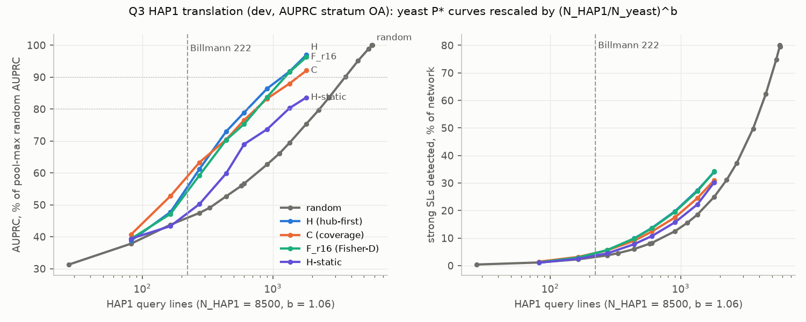
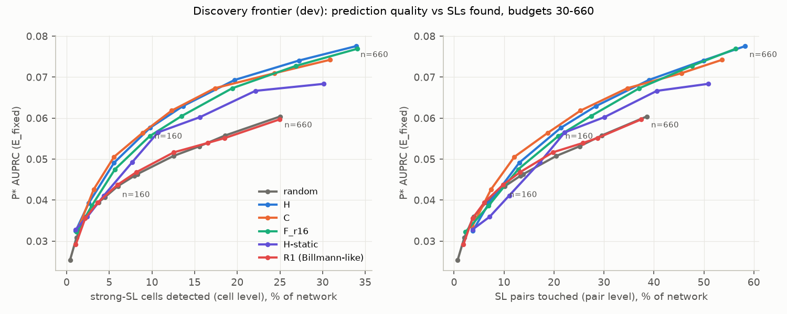
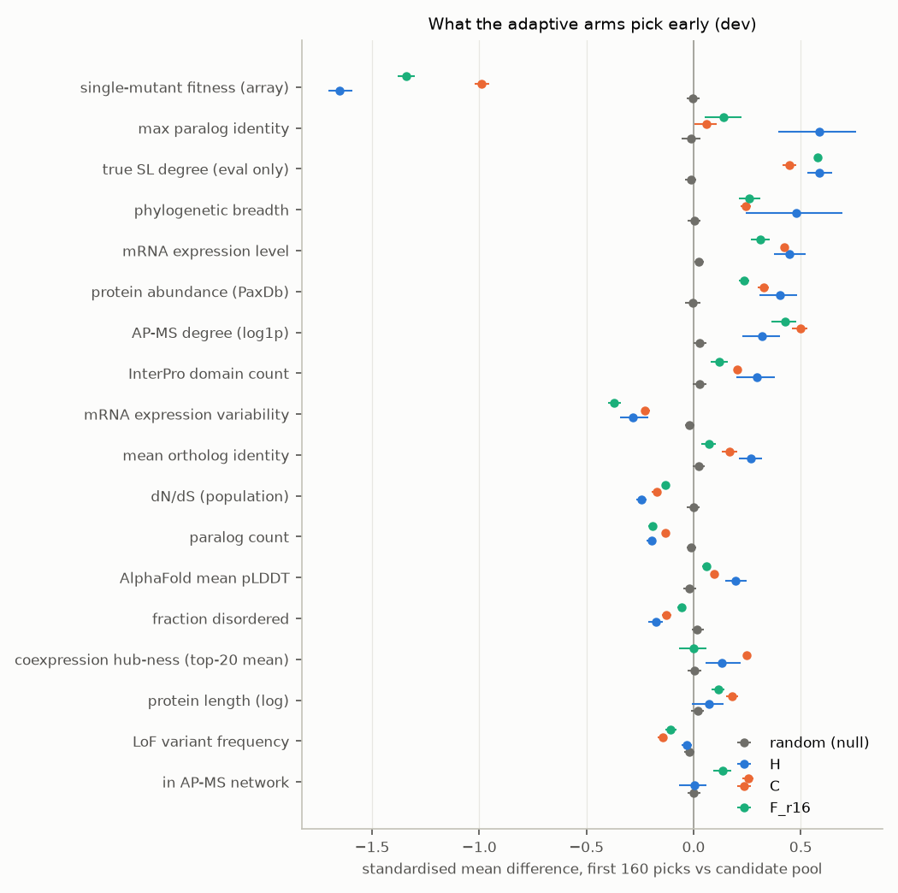
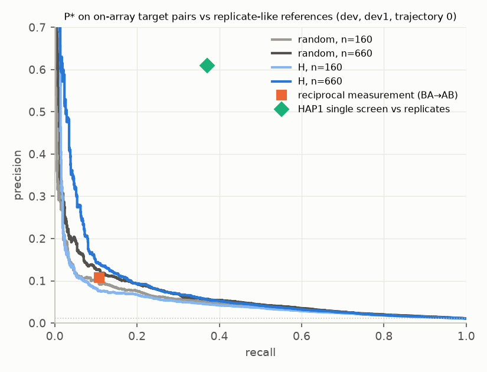
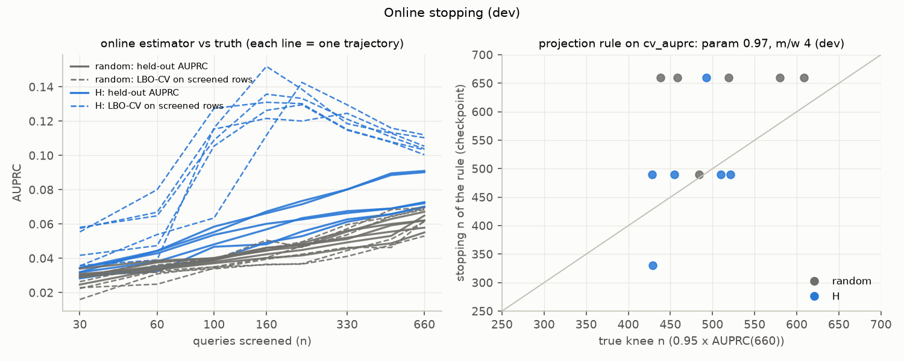

# Q3 analyses — DEV (DEV DATA ONLY)

DESIGN v3.1 §7.2–7.4. Code: `analysis/q3/` (one command per analysis, `--source dev|final|dryrun`); rerun everything with `bash analysis/q3/run_all.sh <source>`. Predictor: frozen P* (stack_lr_wr2_lb). All numbers below are generated from the CSV/JSON files in this directory.

**On the final outputs** (only after `scripts/score_final.py` has finished): (1) `bash analysis/q3/run_all.sh final` (hap1, frontier, choice profile, predcontrib; minutes); (2) `SOURCE=final SPLITS=final TRAJS="0 1" ARMS="R0 H" bash analysis/q3/run_lbo.sh` (LBO-CV refits on the dev bundle, one P* job at a time, ~25 min per trajectory); (3) `bash analysis/q3/run_all.sh final` again, which applies the FROZEN stopping rule (`analysis/q3/stopping_rule.yaml`, never re-tuned) and the CV thresholds. Outputs go to results/q3_final/.

## Key findings

- **Random screening, HAP1 lines** (N_HAP1 8,500, measured b, on-array stratum): n_80 ≈ 2,208 [1,758, 2,871], n_90 ≈ 3,539 [2,976, 4,238] lines (count-scaling bound b = 0: 805 / 1,288).
- **H** reaches the same AUPRC with 639 (n_80) / 1,233 (n_90) lines in 24 / 45 rounds (saving 71% / 65%).
- **H__b110** reaches the same AUPRC with 805 (n_80) / 1,339 (n_90) lines in 3 / 5 rounds (saving 64% / 62%).
- **Billmann's 222 lines** ≈ 81 yeast queries at measured b: random selection gives 46% of the pool-max AUPRC, H 56%.
- **Static 3-feature rank rule** (low single-mutant fitness, low expression variability, high conservation) recovers 72% of H's AUPRC gain at n = 160 (H-static 46%).
- **Online estimator**: LBO-CV AUPRC on screened rows has relative bias -17% to +5% under random selection but +38% to +128% under H (SL-rich screened rows).
- **Stopping**: true knees fall at 0.65–0.92 × the 660 cap; the best online rule has mean |log2 error| 0.25 vs 0.13 for always stopping at n = 490.

## 1. HAP1 translation (§7.3–7.4)

Yeast P* random n_80 / n_90 by AUPRC stratum (pool maximum = 100%): OA 805 / 1,288; all 810 / 1,279; onrows 817 / 1,279 (candidate pool ≈ 2,101). DESIGN §7.4 uses the on-array stratum (OA = E_VV on dev, E_TT at the final) for the HAP1 translation: OA is the primary below; 'all' (E_fixed, the Q1 endpoint with its frozen joint-bootstrap CI) and on-array rows are sensitivities. OA/onrows CIs carry over the 'all' stratum's relative CI width (approximation). Slope b (universe subsampling, re-bootstrapped): n_80 1.06 [0.85, 1.30], n_90 1.06 [0.89, 1.24].

**Random selection, HAP1 lines needed** (N_yeast = 3,283; 95% CI from the joint bootstrap of n_yeast and b; screens = lines × 1.34):

| target | N_HAP1 | scaling | HAP1 lines | screens |
|---|---|---|---|---|
| n80 | 7,500 | measured | 1,933 [1,573, 2,447] | 2,595 |
| n80 | 7,500 | b=0 (count) | 805 | 1,081 |
| n80 | 7,500 | b=1 (fraction) | 1,839 | 2,469 |
| n80 | 8,500 | measured | 2,208 [1,758, 2,871] | 2,963 |
| n80 | 8,500 | b=0 (count) | 805 | 1,081 |
| n80 | 8,500 | b=1 (fraction) | 2,084 | 2,798 |
| n80 | 9,500 | measured | 2,484 [1,942, 3,310] | 3,334 |
| n80 | 9,500 | b=0 (count) | 805 | 1,081 |
| n80 | 9,500 | b=1 (fraction) | 2,330 | 3,127 |
| n90 | 7,500 | measured | 3,099 [2,650, 3,646] | 4,159 |
| n90 | 7,500 | b=0 (count) | 1,288 | 1,729 |
| n90 | 7,500 | b=1 (fraction) | 2,943 | 3,951 |
| n90 | 8,500 | measured | 3,539 [2,976, 4,238] | 4,751 |
| n90 | 8,500 | b=0 (count) | 1,288 | 1,729 |
| n90 | 8,500 | b=1 (fraction) | 3,336 | 4,478 |
| n90 | 9,500 | measured | 3,983 [3,293, 4,858] | 5,347 |
| n90 | 9,500 | b=0 (count) | 1,288 | 1,729 |
| n90 | 9,500 | b=1 (fraction) | 3,728 | 5,005 |

Stratum sensitivity (N_yeast 3,283, N_HAP1 8,500, measured b):

| AUPRC stratum | target | yeast n | HAP1 lines |
|---|---|---|---|
| OA | n80 | 805 | 2,208 [1,758, 2,871] |
| OA | n90 | 1,288 | 3,539 [2,976, 4,238] |
| all | n80 | 810 | 2,220 [1,759, 2,874] |
| all | n90 | 1,279 | 3,512 [2,947, 4,216] |
| onrows | n80 | 817 | 2,241 [1,777, 2,913] |
| onrows | n90 | 1,279 | 3,513 [2,957, 4,228] |

Denominator sensitivity (N_HAP1 = 8,500, measured b):

| target | N_yeast | HAP1 lines |
|---|---|---|
| n80 | N_yeast=3283 (primary) | 2,208 [1,758, 2,871] |
| n80 | N_yeast=4458 (Q∪A) | 1,596 [1,342, 1,943] |
| n80 | N_yeast=pool size | 3,543 [2,593, 5,089] |
| n90 | N_yeast=3283 (primary) | 3,539 [2,976, 4,238] |
| n90 | N_yeast=4458 (Q∪A) | 2,557 [2,246, 2,919] |
| n90 | N_yeast=pool size | 5,685 [4,448, 7,357] |

**Costs, random vs strategies** (N_HAP1 = 8,500, measured b). A strategy's budget is the n at which its own mean curve reaches the random target AUPRC, i.e. its random-equivalent budget n_req equals n_X. Rounds = sequential screening rounds (batch of 10/50/110 yeast queries = batch × (N_HAP1/N_yeast)^b HAP1 lines per round). 'right' = target not reached by n = 660; 'left' = reached before the first checkpoint (value is an upper bound).

| target | arm | yeast n | HAP1 lines [95% CI] | screens | rounds | lines/round | saving vs random | censored |
|---|---|---|---|---|---|---|---|---|
| n80 | random | 805 | 2,208 [1,758, 2,871] | 2,963 | 1 (one-shot) | 2,208 | 0% |  |
| n80 | C | 272 | 746 [608, 941] | 1,001 | 28 | 27 | 66% |  |
| n80 | C__b110 | 326 | 895 [730, 1,130] | 1,202 | 3 | 302 | 59% |  |
| n80 | C__b50 | 311 | 851 [694, 1,074] | 1,143 | 7 | 137 | 61% |  |
| n80 | F-static_r8 | ∞ | ∞ [—, —] | ∞ | — | 27 | — | right;right;right |
| n80 | F_r16 | 277 | 758 [618, 957] | 1,018 | 28 | 27 | 66% |  |
| n80 | H | 233 | 639 [521, 807] | 858 | 24 | 27 | 71% |  |
| n80 | H-static | 486 | 1,333 [1,087, 1,682] | 1,789 | 49 | 27 | 40% |  |
| n80 | H__b110 | 294 | 805 [657, 1,017] | 1,081 | 3 | 302 | 64% |  |
| n80 | H__b50 | 266 | 729 [594, 920] | 978 | 6 | 137 | 67% |  |
| n80 | R1 | ∞ | ∞ [—, —] | ∞ | — | 27 | — | right;right;right |
| n90 | random | 1,288 | 3,539 [2,976, 4,238] | 4,751 | 1 (one-shot) | 3,539 | 0% |  |
| n90 | C | 564 | 1,549 [1,317, 1,829] | 2,079 | 57 | 27 | 56% |  |
| n90 | C__b110 | 572 | 1,572 [1,337, 1,857] | 2,110 | 6 | 302 | 56% |  |
| n90 | C__b50 | 602 | 1,653 [1,405, 1,952] | 2,219 | 13 | 137 | 53% |  |
| n90 | F-static_r8 | ∞ | ∞ [—, —] | ∞ | — | 27 | — | right;right;right |
| n90 | F_r16 | 454 | 1,247 [1,060, 1,473] | 1,674 | 46 | 27 | 65% |  |
| n90 | H | 449 | 1,233 [1,048, 1,456] | 1,655 | 45 | 27 | 65% |  |
| n90 | H-static | ∞ | ∞ [—, —] | ∞ | — | 27 | — | right;right;right |
| n90 | H__b110 | 488 | 1,339 [1,139, 1,582] | 1,798 | 5 | 302 | 62% |  |
| n90 | H__b50 | 455 | 1,249 [1,062, 1,475] | 1,676 | 10 | 137 | 65% |  |
| n90 | R1 | ∞ | ∞ [—, —] | ∞ | — | 27 | — | right;right;right |

**Billmann's 222 lines on the curves** (N_HAP1 = 8,500): equivalent yeast budget, AUPRC as % of the random pool-max AUPRC, strong SLs detected (% of the dev network, cell level).

| scaling | arm | yeast n | AUPRC % of max | SLs detected |
|---|---|---|---|---|
| measured | C | 81 | 59% [54, 63] | 4.6% |
| measured | F_r16 | 81 | 54% [49, 59] | 4.6% |
| measured | H | 81 | 56% [50, 61] | 4.4% |
| measured | H-static | 81 | 47% [44, 50] | 3.6% |
| measured | R0 | 81 | 46% [44, 47] | 3.1% |
| measured | R1 | 81 | 45% [43, 47] | 3.0% |
| b=0 (count) | C | 222 | 77% | 12.5% |
| b=0 (count) | F_r16 | 222 | 75% | 13.7% |
| b=0 (count) | H | 222 | 79% | 13.9% |
| b=0 (count) | H-static | 222 | 69% | 10.9% |
| b=0 (count) | R0 | 222 | 57% | 8.4% |
| b=0 (count) | R1 | 222 | 57% | 8.3% |
| b=1 (fraction) | C | 86 | 60% | 4.9% |
| b=1 (fraction) | F_r16 | 86 | 56% | 4.9% |
| b=1 (fraction) | H | 86 | 57% | 4.7% |
| b=1 (fraction) | H-static | 86 | 48% | 3.9% |
| b=1 (fraction) | R0 | 86 | 46% | 3.3% |
| b=1 (fraction) | R1 | 86 | 46% | 3.2% |

**Marginal returns per +100 HAP1 lines** (N_HAP1 = 8,500, measured b; Δ in percentage points of the random pool-max AUPRC and of the network's strong SLs; H only within its measured range ≤ 660 yeast):

| hap1_lines | auprc_frac_of_max_H | auprc_frac_of_max_R0 | d_auprc_frac_per100_H | d_auprc_frac_per100_R0 | d_sl_detected_frac_per100_H | d_sl_detected_frac_per100_R0 |
|---|---|---|---|---|---|---|
| 100 | 41.3 | 39.5 | 11.6 | 5.7 | 2.2 | 1.4 |
| 222 | 55.6 | 45.9 | 9.6 | 3.0 | 2.7 | 1.3 |
| 300 | 63.5 | 48.3 | 7.2 | 3.3 | 2.6 | 1.4 |
| 500 | 75.4 | 54.3 | 3.4 | 2.3 | 2.2 | 1.3 |
| 750 | 83.0 | 59.9 | 2.3 | 1.8 | 1.9 | 1.3 |
| 1,000 | 87.8 | 64.2 | 1.3 | 1.5 | 1.8 | 1.3 |
| 1,500 | 93.7 | 71.6 | 1.1 | 1.3 | 1.4 | 1.4 |
| 2,000 | — | 77.4 | — | 1.0 | — | 1.4 |
| 3,000 | — | 86.0 | — | 0.7 | — | 1.4 |
| 4,000 | — | 92.5 | — | 0.6 | — | 1.4 |

 (E_fixed version: fig_hap1_curves_all.png)

## 2. Discovery frontier (§7.2)

Counts recomputed from the stored selections on the dev network (T genes excluded on both sides). Cell level = strong-SL cells in screened rows; pair level 'detected' = SL called in a screened row, 'touched' = SL pair (either direction) involving a screened gene.

| n | arm | AUPRC | cells det. | pairs det. | pairs touched | det./touched | cells det. ×random | AUPRC ×random |
|---|---|---|---|---|---|---|---|---|
| 160 | C | 0.056 | 0.089 | 0.090 | 0.188 | 0.481 | 1.487 | 1.300 |
| 160 | F_r16 | 0.056 | 0.097 | 0.097 | 0.209 | 0.466 | 1.625 | 1.281 |
| 160 | H | 0.058 | 0.098 | 0.098 | 0.214 | 0.457 | 1.631 | 1.328 |
| 160 | H-static | 0.049 | 0.077 | 0.078 | 0.172 | 0.456 | 1.282 | 1.135 |
| 160 | H__b110 | 0.055 | 0.090 | 0.091 | 0.199 | 0.456 | 1.498 | 1.264 |
| 160 | R0 | 0.043 | 0.060 | 0.062 | 0.102 | 0.610 | 1.000 | 1.000 |
| 160 | R1 | 0.044 | 0.059 | 0.062 | 0.098 | 0.630 | 0.990 | 1.007 |
| 330 | C | 0.067 | 0.174 | 0.173 | 0.347 | 0.500 | 1.389 | 1.326 |
| 330 | F_r16 | 0.067 | 0.194 | 0.190 | 0.371 | 0.514 | 1.551 | 1.326 |
| 330 | H | 0.069 | 0.197 | 0.193 | 0.390 | 0.495 | 1.572 | 1.365 |
| 330 | H-static | 0.060 | 0.156 | 0.158 | 0.301 | 0.526 | 1.249 | 1.187 |
| 330 | H__b110 | 0.067 | 0.185 | 0.183 | 0.369 | 0.497 | 1.475 | 1.310 |
| 330 | R0 | 0.051 | 0.125 | 0.129 | 0.204 | 0.633 | 1.000 | 1.000 |
| 330 | R1 | 0.052 | 0.126 | 0.130 | 0.198 | 0.657 | 1.004 | 1.018 |
| 660 | C | 0.074 | 0.309 | 0.307 | 0.536 | 0.573 | 1.234 | 1.229 |
| 660 | F_r16 | 0.077 | 0.341 | 0.336 | 0.564 | 0.595 | 1.362 | 1.274 |
| 660 | H | 0.078 | 0.339 | 0.334 | 0.582 | 0.573 | 1.356 | 1.284 |
| 660 | H-static | 0.068 | 0.302 | 0.303 | 0.509 | 0.594 | 1.205 | 1.132 |
| 660 | H__b110 | 0.077 | 0.334 | 0.329 | 0.576 | 0.572 | 1.336 | 1.281 |
| 660 | R0 | 0.060 | 0.250 | 0.257 | 0.386 | 0.667 | 1.000 | 1.000 |
| 660 | R1 | 0.060 | 0.250 | 0.257 | 0.375 | 0.687 | 0.998 | 0.988 |

## 3. Choice of query lines (§7.4)

Standardised mean difference (first 160 picks vs the candidate pool; mean over trajectories; R0 = null control). SMF is the array strain's single-mutant fitness (HAP1 single-KO fitness analogue); true SL degree is evaluation-only context.

| feature | R0 | H | C | F_r16 | H-static | R1 |
|---|---|---|---|---|---|---|
| smf | -0.003 | -1.651 | -0.988 | -1.340 | -1.640 | 0.103 |
| paralog_identity | -0.011 | 0.586 | 0.058 | 0.138 | 1.010 | -0.101 |
| true_sl_degree | -0.013 | 0.585 | 0.448 | 0.578 | 0.255 | -0.023 |
| conservation | 0.002 | 0.479 | 0.244 | 0.258 | 0.595 | -0.021 |
| expr_mean | 0.025 | 0.445 | 0.421 | 0.311 | 1.265 | -0.074 |
| abundance | -0.004 | 0.402 | 0.326 | 0.234 | 1.633 | -0.041 |
| apms_degree | 0.029 | 0.318 | 0.498 | 0.425 | 1.054 | -0.056 |
| domains | 0.027 | 0.297 | 0.203 | 0.119 | 0.492 | -0.037 |
| expr_sd | -0.019 | -0.281 | -0.226 | -0.370 | 0.252 | 0.037 |
| identity | 0.024 | 0.268 | 0.169 | 0.072 | 1.179 | -0.084 |
| dnds | -0.002 | -0.244 | -0.173 | -0.133 | -0.613 | 0.042 |
| paralogs | -0.010 | -0.197 | -0.132 | -0.192 | -0.053 | 0.003 |
| plddt | -0.018 | 0.196 | 0.097 | 0.058 | 0.666 | -0.016 |
| disorder | 0.017 | -0.177 | -0.127 | -0.058 | -0.565 | 0.015 |
| offarray_share | 0.188 | 0.171 | 0.191 | 0.196 | 0.150 | 0.197 |
| coexp_hub | 0.004 | 0.133 | 0.248 | -0.000 | 1.266 | -0.055 |
| length | 0.018 | 0.072 | 0.181 | 0.117 | -0.352 | -0.024 |
| lof_freq | -0.019 | -0.032 | -0.145 | -0.106 | 0.111 | -0.023 |
| apms_in_network | 0.002 | 0.002 | 0.255 | 0.137 | 0.310 | -0.049 |

Leave-split-out rank rules (fitted on the finalists' pick frequencies in the other splits, minus this split's D_val genes):

| split | rule | features | AUROC vs picked | ρ vs pick freq. | ρ vs true degree |
|---|---|---|---|---|---|
| dev1 | forward_k1 | smf | 0.701 | 0.338 | 0.225 |
| dev1 | forward_k2 | smf+conservation | 0.738 | 0.396 | 0.198 |
| dev1 | forward_k3 | smf+conservation+expr_sd | 0.743 | 0.404 | 0.238 |
| dev1 | l1_all | smf+abundance+expr_mean+expr_sd+coexp_hub+apms_degree+apms_in_network+conservation+identity+paralogs+length+plddt+dnds+lof_freq | 0.759 | 0.432 | 0.265 |
| dev2 | forward_k1 | smf | 0.730 | 0.372 | 0.209 |
| dev2 | forward_k2 | smf+expr_sd | 0.751 | 0.402 | 0.268 |
| dev2 | forward_k3 | smf+expr_sd+conservation | 0.770 | 0.430 | 0.240 |
| dev2 | l1_all | smf+abundance+expr_sd+coexp_hub+apms_degree+apms_in_network+conservation+identity+paralogs+paralog_identity+length+plddt+dnds+lof_freq | 0.792 | 0.465 | 0.258 |
| dev3 | forward_k1 | smf | 0.703 | 0.354 | 0.198 |
| dev3 | forward_k2 | smf+conservation | 0.740 | 0.410 | 0.192 |
| dev3 | forward_k3 | smf+conservation+expr_sd | 0.737 | 0.405 | 0.235 |
| dev3 | l1_all | smf+abundance+expr_sd+coexp_hub+apms_degree+apms_in_network+conservation+identity+paralogs+paralog_identity+length+plddt+disorder+domains+dnds+lof_freq | 0.770 | 0.456 | 0.260 |

Rules fitted on all three dev splits (standardised features; the one to carry to HAP1): k=1: smf -0.81; k=2: smf -0.80, expr_sd -0.41; k=3: smf -0.79, expr_sd -0.40, conservation +0.32

**Static rank rule vs the adaptive strategies** (randomised top-20 static picks from the leave-split-out rule, P* refit; recovered = (rule − random)/(strategy − random)):

| rule | n | rule | random | H | H-static | rule gain | H gain | recovered vs H | recovered vs finalists | H-static recovered | splits | fits | off-array share |
|---|---|---|---|---|---|---|---|---|---|---|---|---|---|
| forward_k1 | 160 | 0.050 | 0.043 | 0.058 | 0.049 | 0.159 | 0.327 | 0.434 | 0.471 | 0.460 | 3 | 9 | 0.192 |
| forward_k1 | 330 | 0.064 | 0.051 | 0.069 | 0.060 | 0.262 | 0.365 | 0.732 | 0.791 | 0.519 | 3 | 9 | 0.194 |
| forward_k1 | 660 | 0.075 | 0.060 | 0.080 | 0.070 | 0.241 | 0.332 | 0.730 | 0.805 | 0.488 | 2 | 4 | 0.195 |
| forward_k3 | 160 | 0.054 | 0.043 | 0.058 | 0.049 | 0.246 | 0.327 | 0.725 | 0.779 | 0.460 | 3 | 9 | 0.192 |
| forward_k3 | 330 | 0.066 | 0.051 | 0.069 | 0.060 | 0.289 | 0.365 | 0.790 | 0.854 | 0.519 | 3 | 9 | 0.192 |
| forward_k3 | 660 | 0.067 | 0.055 | 0.070 | 0.061 | 0.217 | 0.269 | 0.808 | 0.912 | 0.398 | 1 | 2 | 0.193 |

n = 660 is partial: those fits were stopped by the 3 GB RSS watchdog (P* at n = 660 on the full dev target set peaks at ≈3.0–3.2 GB), so only the splits listed were completed.

## 4. What prediction can contribute (§7.4)

Replicate-like reference on the on-array target stratum: the reciprocal measurement of the same pair (BA → AB). Both directions are evaluation cells, so its precision equals its recall.

| split | n_cells | n_pos | prevalence | ref_precision | ref_recall | kappa |
|---|---|---|---|---|---|---|
| dev1 | 155,028 | 1,689 | 0.011 | 0.108 | 0.108 | 0.098 |
| dev2 | 151,732 | 1,789 | 0.012 | 0.133 | 0.133 | 0.123 |
| dev3 | 148,982 | 1,827 | 0.012 | 0.124 | 0.124 | 0.113 |

P* on the same cells (mean over trajectories and splits). HAP1 context: Billmann single screen vs replicates, precision 0.61 at recall 0.37.

| arm | n | AUPRC (paired cells) | precision @ ref recall | recall @ ref precision | precision @ recall 0.37 | recall @ precision 0.61 |
|---|---|---|---|---|---|---|
| C | 160 | 0.070 | 0.112 | 0.110 | 0.052 | 0.011 |
| C | 330 | 0.084 | 0.151 | 0.155 | 0.061 | 0.018 |
| C | 660 | 0.093 | 0.183 | 0.187 | 0.065 | 0.020 |
| F_r16 | 160 | 0.071 | 0.113 | 0.108 | 0.050 | 0.015 |
| F_r16 | 330 | 0.085 | 0.153 | 0.151 | 0.054 | 0.022 |
| F_r16 | 660 | 0.097 | 0.192 | 0.184 | 0.062 | 0.026 |
| H | 160 | 0.074 | 0.119 | 0.117 | 0.052 | 0.016 |
| H | 330 | 0.088 | 0.170 | 0.165 | 0.055 | 0.020 |
| H | 660 | 0.098 | 0.192 | 0.188 | 0.064 | 0.024 |
| R0 | 160 | 0.049 | 0.085 | 0.044 | 0.050 | 0.000 |
| R0 | 330 | 0.061 | 0.104 | 0.088 | 0.055 | 0.002 |
| R0 | 660 | 0.075 | 0.130 | 0.134 | 0.060 | 0.008 |

Expected true strong SLs among the top-k predictions per unscreened gene:

| columns | arm | n | k | true SLs / gene | random expectation | precision | genes with ≥1 |
|---|---|---|---|---|---|---|---|
| E_fixed | H | 160 | 10 | 0.908 | 0.095 | 0.091 | 0.493 |
| E_fixed | H | 160 | 50 | 2.952 | 0.477 | 0.059 | 0.813 |
| on_array_cols | H | 160 | 10 | 0.726 | 0.126 | 0.073 | 0.434 |
| on_array_cols | H | 160 | 50 | 2.083 | 0.630 | 0.042 | 0.725 |
| E_fixed | H | 330 | 10 | 1.062 | 0.095 | 0.106 | 0.519 |
| E_fixed | H | 330 | 50 | 3.165 | 0.477 | 0.063 | 0.817 |
| on_array_cols | H | 330 | 10 | 0.808 | 0.126 | 0.081 | 0.453 |
| on_array_cols | H | 330 | 50 | 2.148 | 0.630 | 0.043 | 0.732 |
| E_fixed | H | 660 | 10 | 1.163 | 0.095 | 0.116 | 0.554 |
| E_fixed | H | 660 | 50 | 3.444 | 0.477 | 0.069 | 0.840 |
| on_array_cols | H | 660 | 10 | 0.902 | 0.126 | 0.090 | 0.481 |
| on_array_cols | H | 660 | 50 | 2.272 | 0.630 | 0.045 | 0.749 |
| E_fixed | R0 | 160 | 10 | 0.844 | 0.095 | 0.084 | 0.523 |
| E_fixed | R0 | 160 | 50 | 2.971 | 0.477 | 0.059 | 0.841 |
| on_array_cols | R0 | 160 | 10 | 0.674 | 0.126 | 0.067 | 0.446 |
| on_array_cols | R0 | 160 | 50 | 2.120 | 0.630 | 0.042 | 0.750 |
| E_fixed | R0 | 330 | 10 | 0.947 | 0.095 | 0.095 | 0.544 |
| E_fixed | R0 | 330 | 50 | 3.127 | 0.477 | 0.063 | 0.845 |
| on_array_cols | R0 | 330 | 10 | 0.746 | 0.126 | 0.075 | 0.472 |
| on_array_cols | R0 | 330 | 50 | 2.193 | 0.630 | 0.044 | 0.754 |
| E_fixed | R0 | 660 | 10 | 1.058 | 0.095 | 0.106 | 0.571 |
| E_fixed | R0 | 660 | 50 | 3.294 | 0.477 | 0.066 | 0.853 |
| on_array_cols | R0 | 660 | 10 | 0.810 | 0.126 | 0.081 | 0.488 |
| on_array_cols | R0 | 660 | 50 | 2.261 | 0.630 | 0.045 | 0.757 |

Thresholds chosen by leave-batch-out CV on screened rows, applied to the targets (mean over the LBO trajectories):

| arm | n | set by | level | CV precision | CV recall | target precision | target recall | on-array precision | on-array recall | calls / gene |
|---|---|---|---|---|---|---|---|---|---|---|
| H | 160 | precision | 0.100 | 0.100 | 0.364 | 0.071 | 0.195 | 0.072 | 0.226 | 37.032 |
| H | 160 | precision | 0.200 | 0.200 | 0.178 | 0.128 | 0.076 | 0.132 | 0.091 | 7.998 |
| H | 160 | recall | 0.050 | 0.505 | 0.050 | 0.327 | 0.021 | 0.336 | 0.028 | 0.859 |
| H | 160 | recall | 0.100 | 0.329 | 0.100 | 0.198 | 0.039 | 0.205 | 0.051 | 2.678 |
| H | 160 | recall | 0.200 | 0.180 | 0.200 | 0.115 | 0.089 | 0.120 | 0.106 | 10.506 |
| H | 330 | precision | 0.100 | 0.100 | 0.328 | 0.078 | 0.215 | 0.077 | 0.247 | 37.231 |
| H | 330 | precision | 0.200 | 0.200 | 0.163 | 0.147 | 0.096 | 0.152 | 0.117 | 8.762 |
| H | 330 | recall | 0.050 | 0.488 | 0.050 | 0.352 | 0.031 | 0.359 | 0.041 | 1.188 |
| H | 330 | recall | 0.100 | 0.313 | 0.100 | 0.228 | 0.059 | 0.227 | 0.073 | 3.464 |
| H | 330 | recall | 0.200 | 0.165 | 0.200 | 0.124 | 0.121 | 0.127 | 0.143 | 13.192 |
| H | 660 | precision | 0.100 | 0.100 | 0.283 | 0.083 | 0.234 | 0.083 | 0.267 | 37.871 |
| H | 660 | precision | 0.200 | 0.200 | 0.143 | 0.161 | 0.106 | 0.165 | 0.128 | 8.874 |
| H | 660 | recall | 0.050 | 0.457 | 0.050 | 0.342 | 0.039 | 0.334 | 0.049 | 1.530 |
| H | 660 | recall | 0.100 | 0.278 | 0.100 | 0.217 | 0.075 | 0.222 | 0.093 | 4.621 |
| H | 660 | recall | 0.200 | 0.143 | 0.200 | 0.117 | 0.154 | 0.120 | 0.179 | 17.753 |
| R0 | 160 | precision | 0.100 | 0.100 | 0.033 | 0.123 | 0.036 | 0.121 | 0.036 | 4.748 |
| R0 | 160 | precision | 0.200 | 0.200 | 0.005 | 0.182 | 0.006 | 0.199 | 0.008 | 0.504 |
| R0 | 160 | recall | 0.050 | 0.089 | 0.050 | 0.094 | 0.058 | 0.099 | 0.051 | 8.359 |
| R0 | 160 | recall | 0.100 | 0.076 | 0.100 | 0.080 | 0.112 | 0.084 | 0.107 | 18.910 |
| R0 | 160 | recall | 0.200 | 0.060 | 0.200 | 0.064 | 0.213 | 0.063 | 0.224 | 44.732 |
| R0 | 330 | precision | 0.100 | 0.100 | 0.080 | 0.105 | 0.085 | 0.114 | 0.091 | 11.433 |
| R0 | 330 | precision | 0.200 | 0.200 | 0.018 | 0.198 | 0.020 | 0.249 | 0.025 | 1.187 |
| R0 | 330 | recall | 0.050 | 0.122 | 0.050 | 0.123 | 0.057 | 0.133 | 0.060 | 6.315 |
| R0 | 330 | recall | 0.100 | 0.094 | 0.100 | 0.095 | 0.107 | 0.099 | 0.110 | 15.222 |
| R0 | 330 | recall | 0.200 | 0.070 | 0.200 | 0.073 | 0.203 | 0.073 | 0.219 | 37.701 |
| R0 | 660 | precision | 0.100 | 0.100 | 0.143 | 0.100 | 0.139 | 0.103 | 0.149 | 19.025 |
| R0 | 660 | precision | 0.200 | 0.200 | 0.044 | 0.194 | 0.043 | 0.207 | 0.051 | 3.078 |
| R0 | 660 | recall | 0.050 | 0.185 | 0.050 | 0.175 | 0.050 | 0.188 | 0.058 | 3.843 |
| R0 | 660 | recall | 0.100 | 0.123 | 0.100 | 0.120 | 0.098 | 0.125 | 0.107 | 10.927 |
| R0 | 660 | recall | 0.200 | 0.083 | 0.200 | 0.084 | 0.195 | 0.085 | 0.211 | 31.264 |

## 5. Online stopping estimator (§7.4)

LBO-CV AUPRC on screened rows vs the trajectory's held-out AUPRC (E_fixed), per n:

| n | R | cv_mean | true_mean | bias | mae | rel_bias | rel_mae | pearson | spearman | pearson_split_centred | lift_rel_bias | pearson_lift | fit_s_mean |
|---|---|---|---|---|---|---|---|---|---|---|---|---|---|
| 30 | 12 | 0.036 | 0.031 | 0.005 | 0.010 | 0.153 | 0.329 | 0.642 | 0.531 | 0.678 | -0.020 | 0.546 | 87.084 |
| 60 | 12 | 0.046 | 0.038 | 0.008 | 0.012 | 0.192 | 0.296 | 0.822 | 0.629 | 0.870 | -0.078 | 0.799 | 142.036 |
| 100 | 12 | 0.071 | 0.045 | 0.027 | 0.029 | 0.535 | 0.609 | 0.762 | 0.678 | 0.852 | 0.061 | 0.845 | 142.900 |
| 160 | 12 | 0.086 | 0.051 | 0.035 | 0.038 | 0.611 | 0.685 | 0.760 | 0.867 | 0.869 | 0.113 | 0.807 | 150.495 |
| 220 | 12 | 0.088 | 0.055 | 0.033 | 0.036 | 0.527 | 0.603 | 0.827 | 0.853 | 0.910 | 0.095 | 0.867 | 159.685 |
| 330 | 12 | 0.086 | 0.061 | 0.025 | 0.028 | 0.364 | 0.422 | 0.824 | 0.811 | 0.931 | 0.056 | 0.876 | 178.391 |
| 490 | 12 | 0.084 | 0.066 | 0.019 | 0.022 | 0.266 | 0.328 | 0.726 | 0.804 | 0.914 | 0.078 | 0.784 | 209.344 |
| 660 | 12 | 0.085 | 0.070 | 0.015 | 0.018 | 0.214 | 0.257 | 0.682 | 0.699 | 0.943 | 0.102 | 0.749 | 254.520 |

| arm | n | R | cv_mean | true_mean | rel_bias | rel_mae | pearson | lift_rel_bias | lift_rel_mae | pearson_lift |
|---|---|---|---|---|---|---|---|---|---|---|
| H | 30 | 6 | 0.047 | 0.032 | 0.479 | 0.479 | 0.760 | 0.342 | 0.357 | 0.633 |
| H | 60 | 6 | 0.059 | 0.040 | 0.469 | 0.469 | 0.882 | 0.115 | 0.174 | 0.752 |
| H | 100 | 6 | 0.106 | 0.050 | 1.144 | 1.144 | 0.184 | 0.346 | 0.359 | 0.384 |
| H | 160 | 6 | 0.130 | 0.058 | 1.280 | 1.280 | -0.170 | 0.431 | 0.431 | -0.281 |
| H | 220 | 6 | 0.132 | 0.063 | 1.125 | 1.125 | -0.150 | 0.395 | 0.395 | -0.179 |
| H | 330 | 6 | 0.121 | 0.070 | 0.751 | 0.751 | -0.108 | 0.287 | 0.287 | -0.167 |
| H | 490 | 6 | 0.111 | 0.075 | 0.522 | 0.522 | -0.421 | 0.277 | 0.277 | -0.415 |
| H | 660 | 6 | 0.106 | 0.078 | 0.382 | 0.382 | -0.313 | 0.299 | 0.299 | -0.581 |
| R0 | 30 | 6 | 0.025 | 0.030 | -0.173 | 0.178 | 0.526 | -0.382 | 0.382 | 0.226 |
| R0 | 60 | 6 | 0.032 | 0.035 | -0.084 | 0.124 | 0.369 | -0.271 | 0.271 | 0.732 |
| R0 | 100 | 6 | 0.036 | 0.039 | -0.073 | 0.075 | 0.377 | -0.224 | 0.224 | -0.039 |
| R0 | 160 | 6 | 0.041 | 0.044 | -0.059 | 0.091 | 0.730 | -0.204 | 0.204 | 0.172 |
| R0 | 220 | 6 | 0.043 | 0.046 | -0.070 | 0.081 | 0.736 | -0.205 | 0.205 | 0.690 |
| R0 | 330 | 6 | 0.050 | 0.052 | -0.022 | 0.093 | 0.279 | -0.175 | 0.175 | 0.527 |
| R0 | 490 | 6 | 0.057 | 0.057 | 0.011 | 0.134 | 0.304 | -0.120 | 0.122 | 0.385 |
| R0 | 660 | 6 | 0.064 | 0.062 | 0.045 | 0.132 | -0.459 | -0.095 | 0.097 | -0.622 |

Plateau-rule grid (best first; mean |log2(n_stop / n_knee)|; stop_frac = AUPRC at stop / AUPRC(660)):

| family | statistic | δ (plateau) / τ (projection) | m / window | mean |log2 err| | mean log2 err | triggered | AUPRC at stop / AUPRC(660) |
|---|---|---|---|---|---|---|---|
| projection | cv_auprc | 0.970 | 4 | 0.253 | 0.165 | 0.500 | 0.971 |
| projection | cv_auprc | 0.950 | 4 | 0.260 | 0.082 | 0.583 | 0.963 |
| projection | cv_auprc | 0.900 | 4 | 0.270 | -0.192 | 1.000 | 0.914 |
| projection | cv_lift | 0.930 | 4 | 0.281 | 0.011 | 0.750 | 0.938 |
| projection | cv_auprc | 0.930 | 4 | 0.294 | -0.073 | 0.833 | 0.929 |
| projection | cv_lift | 0.950 | 4 | 0.305 | 0.165 | 0.500 | 0.960 |
| projection | cv_lift | 0.970 | 4 | 0.325 | 0.249 | 0.417 | 0.970 |
| projection | cv_lift | 0.900 | 4 | 0.351 | -0.204 | 0.917 | 0.907 |

Comparator without online information: always stop at a fixed n (mean |log2(n / knee)|):

| n_fixed | mae_log2 | bias_log2 |
|---|---|---|
| 30 | 4.032 | -4.032 |
| 60 | 3.032 | -3.032 |
| 100 | 2.295 | -2.295 |
| 160 | 1.617 | -1.617 |
| 220 | 1.157 | -1.157 |
| 330 | 0.572 | -0.572 |
| 490 | 0.130 | -0.002 |
| 660 | 0.428 | 0.428 |

True knees per trajectory (0.95 × AUPRC(660)):

| arm | split | traj | knee | knee_grid |
|---|---|---|---|---|
| H | dev1 | 0 | 521.034 | 660.000 |
| H | dev1 | 1 | 509.752 | 660.000 |
| H | dev2 | 0 | 428.386 | 490.000 |
| H | dev2 | 1 | 428.959 | 490.000 |
| H | dev3 | 0 | 492.612 | 660.000 |
| H | dev3 | 1 | 454.723 | 490.000 |
| R0 | dev1 | 0 | 458.063 | 490.000 |
| R0 | dev1 | 1 | 579.844 | 660.000 |
| R0 | dev2 | 0 | 518.822 | 660.000 |
| R0 | dev2 | 1 | 608.283 | 660.000 |
| R0 | dev3 | 0 | 438.371 | 490.000 |
| R0 | dev3 | 1 | 484.185 | 490.000 |

Leave-split-out check of the rule choice:

| held_out | delta | m | mae_log2 | bias_log2 | R |
|---|---|---|---|---|---|
| dev1 | 0.930 | 4 | 0.371 | -0.108 | 4 |
| dev2 | 0.900 | 4 | 0.384 | -0.287 | 4 |
| dev3 | 0.950 | 4 | 0.373 | 0.142 | 4 |

**Frozen rule** (`analysis/q3/stopping_rule.yaml`, frozen 2026-10-30T05:15:57Z): projection family; stop at the first checkpoint n ≥ 60 where cv_auprc ≥ 0.97 × its log-linear projection (last 4 checkpoints) to the planned maximum n = 660; otherwise stop at 660 (flagged).

Frozen rule applied:

| arm | split | traj | n_stop | triggered | knee | knee_grid | log2_err | true_at_stop_frac |
|---|---|---|---|---|---|---|---|---|
| H | dev1 | 0 | 490.000 | True | 521.034 | 660.000 | -0.089 | 0.937 |
| H | dev1 | 1 | 490.000 | True | 509.752 | 660.000 | -0.057 | 0.942 |
| H | dev2 | 0 | 490.000 | True | 428.386 | 490.000 | 0.194 | 0.982 |
| H | dev2 | 1 | 330.000 | True | 428.959 | 490.000 | -0.378 | 0.881 |
| H | dev3 | 0 | 660.000 | False | 492.612 | 660.000 | 0.422 | 1.000 |
| H | dev3 | 1 | 490.000 | True | 454.723 | 490.000 | 0.108 | 0.957 |
| R0 | dev1 | 0 | 660.000 | False | 458.063 | 490.000 | 0.527 | 1.000 |
| R0 | dev1 | 1 | 660.000 | False | 579.844 | 660.000 | 0.187 | 1.000 |
| R0 | dev2 | 0 | 660.000 | False | 518.822 | 660.000 | 0.347 | 1.000 |
| R0 | dev2 | 1 | 660.000 | False | 608.283 | 660.000 | 0.118 | 1.000 |
| R0 | dev3 | 0 | 660.000 | False | 438.371 | 490.000 | 0.590 | 1.000 |
| R0 | dev3 | 1 | 490.000 | True | 484.185 | 490.000 | 0.017 | 0.954 |

## Ambiguities in DESIGN §7.2–7.4 and how they were resolved (none silently)

1. **HAP1 constants are not in protocol.yaml.** DESIGN §5 and the brief place them there; the frozen file has no HAP1
   block. They are in `analysis/q3/hap1_constants.yaml` with their LITERATURE.md sources (N_HAP1 7,500 / 8,500 / 9,500;
   replicate factor 298/222 = 1.342; Billmann precision 0.61 / recall 0.37). Q3 seeds live there too
   (`config/seeds.yaml` is frozen).
2. **Which AUPRC stratum drives the translation.** §7.4 names the on-array stratum as the HAP1 estimate; §7.3/Q1 use
   E_fixed. Primary = on-array target columns (OA: E_VV on dev, E_TT at the final); E_fixed ('all') and on-array
   target rows ('onrows') are sensitivities.
3. **N_yeast vs the curve's anchor.** n_80 is anchored on the AUPRC at the candidate-pool maximum (dev ≈ 2,100;
   final 2,627), while §7.4 fixes N_yeast = 3,283. 3,283 is primary; 4,458 (Q ∪ A, DESIGN sensitivity) and
   N_yeast = pool size (added sensitivity) are reported. With b ≈ 1 the pool-size version is ~1.6× larger: this is
   the largest single lever on the HAP1 number.
4. **Bootstrap of n_yeast.** Only the 95% CIs of the frozen joint bootstrap are stored, not its replicates: n_yeast
   replicates are lognormal matched to each CI (per split, averaged over splits on dev). b replicates re-run P1's
   within-level draw bootstrap exactly (point b reproduces slope.json to 1e-9). OA/onrows strata carry over the
   'all' stratum's relative CI width (approximation).
5. **'Use the strategy's n_req'.** The strategy's cost for target X is the budget n_s at which its own mean (PAVA)
   curve reaches the random target AUPRC, so n_req(n_s) = n_X. Reached before the first checkpoint → first
   checkpoint reported as an upper bound ('left'); not reached by 660 → censored ('right').
6. **Sequential rounds.** Random = 1 round (all lines in parallel). Adaptive = n_s / batch rounds; batch 10 / 50 /
   110 yeast queries = batch × (N_HAP1/N_yeast)^b HAP1 lines per round. The 110 arm (≤ 6 rounds to 660, §6.3) is
   read from its own stored curve (checkpoints 160 / 330 / 660).
7. **Pair-level discovery.** An unordered pair is SL if any measured direction among pool rows is a strong SL;
   'detected' = called in a screened row; 'touched' = involves a screened gene. T genes are dropped on both sides
   (final mode needs no T label). Stored P1/P4 cell counts include T columns, so recomputed cell counts are 0–25%
   lower (tested).
8. **'Genes picked early'.** First 160 picks of each stored trajectory vs that trajectory's candidate pool;
   standardised mean difference, CI by resampling trajectories within split. SMF exists only for on-array genes.
9. **Rank rule.** Target = the finalists' (H, C, F_r16) pick frequency in their first 160 (not the true degree, which
   needs labels); fitted leave-split-out with the evaluation split's D_val genes removed from the rule's training rows.
   Genes without SMF (off-array, a yeast artefact) are scored route-stratified as in the strategies' D5 calibration
   (ranked by the rule minus its SMF term, mapped onto the on-array score quantiles); otherwise a static SMF rule never
   picks them. Static selection = randomised top-20 picks (protocol top-k), seeds 0–2; P* refit outside the harness
   (no ledger writes), bit-identical to the stored AUPRC on dev1 r0 n = 160.
10. **Replicate reference.** The reciprocal label (BA) is a binary predictor of AB on on-array target cells where both
    directions are evaluation cells; by symmetry its precision equals its recall. P* is compared at matched recall
    and matched precision on the same cells. Billmann's 0.61 / 0.37 is a same-direction replicate screen (stricter
    reference) and is context only.
11. **LBO-CV cells.** Held-out batch rows × columns not screened in S_n (no reciprocal feature, as in E_fixed), not
    test genes, not self, measured. Batches = consecutive blocks of 10 in selection order; fold = batch mod 5
    (interleaved). Dev columns include D_val genes (unscreened arrays a lab would see); the final has no D_val.
12. **True knee and the stopping-rule family.** True knee on the trajectory's PAVA curve over the Q2 checkpoints,
    log-n interpolated (grid knee also given). DESIGN names a 'plateau rule' but no family. Two families were scored
    on dev: plateau (relative gain per doubling < δ for m consecutive checkpoints) and projection (current value ≥ τ ×
    log-linear projection to the planned maximum budget 660, i.e. 'within 1 − τ of where we would end'; this matches
    the knee definition, which is itself relative to AUPRC(660)). Each family uses either raw CV AUPRC or CV lift.
    Lift is included because adaptive arms screen less SL-rich rows as n grows, so their raw CV AUPRC falls while the
    held-out AUPRC rises. All rules stop at n ≥ 60, else at 660 (flagged). The choice is made on the same dev
    trajectories (in-sample), with a leave-split-out check and a no-information comparator (always stop at a fixed n).
13. **LBO scope.** For cost, LBO runs for R0 and H, trajectories 0–1, dev1–3 only (12 trajectories, one P* job at a
    time); the CV-threshold analysis covers those trajectories only.
