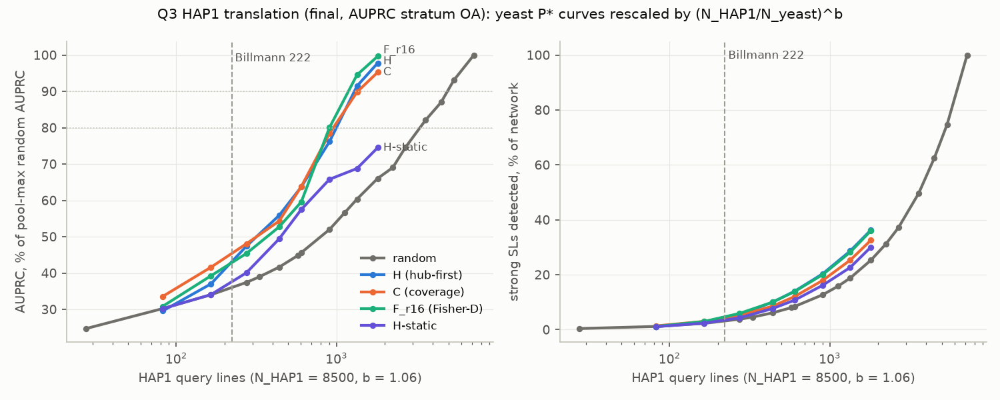
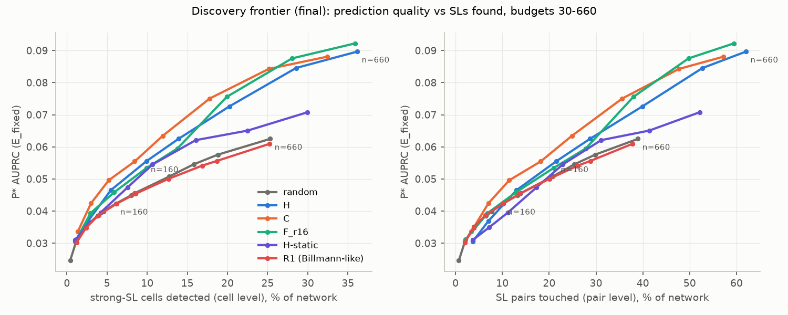
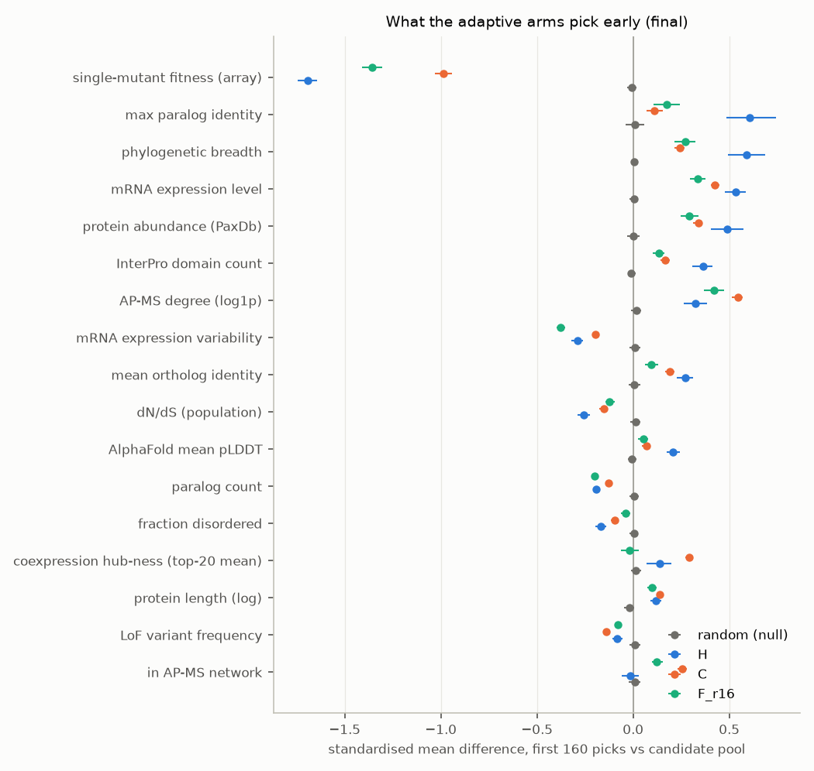
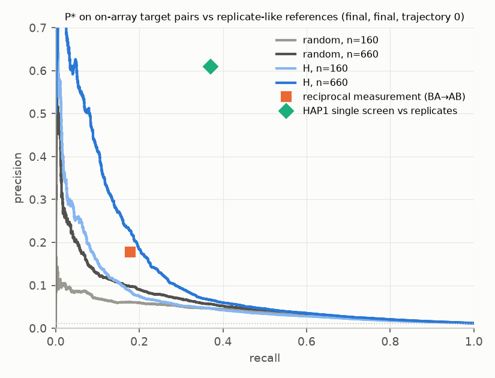
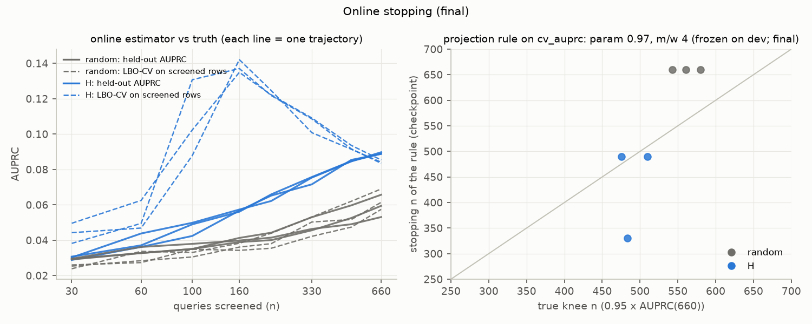

# Q3 analyses — FINAL 

T-based numbers are primary; dev (results/q3_dev/summary.md) is the consistency check. Side by side: `dev_vs_final.md`. Stopping rule applied exactly as frozen in 51cae82. Translation uses the T-based n_80 / n_90 (results/final/q1_nx.csv) and stratum-specific n_req, with the dev universe slope b. Saturating-fit parameters are not quoted (c sits on its bound).

DESIGN v3.1 §7.2–7.4. Code: `analysis/q3/` (one command per analysis, `--source dev|final|dryrun`); rerun everything with `bash analysis/q3/run_all.sh <source>`. Predictor: frozen P* (stack_lr_wr2_lb). All numbers below are generated from the CSV/JSON files in this directory.

## Key findings

- **Random screening, HAP1 lines** to reach 80% / 90% of what screening the whole pool gives (no plateau; N_HAP1 8,500, measured b, on-array stratum): n_80 ≈ 3,321 [2,570, 4,374], n_90 ≈ 4,934 [4,110, 5,982] lines (count-scaling bound b = 0: 1,211 / 1,796).
- **H** reaches the same AUPRC with 999 (n_80) / 1,296 (n_90) lines in 37 / 48 rounds (saving 70% / 74%).
- **H__b110** reaches the same AUPRC with 1,037 (n_80) / 1,438 (n_90) lines in 4 / 5 rounds (saving 69% / 71%).
- **Stratum-specific n_req at n = 160 (on-array stratum)**: H ≈ random at 396 [343, 460] (2.48×; 439 vs 1,087 HAP1 lines); C ≈ random at 368 [324, 420] (2.30×; 439 vs 1,010 HAP1 lines); F_r16 ≈ random at 341 [305, 377] (2.13×; 439 vs 935 HAP1 lines).
- **Billmann's 222 lines** ≈ 81 yeast queries at measured b: random selection gives 36% of the pool-max AUPRC, H 43%.
- **Where the gain is (n = 160)**: pooled AUPRC +26 to +31%, but macro AUPRC only +5 to +10% and AUROC -0.009 to -0.000; top SL-count tertile +22 to +24%, tertiles 1–2 -10 to +9%.
- **Static 3-feature rank rule** (post-final descriptive; rule fixed in bde1622) (low single-mutant fitness, low expression variability, high conservation) recovers 108% of H's AUPRC gain at n = 160 (H-static 38%).
- **Online estimator**: LBO-CV AUPRC on screened rows has relative bias -15% to +6% under random selection but -5% to +143% under H (SL-rich screened rows).
- **Frozen stopping rule on these trajectories**: stops H at 330, 490, 490 and random at 660, 660, 660 (triggered 50%; AUPRC at stop = 96% of AUPRC(660)).
- **Stopping** (frozen rule, applied): true knees fall at 0.72–0.88 × the 660 cap; the frozen rule has mean |log2 error| 0.23 vs 0.12 for always stopping at n = 490.

## Where the gain is (qualifiers to every strategy number)

Finalist vs random at the same n: pooled AUPRC (the endpoint) vs per-query macro AUPRC, AUROC difference, and (T) relative Δ on E_TT, on-array rows and by target SL-count tertile (scorer contrasts.csv; CIs are the Δ CIs). At n = 160 much of the pooled gain is better cross-query ordering and top-of-list precision: macro AUPRC gains far less, AUROC does not improve, and the gain is detectable only in the top SL-count tertile.

| arm | n | pooled_auprc_rel | macro_auprc_rel | auroc_diff | TT_rel | onrows_rel | tert1_rel | tert1_ci | tert2_rel | tert2_ci | tert3_rel | tert3_ci |
|---|---|---|---|---|---|---|---|---|---|---|---|---|
| H | 160 | +31.2% | +9.7% | -0.009 | +34.2% | +40.5% | +3.2% | [-0.0057, +0.0066] | +4.7% | [-0.0045, +0.0080] | +22.8% | [+0.0061, +0.0252] |
| H | 660 | +43.5% | +19.3% | -0.006 | +48.1% | +50.7% | +36.2% | [-0.0019, +0.0166] | +40.5% | [+0.0097, +0.0313] | +30.8% | [+0.0188, +0.0397] |
| C | 160 | +31.0% | +10.0% | -0.000 | +30.5% | +37.8% | +9.1% | [-0.0019, +0.0047] | +4.1% | [-0.0027, +0.0058] | +23.8% | [+0.0078, +0.0248] |
| C | 660 | +40.9% | +16.9% | -0.002 | +44.2% | +45.7% | +42.7% | [-0.0018, +0.0192] | +36.6% | [+0.0076, +0.0294] | +27.8% | [+0.0167, +0.0361] |
| F_r16 | 160 | +26.2% | +4.7% | -0.004 | +26.6% | +34.8% | -10.3% | [-0.0047, +0.0016] | -2.1% | [-0.0052, +0.0036] | +22.2% | [+0.0062, +0.0242] |
| F_r16 | 660 | +47.6% | +18.3% | -0.004 | +50.9% | +55.1% | +47.5% | [-0.0007, +0.0200] | +42.8% | [+0.0100, +0.0333] | +34.0% | [+0.0211, +0.0436] |

## 1. HAP1 translation (§7.3–7.4)

n_80 / n_90 = the random budget reaching 80% / 90% of what screening the WHOLE candidate pool gives (the curve has no plateau; this is not a saturation point). Yeast P* random n_80 / n_90 by AUPRC stratum: OA 1,211 / 1,796; all 1,143 / 1,761; onrows 1,236 / 1,821 (candidate pool ≈ 2,627). DESIGN §7.4 uses the on-array stratum (OA = E_VV on dev, E_TT at the final) for the HAP1 translation: OA is the primary below; 'all' (E_fixed, the Q1 endpoint with its frozen joint-bootstrap CI) and on-array rows are sensitivities. OA/onrows CIs carry over the 'all' stratum's relative CI width (approximation). Slope b (universe subsampling, re-bootstrapped): n_80 1.06 [0.85, 1.30], n_90 1.06 [0.89, 1.24].

**Random selection, HAP1 lines needed** (N_yeast = 3,283; 95% CI from the joint bootstrap of n_yeast and b; screens = lines × 1.34):

| target | N_HAP1 | scaling | HAP1 lines | screens |
|---|---|---|---|---|
| n80 | 7,500 | measured | 2,908 [2,299, 3,735] | 3,904 |
| n80 | 7,500 | b=0 (count) | 1,211 | 1,626 |
| n80 | 7,500 | b=1 (fraction) | 2,767 | 3,714 |
| n80 | 8,500 | measured | 3,321 [2,570, 4,374] | 4,458 |
| n80 | 8,500 | b=0 (count) | 1,211 | 1,626 |
| n80 | 8,500 | b=1 (fraction) | 3,136 | 4,209 |
| n80 | 9,500 | measured | 3,736 [2,835, 5,039] | 5,015 |
| n80 | 9,500 | b=0 (count) | 1,211 | 1,626 |
| n80 | 9,500 | b=1 (fraction) | 3,505 | 4,704 |
| n90 | 7,500 | measured | 4,320 [3,669, 5,137] | 5,799 |
| n90 | 7,500 | b=0 (count) | 1,796 | 2,411 |
| n90 | 7,500 | b=1 (fraction) | 4,104 | 5,508 |
| n90 | 8,500 | measured | 4,934 [4,110, 5,982] | 6,623 |
| n90 | 8,500 | b=0 (count) | 1,796 | 2,411 |
| n90 | 8,500 | b=1 (fraction) | 4,651 | 6,243 |
| n90 | 9,500 | measured | 5,553 [4,553, 6,863] | 7,454 |
| n90 | 9,500 | b=0 (count) | 1,796 | 2,411 |
| n90 | 9,500 | b=1 (fraction) | 5,198 | 6,977 |

Stratum sensitivity (N_yeast 3,283, N_HAP1 8,500, measured b):

| AUPRC stratum | target | yeast n | HAP1 lines |
|---|---|---|---|
| OA | n80 | 1,211 | 3,321 [2,570, 4,374] |
| OA | n90 | 1,796 | 4,934 [4,110, 5,982] |
| all | n80 | 1,143 | 3,135 [2,438, 4,132] |
| all | n90 | 1,761 | 4,837 [4,030, 5,897] |
| onrows | n80 | 1,236 | 3,388 [2,632, 4,440] |
| onrows | n90 | 1,821 | 5,003 [4,152, 6,065] |

Denominator sensitivity (N_HAP1 = 8,500, measured b):

| target | N_yeast | HAP1 lines |
|---|---|---|
| n80 | N_yeast=3283 (primary) | 3,321 [2,570, 4,374] |
| n80 | N_yeast=4458 (Q∪A) | 2,401 [1,953, 2,992] |
| n80 | N_yeast=pool size | 4,206 [3,129, 5,816] |
| n90 | N_yeast=3283 (primary) | 4,934 [4,110, 5,982] |
| n90 | N_yeast=4458 (Q∪A) | 3,565 [3,095, 4,136] |
| n90 | N_yeast=pool size | 6,253 [5,041, 7,863] |

**Costs, random vs strategies** (N_HAP1 = 8,500, measured b). A strategy's budget is the n at which its own mean curve reaches the random target AUPRC, i.e. its random-equivalent budget n_req equals n_X. Rounds = sequential screening rounds (batch of 10/50/110 yeast queries = batch × (N_HAP1/N_yeast)^b HAP1 lines per round). 'right' = target not reached by n = 660; 'left' = reached before the first checkpoint (value is an upper bound).

| target | arm | yeast n | HAP1 lines [95% CI] | screens | rounds | lines/round | saving vs random | censored |
|---|---|---|---|---|---|---|---|---|
| n80 | random | 1,211 | 3,321 [2,570, 4,374] | 4,458 | 1 (one-shot) | 3,321 | 0% |  |
| n80 | C | 349 | 956 [780, 1,207] | 1,284 | 35 | 27 | 71% |  |
| n80 | C__b110 | 423 | 1,159 [945, 1,463] | 1,556 | 4 | 302 | 65% |  |
| n80 | C__b50 | 369 | 1,011 [824, 1,276] | 1,357 | 8 | 137 | 70% |  |
| n80 | F-static_r16 | ∞ | ∞ [—, —] | ∞ | — | 27 | — | right |
| n80 | F_r16 | 330 | 904 [737, 1,141] | 1,214 | 33 | 27 | 73% |  |
| n80 | H | 364 | 999 [815, 1,261] | 1,341 | 37 | 27 | 70% |  |
| n80 | H-static | ∞ | ∞ [—, —] | ∞ | — | 27 | — | right |
| n80 | H__b110 | 378 | 1,037 [846, 1,309] | 1,393 | 4 | 302 | 69% |  |
| n80 | H__b50 | 343 | 940 [766, 1,186] | 1,261 | 7 | 137 | 72% |  |
| n80 | R1 | ∞ | ∞ [—, —] | ∞ | — | 27 | — | right |
| n90 | random | 1,796 | 4,934 [4,110, 5,982] | 6,623 | 1 (one-shot) | 4,934 | 0% |  |
| n90 | C | 495 | 1,361 [1,157, 1,607] | 1,827 | 50 | 27 | 72% |  |
| n90 | C__b110 | 580 | 1,592 [1,354, 1,881] | 2,138 | 6 | 302 | 68% |  |
| n90 | C__b50 | 546 | 1,499 [1,274, 1,770] | 2,012 | 11 | 137 | 70% |  |
| n90 | F-static_r16 | ∞ | ∞ [—, —] | ∞ | — | 27 | — | right |
| n90 | F_r16 | 433 | 1,189 [1,011, 1,405] | 1,597 | 44 | 27 | 76% |  |
| n90 | H | 472 | 1,296 [1,102, 1,531] | 1,740 | 48 | 27 | 74% |  |
| n90 | H-static | ∞ | ∞ [—, —] | ∞ | — | 27 | — | right |
| n90 | H__b110 | 524 | 1,438 [1,223, 1,699] | 1,930 | 5 | 302 | 71% |  |
| n90 | H__b50 | 495 | 1,360 [1,156, 1,606] | 1,825 | 10 | 137 | 72% |  |
| n90 | R1 | ∞ | ∞ [—, —] | ∞ | — | 27 | — | right |

**Billmann's 222 lines on the curves** (N_HAP1 = 8,500): equivalent yeast budget, AUPRC as % of the random pool-max AUPRC, strong SLs detected (% of the dev network, cell level).

| scaling | arm | yeast n | AUPRC % of max | SLs detected |
|---|---|---|---|---|
| measured | C | 81 | 45% [42, 48] | 4.3% |
| measured | F_r16 | 81 | 43% [40, 45] | 4.7% |
| measured | H | 81 | 43% [38, 47] | 4.4% |
| measured | H-static | 81 | 38% [35, 40] | 3.5% |
| measured | R0 | 81 | 36% [34, 37] | 3.2% |
| measured | R1 | 81 | 36% [34, 37] | 3.3% |
| b=0 (count) | C | 222 | 64% | 12.2% |
| b=0 (count) | F_r16 | 222 | 60% | 14.0% |
| b=0 (count) | H | 222 | 64% | 14.1% |
| b=0 (count) | H-static | 222 | 58% | 10.8% |
| b=0 (count) | R0 | 222 | 46% | 8.5% |
| b=0 (count) | R1 | 222 | 45% | 8.6% |
| b=1 (fraction) | C | 86 | 46% | 4.6% |
| b=1 (fraction) | F_r16 | 86 | 44% | 5.0% |
| b=1 (fraction) | H | 86 | 44% | 4.7% |
| b=1 (fraction) | H-static | 86 | 38% | 3.7% |
| b=1 (fraction) | R0 | 86 | 36% | 3.3% |
| b=1 (fraction) | R1 | 86 | 36% | 3.5% |

**Marginal returns per +100 HAP1 lines** (N_HAP1 = 8,500, measured b; Δ in percentage points of the random pool-max AUPRC and of the network's strong SLs; H only within its measured range ≤ 660 yeast):

| hap1_lines | auprc_frac_of_max_H | auprc_frac_of_max_R0 | d_auprc_frac_per100_H | d_auprc_frac_per100_R0 | d_sl_detected_frac_per100_H | d_sl_detected_frac_per100_R0 |
|---|---|---|---|---|---|---|
| 100 | 31.6 | 31.3 | 9.3 | 4.0 | 2.2 | 1.4 |
| 222 | 43.1 | 36.0 | 7.2 | 2.7 | 2.7 | 1.3 |
| 300 | 49.0 | 38.2 | 5.2 | 2.6 | 2.7 | 1.4 |
| 500 | 59.1 | 43.2 | 4.5 | 2.3 | 2.3 | 1.4 |
| 750 | 70.4 | 49.0 | 3.8 | 2.0 | 2.0 | 1.3 |
| 1,000 | 80.0 | 54.1 | 3.7 | 2.0 | 2.0 | 1.3 |
| 1,500 | 93.8 | 62.5 | 1.4 | 1.2 | 1.7 | 1.4 |
| 2,000 | — | 67.4 | — | 0.7 | — | 1.3 |
| 3,000 | — | 77.4 | — | 0.9 | — | 1.4 |
| 4,000 | — | 84.4 | — | 0.5 | — | 1.4 |

**Stratum-specific random-equivalent budgets** (PI addendum; DESIGN §7.4: the on-array stratum OA = E_TT on T is the HAP1-relevant one). n_req inverts the arm's mean curve on the random mean curve of the SAME stratum (frozen n_req). CI = trajectory bootstrap only (strategy and random trajectories resampled; no query resampling, so narrower than the scorer's query-bootstrap CI). The E_fixed ('all') points reproduce the scorer's n_req.csv exactly; the E_fixed ratio is NOT the translation estimate.

| stratum | arm | strategy n | random-equivalent n_req [95% CI] | n_req / n | HAP1 lines: strategy → random-equivalent (N_HAP1 8,500, measured b) | scorer n_req (E_fixed) |
|---|---|---|---|---|---|---|
| OA | H | 30 | 26 [22, 32] | 0.88 | 82 → 72 | 30 |
| OA | H | 60 | 94 [75, 118] | 1.56 | 165 → 257 | 79 |
| OA | H | 100 | 246 [207, 298] | 2.46 | 274 → 675 | 237 |
| OA | H | 160 | 396 [343, 460] | 2.48 | 439 → 1,087 | 434 |
| OA | H | 220 | 584 [505, 682] | 2.65 | 603 → 1,600 | 660 |
| OA | H | 330 | 1,045 [889, 1,182] | 3.17 | 905 → 2,864 | 1,108 |
| OA | H | 490 | 1,877 [1,756, 2,020] | 3.83 | 1,344 → 5,148 | 1,895 |
| OA | H | 660 | 2,397 [2,239, 2,481] | 3.63 | 1,810 → 6,572 | 2,387 |
| OA | C | 30 | 55 [45, 68] | 1.84 | 82 → 151 | 48 |
| OA | C | 60 | 159 [138, 184] | 2.65 | 165 → 437 | 162 |
| OA | C | 100 | 257 [226, 301] | 2.57 | 274 → 705 | 302 |
| OA | C | 160 | 368 [324, 420] | 2.30 | 439 → 1,010 | 433 |
| OA | C | 220 | 587 [506, 697] | 2.67 | 603 → 1,609 | 716 |
| OA | C | 330 | 1,139 [985, 1,273] | 3.45 | 905 → 3,123 | 1,229 |
| OA | C | 490 | 1,786 [1,672, 1,929] | 3.64 | 1,344 → 4,896 | 1,876 |
| OA | C | 660 | 2,158 [1,963, 2,272] (right-cens. 0%) | 3.27 | 1,810 → 5,917 | 2,212 |
| OA | F_r16 | 30 | 34 [27, 42] | 1.12 | 82 → 92 | 33 |
| OA | F_r16 | 60 | 124 [105, 143] | 2.07 | 165 → 340 | 112 |
| OA | F_r16 | 100 | 217 [194, 241] | 2.17 | 274 → 595 | 225 |
| OA | F_r16 | 160 | 341 [305, 377] | 2.13 | 439 → 935 | 384 |
| OA | F_r16 | 220 | 472 [415, 530] | 2.15 | 603 → 1,295 | 550 |
| OA | F_r16 | 330 | 1,213 [1,028, 1,389] | 3.68 | 905 → 3,326 | 1,256 |
| OA | F_r16 | 490 | 2,094 [1,917, 2,233] (right-cens. 0%) | 4.27 | 1,344 → 5,742 | 2,158 |
| OA | F_r16 | 660 | 2,589 [2,510, 2,623] (right-cens. 14%) | 3.92 | 1,810 → 7,100 | ∞ |

Sensitivities (E_fixed, on-array rows):

| stratum | arm | strategy n | random-equivalent n_req [95% CI] | n_req / n | HAP1 lines: strategy → random-equivalent (N_HAP1 8,500, measured b) | scorer n_req (E_fixed) |
|---|---|---|---|---|---|---|
| all | H | 30 | 30 [25, 35] | 1.00 | 82 → 82 | 30 |
| all | H | 60 | 79 [65, 94] | 1.31 | 165 → 216 | 79 |
| all | H | 100 | 237 [198, 280] | 2.37 | 274 → 651 | 237 |
| all | H | 160 | 434 [380, 497] | 2.71 | 439 → 1,191 | 434 |
| all | H | 220 | 660 [591, 827] | 3.00 | 603 → 1,810 | 660 |
| all | H | 330 | 1,108 [990, 1,217] | 3.36 | 905 → 3,038 | 1,108 |
| all | H | 490 | 1,895 [1,783, 2,019] | 3.87 | 1,344 → 5,197 | 1,895 |
| all | H | 660 | 2,387 [2,275, 2,462] (right-cens. 1%) | 3.62 | 1,810 → 6,545 | 2,387 |
| all | C | 30 | 48 [42, 56] | 1.61 | 82 → 132 | 48 |
| all | C | 60 | 162 [142, 182] | 2.70 | 165 → 444 | 162 |
| all | C | 100 | 302 [265, 340] | 3.02 | 274 → 829 | 302 |
| all | C | 160 | 433 [391, 478] | 2.70 | 439 → 1,186 | 433 |
| all | C | 220 | 716 [616, 858] (right-cens. 0%) | 3.26 | 603 → 1,964 | 716 |
| all | C | 330 | 1,229 [1,100, 1,364] (right-cens. 0%) | 3.72 | 905 → 3,370 | 1,229 |
| all | C | 490 | 1,876 [1,766, 1,986] (right-cens. 0%) | 3.83 | 1,344 → 5,145 | 1,876 |
| all | C | 660 | 2,212 [2,073, 2,300] (right-cens. 1%) | 3.35 | 1,810 → 6,066 | 2,212 |
| all | F_r16 | 30 | 33 [27, 40] | 1.10 | 82 → 90 | 33 |
| all | F_r16 | 60 | 112 [98, 129] | 1.86 | 165 → 307 | 112 |
| all | F_r16 | 100 | 225 [206, 246] | 2.25 | 274 → 617 | 225 |
| all | F_r16 | 160 | 384 [349, 419] | 2.40 | 439 → 1,054 | 384 |
| all | F_r16 | 220 | 550 [500, 614] | 2.50 | 603 → 1,508 | 550 |
| all | F_r16 | 330 | 1,256 [1,122, 1,418] | 3.81 | 905 → 3,445 | 1,256 |
| all | F_r16 | 490 | 2,158 [1,999, 2,260] (right-cens. 1%) | 4.40 | 1,344 → 5,918 | 2,158 |
| all | F_r16 | 660 | ∞ [2,621, 2,621] (right-cens. 100%) | ∞ | 1,810 → ∞ | ∞ |
| onrows | H | 30 | 25 [21, 31] | 0.84 | 82 → 69 | 30 |
| onrows | H | 60 | 73 [61, 92] | 1.22 | 165 → 201 | 79 |
| onrows | H | 100 | 256 [220, 315] | 2.56 | 274 → 703 | 237 |
| onrows | H | 160 | 463 [416, 527] | 2.90 | 439 → 1,271 | 434 |
| onrows | H | 220 | 714 [633, 836] | 3.25 | 603 → 1,958 | 660 |
| onrows | H | 330 | 1,141 [1,030, 1,243] | 3.46 | 905 → 3,128 | 1,108 |
| onrows | H | 490 | 1,846 [1,736, 1,963] | 3.77 | 1,344 → 5,061 | 1,895 |
| onrows | H | 660 | 2,357 [2,254, 2,424] (right-cens. 1%) | 3.57 | 1,810 → 6,463 | 2,387 |
| onrows | C | 30 | 47 [40, 55] | 1.55 | 82 → 128 | 48 |
| onrows | C | 60 | 170 [146, 198] | 2.83 | 165 → 466 | 162 |
| onrows | C | 100 | 316 [276, 355] | 3.16 | 274 → 866 | 302 |
| onrows | C | 160 | 439 [398, 485] | 2.75 | 439 → 1,204 | 433 |
| onrows | C | 220 | 707 [625, 838] | 3.21 | 603 → 1,938 | 716 |
| onrows | C | 330 | 1,173 [1,037, 1,281] | 3.56 | 905 → 3,217 | 1,229 |
| onrows | C | 490 | 1,792 [1,693, 1,902] | 3.66 | 1,344 → 4,913 | 1,876 |
| onrows | C | 660 | 2,076 [1,947, 2,185] (right-cens. 0%) | 3.15 | 1,810 → 5,693 | 2,212 |
| onrows | F_r16 | 30 | 32 [24, 39] | 1.06 | 82 → 87 | 33 |
| onrows | F_r16 | 60 | 116 [99, 133] | 1.93 | 165 → 317 | 112 |
| onrows | F_r16 | 100 | 243 [222, 270] | 2.43 | 274 → 667 | 225 |
| onrows | F_r16 | 160 | 414 [378, 452] | 2.59 | 439 → 1,136 | 384 |
| onrows | F_r16 | 220 | 604 [541, 676] | 2.74 | 603 → 1,656 | 550 |
| onrows | F_r16 | 330 | 1,301 [1,183, 1,472] | 3.94 | 905 → 3,568 | 1,256 |
| onrows | F_r16 | 490 | 2,099 [1,954, 2,212] | 4.28 | 1,344 → 5,755 | 2,158 |
| onrows | F_r16 | 660 | ∞ [2,585, 2,627] (right-cens. 56%) | ∞ | 1,810 → ∞ | ∞ |

 (E_fixed version: fig_hap1_curves_all.png)

## 2. Discovery frontier (§7.2)

Counts recomputed from the stored selections on the dev network (T genes excluded on both sides). Cell level = strong-SL cells in screened rows; pair level 'detected' = SL called in a screened row, 'touched' = SL pair (either direction) involving a screened gene.

| n | arm | AUPRC | cells det. | pairs det. | pairs touched | det./touched | cells det. ×random | AUPRC ×random |
|---|---|---|---|---|---|---|---|---|
| 160 | C | 0.055 | 0.084 | 0.085 | 0.182 | 0.470 | 1.385 | 1.310 |
| 160 | F_r16 | 0.053 | 0.099 | 0.098 | 0.209 | 0.469 | 1.626 | 1.262 |
| 160 | H | 0.056 | 0.099 | 0.098 | 0.215 | 0.456 | 1.624 | 1.312 |
| 160 | H-static | 0.047 | 0.076 | 0.077 | 0.173 | 0.445 | 1.239 | 1.119 |
| 160 | H__b110 | 0.057 | 0.095 | 0.095 | 0.213 | 0.448 | 1.551 | 1.335 |
| 160 | R0 | 0.042 | 0.061 | 0.063 | 0.102 | 0.619 | 1.000 | 1.000 |
| 160 | R1 | 0.042 | 0.062 | 0.064 | 0.101 | 0.637 | 1.016 | 0.999 |
| 330 | C | 0.075 | 0.178 | 0.177 | 0.356 | 0.498 | 1.399 | 1.480 |
| 330 | F_r16 | 0.076 | 0.199 | 0.193 | 0.380 | 0.509 | 1.566 | 1.490 |
| 330 | H | 0.073 | 0.202 | 0.196 | 0.399 | 0.491 | 1.592 | 1.432 |
| 330 | H-static | 0.062 | 0.161 | 0.162 | 0.311 | 0.520 | 1.263 | 1.224 |
| 330 | H__b110 | 0.073 | 0.192 | 0.190 | 0.388 | 0.488 | 1.512 | 1.430 |
| 330 | R0 | 0.051 | 0.127 | 0.131 | 0.207 | 0.635 | 1.000 | 1.000 |
| 330 | R1 | 0.050 | 0.126 | 0.131 | 0.200 | 0.652 | 0.994 | 0.986 |
| 660 | C | 0.088 | 0.324 | 0.320 | 0.572 | 0.559 | 1.279 | 1.409 |
| 660 | F_r16 | 0.092 | 0.359 | 0.348 | 0.594 | 0.586 | 1.416 | 1.476 |
| 660 | H | 0.090 | 0.362 | 0.351 | 0.620 | 0.566 | 1.428 | 1.435 |
| 660 | H-static | 0.071 | 0.299 | 0.298 | 0.521 | 0.572 | 1.182 | 1.132 |
| 660 | H__b110 | 0.090 | 0.354 | 0.344 | 0.614 | 0.560 | 1.397 | 1.433 |
| 660 | R0 | 0.062 | 0.253 | 0.261 | 0.390 | 0.669 | 1.000 | 1.000 |
| 660 | R1 | 0.061 | 0.252 | 0.260 | 0.378 | 0.688 | 0.996 | 0.975 |

## 3. Choice of query lines (§7.4)

Standardised mean difference (first 160 picks vs the candidate pool; mean over trajectories; R0 = null control). SMF is the array strain's single-mutant fitness (HAP1 single-KO fitness analogue); true SL degree is evaluation-only context.

| feature | R0 | H | C | F_r16 | H-static | R1 |
|---|---|---|---|---|---|---|
| smf | -0.007 | -1.691 | -0.986 | -1.358 | -1.803 | 0.078 |
| paralog_identity | 0.009 | 0.607 | 0.111 | 0.173 | 1.087 | -0.003 |
| conservation | 0.007 | 0.592 | 0.241 | 0.272 | 0.628 | 0.005 |
| expr_mean | 0.005 | 0.534 | 0.426 | 0.334 | 1.368 | -0.000 |
| abundance | 0.000 | 0.490 | 0.340 | 0.292 | 1.754 | -0.016 |
| domains | -0.009 | 0.363 | 0.167 | 0.134 | 0.558 | -0.021 |
| apms_degree | 0.016 | 0.323 | 0.545 | 0.420 | 1.193 | -0.010 |
| expr_sd | 0.009 | -0.290 | -0.194 | -0.376 | 0.317 | -0.024 |
| identity | 0.006 | 0.272 | 0.192 | 0.094 | 1.266 | -0.008 |
| dnds | 0.012 | -0.258 | -0.153 | -0.122 | -0.636 | 0.004 |
| plddt | -0.005 | 0.209 | 0.070 | 0.053 | 0.692 | 0.009 |
| paralogs | 0.005 | -0.192 | -0.129 | -0.200 | -0.037 | -0.001 |
| offarray_share | 0.195 | 0.179 | 0.202 | 0.208 | 0.150 | 0.206 |
| disorder | 0.004 | -0.168 | -0.097 | -0.039 | -0.585 | -0.014 |
| coexp_hub | 0.015 | 0.138 | 0.294 | -0.020 | 1.474 | -0.019 |
| length | -0.021 | 0.119 | 0.137 | 0.097 | -0.388 | 0.008 |
| lof_freq | 0.008 | -0.082 | -0.138 | -0.077 | 0.151 | -0.014 |
| apms_in_network | 0.008 | -0.014 | 0.255 | 0.124 | 0.297 | 0.046 |

**Label: post-final descriptive; rule fixed before scoring (bde1622); not part of the frozen final plan.** The rules fitted on all three dev splits were applied once to the final pool (randomised top-20 static picks, seeds 0–2) and scored on T; no refitting or tweaking. A resume bug in the runner (not in the rule) stopped the run after n = 160; it was fixed and the remaining pre-specified budgets were run with the rule unchanged.

**Static rank rule vs the adaptive strategies** (randomised top-20 static picks from the leave-split-out rule, P* refit; recovered = (rule − random)/(strategy − random)):

| rule | n | rule | random | H | H-static | rule gain | H gain | recovered vs H | recovered vs finalists | H-static recovered | splits | fits | off-array share |
|---|---|---|---|---|---|---|---|---|---|---|---|---|---|
| forward_k1 | 160 | 0.053 | 0.042 | 0.056 | 0.047 | 0.255 | 0.312 | 0.817 | 0.865 | 0.382 | 1 | 3 | 0.198 |
| forward_k1 | 330 | 0.072 | 0.051 | 0.073 | 0.062 | 0.419 | 0.432 | 0.969 | 0.896 | 0.519 | 1 | 3 | 0.195 |
| forward_k1 | 660 | 0.083 | 0.062 | 0.090 | 0.071 | 0.335 | 0.435 | 0.770 | 0.761 | 0.304 | 1 | 3 | 0.193 |
| forward_k3 | 160 | 0.057 | 0.042 | 0.056 | 0.047 | 0.337 | 0.312 | 1.080 | 1.143 | 0.382 | 1 | 3 | 0.198 |
| forward_k3 | 330 | 0.071 | 0.051 | 0.073 | 0.062 | 0.399 | 0.432 | 0.924 | 0.854 | 0.519 | 1 | 3 | 0.196 |
| forward_k3 | 660 | 0.087 | 0.062 | 0.090 | 0.071 | 0.394 | 0.435 | 0.907 | 0.896 | 0.304 | 1 | 3 | 0.193 |

n = 660 is partial: those fits were stopped by the 3 GB RSS watchdog (P* at n = 660 on the full dev target set peaks at ≈3.0–3.2 GB), so only the splits listed were completed.

## 4. What prediction can contribute (§7.4)

Replicate-like reference on the on-array target stratum: the reciprocal measurement of the same pair (BA → AB). Both directions are evaluation cells, so its precision equals its recall.

| split | n_cells | n_pos | prevalence | ref_precision | ref_recall | kappa |
|---|---|---|---|---|---|---|
| final | 238,870 | 2,754 | 0.012 | 0.178 | 0.178 | 0.168 |

P* on the same cells (mean over trajectories and splits). HAP1 context: Billmann single screen vs replicates, precision 0.61 at recall 0.37.

| arm | n | AUPRC (paired cells) | precision @ ref recall | recall @ ref precision | precision @ recall 0.37 | recall @ precision 0.61 |
|---|---|---|---|---|---|---|
| C | 160 | 0.065 | 0.092 | 0.078 | 0.050 | 0.003 |
| C | 330 | 0.100 | 0.153 | 0.159 | 0.060 | 0.018 |
| C | 660 | 0.124 | 0.218 | 0.202 | 0.066 | 0.038 |
| F_r16 | 160 | 0.065 | 0.087 | 0.069 | 0.048 | 0.006 |
| F_r16 | 330 | 0.105 | 0.149 | 0.155 | 0.056 | 0.034 |
| F_r16 | 660 | 0.132 | 0.226 | 0.204 | 0.067 | 0.055 |
| H | 160 | 0.069 | 0.091 | 0.084 | 0.046 | 0.008 |
| H | 330 | 0.099 | 0.147 | 0.155 | 0.053 | 0.024 |
| H | 660 | 0.129 | 0.224 | 0.205 | 0.066 | 0.048 |
| R0 | 160 | 0.048 | 0.070 | 0.018 | 0.048 | 0.001 |
| R0 | 330 | 0.062 | 0.087 | 0.050 | 0.054 | 0.004 |
| R0 | 660 | 0.083 | 0.115 | 0.107 | 0.061 | 0.010 |

Expected true strong SLs among the top-k predictions per unscreened gene:

| columns | arm | n | k | true SLs / gene | random expectation | precision | genes with ≥1 |
|---|---|---|---|---|---|---|---|
| E_fixed | H | 160 | 10 | 0.925 | 0.095 | 0.093 | 0.481 |
| E_fixed | H | 160 | 50 | 2.979 | 0.476 | 0.060 | 0.799 |
| on_array_cols | H | 160 | 10 | 0.746 | 0.125 | 0.075 | 0.416 |
| on_array_cols | H | 160 | 50 | 2.248 | 0.623 | 0.045 | 0.720 |
| E_fixed | H | 330 | 10 | 1.124 | 0.095 | 0.112 | 0.513 |
| E_fixed | H | 330 | 50 | 3.319 | 0.476 | 0.066 | 0.816 |
| on_array_cols | H | 330 | 10 | 0.893 | 0.125 | 0.089 | 0.440 |
| on_array_cols | H | 330 | 50 | 2.389 | 0.623 | 0.048 | 0.727 |
| E_fixed | H | 660 | 10 | 1.342 | 0.095 | 0.134 | 0.543 |
| E_fixed | H | 660 | 50 | 3.680 | 0.476 | 0.074 | 0.837 |
| on_array_cols | H | 660 | 10 | 1.045 | 0.125 | 0.104 | 0.480 |
| on_array_cols | H | 660 | 50 | 2.619 | 0.623 | 0.052 | 0.749 |
| E_fixed | R0 | 160 | 10 | 0.798 | 0.095 | 0.080 | 0.495 |
| E_fixed | R0 | 160 | 50 | 3.037 | 0.476 | 0.061 | 0.841 |
| on_array_cols | R0 | 160 | 10 | 0.703 | 0.125 | 0.070 | 0.447 |
| on_array_cols | R0 | 160 | 50 | 2.256 | 0.623 | 0.045 | 0.745 |
| E_fixed | R0 | 330 | 10 | 0.928 | 0.095 | 0.093 | 0.532 |
| E_fixed | R0 | 330 | 50 | 3.233 | 0.476 | 0.065 | 0.846 |
| on_array_cols | R0 | 330 | 10 | 0.786 | 0.125 | 0.079 | 0.468 |
| on_array_cols | R0 | 330 | 50 | 2.352 | 0.623 | 0.047 | 0.748 |
| E_fixed | R0 | 660 | 10 | 1.089 | 0.095 | 0.109 | 0.566 |
| E_fixed | R0 | 660 | 50 | 3.464 | 0.476 | 0.069 | 0.854 |
| on_array_cols | R0 | 660 | 10 | 0.895 | 0.125 | 0.089 | 0.493 |
| on_array_cols | R0 | 660 | 50 | 2.483 | 0.623 | 0.050 | 0.755 |

Thresholds chosen by leave-batch-out CV on screened rows, applied to the targets (mean over the LBO trajectories):

| arm | n | set by | level | CV precision | CV recall | target precision | target recall | on-array precision | on-array recall | calls / gene |
|---|---|---|---|---|---|---|---|---|---|---|
| H | 30 | precision | 0.100 | 0.100 | 0.071 | 0.063 | 0.034 | 0.062 | 0.035 | 8.144 |
| H | 30 | precision | 0.200 | 0.200 | 0.018 | 0.075 | 0.004 | 0.093 | 0.006 | 0.816 |
| H | 30 | recall | 0.050 | 0.115 | 0.050 | 0.065 | 0.019 | 0.069 | 0.021 | 4.302 |
| H | 30 | recall | 0.100 | 0.086 | 0.100 | 0.057 | 0.059 | 0.055 | 0.059 | 14.896 |
| H | 30 | recall | 0.200 | 0.061 | 0.200 | 0.049 | 0.166 | 0.046 | 0.191 | 49.322 |
| H | 60 | precision | 0.100 | 0.100 | 0.106 | 0.081 | 0.058 | 0.084 | 0.055 | 10.153 |
| H | 60 | precision | 0.200 | 0.200 | 0.010 | 0.160 | 0.007 | 0.208 | 0.010 | 0.646 |
| H | 60 | recall | 0.050 | 0.117 | 0.050 | 0.110 | 0.028 | 0.120 | 0.028 | 3.888 |
| H | 60 | recall | 0.100 | 0.103 | 0.100 | 0.084 | 0.054 | 0.090 | 0.052 | 9.504 |
| H | 60 | recall | 0.200 | 0.079 | 0.200 | 0.065 | 0.134 | 0.065 | 0.142 | 29.864 |
| H | 100 | precision | 0.100 | 0.100 | 0.331 | 0.072 | 0.164 | 0.074 | 0.195 | 34.236 |
| H | 100 | precision | 0.200 | 0.200 | 0.135 | 0.129 | 0.047 | 0.138 | 0.055 | 5.566 |
| H | 100 | recall | 0.050 | 0.352 | 0.050 | 0.241 | 0.017 | 0.249 | 0.020 | 1.166 |
| H | 100 | recall | 0.100 | 0.267 | 0.100 | 0.169 | 0.031 | 0.177 | 0.037 | 2.870 |
| H | 100 | recall | 0.200 | 0.152 | 0.200 | 0.101 | 0.081 | 0.106 | 0.092 | 11.975 |
| H | 160 | precision | 0.100 | 0.100 | 0.384 | 0.068 | 0.207 | 0.068 | 0.241 | 43.837 |
| H | 160 | precision | 0.200 | 0.200 | 0.192 | 0.123 | 0.087 | 0.129 | 0.104 | 10.136 |
| H | 160 | recall | 0.050 | 0.533 | 0.050 | 0.313 | 0.020 | 0.299 | 0.024 | 0.938 |
| H | 160 | recall | 0.100 | 0.357 | 0.100 | 0.209 | 0.040 | 0.222 | 0.048 | 2.739 |
| H | 160 | recall | 0.200 | 0.192 | 0.200 | 0.119 | 0.091 | 0.124 | 0.108 | 11.078 |
| H | 220 | precision | 0.100 | 0.100 | 0.347 | 0.074 | 0.208 | 0.075 | 0.242 | 40.082 |
| H | 220 | precision | 0.200 | 0.200 | 0.164 | 0.145 | 0.093 | 0.156 | 0.114 | 9.193 |
| H | 220 | recall | 0.050 | 0.472 | 0.050 | 0.323 | 0.029 | 0.323 | 0.036 | 1.273 |
| H | 220 | recall | 0.100 | 0.295 | 0.100 | 0.214 | 0.058 | 0.233 | 0.073 | 3.859 |
| H | 220 | recall | 0.200 | 0.170 | 0.200 | 0.120 | 0.114 | 0.128 | 0.139 | 13.591 |
| H | 330 | precision | 0.100 | 0.100 | 0.288 | 0.085 | 0.204 | 0.089 | 0.242 | 34.290 |
| H | 330 | precision | 0.200 | 0.200 | 0.137 | 0.170 | 0.104 | 0.182 | 0.127 | 8.746 |
| H | 330 | recall | 0.050 | 0.416 | 0.050 | 0.332 | 0.042 | 0.350 | 0.055 | 1.805 |
| H | 330 | recall | 0.100 | 0.258 | 0.100 | 0.218 | 0.079 | 0.237 | 0.102 | 5.293 |
| H | 330 | recall | 0.200 | 0.144 | 0.200 | 0.120 | 0.146 | 0.127 | 0.175 | 17.487 |
| H | 490 | precision | 0.100 | 0.100 | 0.251 | 0.089 | 0.225 | 0.093 | 0.262 | 36.239 |
| H | 490 | precision | 0.200 | 0.200 | 0.119 | 0.181 | 0.113 | 0.199 | 0.142 | 8.927 |
| H | 490 | recall | 0.050 | 0.373 | 0.050 | 0.329 | 0.055 | 0.350 | 0.074 | 2.405 |
| H | 490 | recall | 0.100 | 0.232 | 0.100 | 0.209 | 0.098 | 0.230 | 0.125 | 6.710 |
| H | 490 | recall | 0.200 | 0.126 | 0.200 | 0.110 | 0.181 | 0.119 | 0.215 | 23.575 |
| H | 660 | precision | 0.100 | 0.100 | 0.226 | 0.084 | 0.249 | 0.088 | 0.288 | 42.541 |
| H | 660 | precision | 0.200 | 0.200 | 0.104 | 0.181 | 0.122 | 0.199 | 0.154 | 9.630 |
| H | 660 | recall | 0.050 | 0.350 | 0.050 | 0.313 | 0.067 | 0.338 | 0.091 | 3.086 |
| H | 660 | recall | 0.100 | 0.208 | 0.100 | 0.188 | 0.118 | 0.207 | 0.150 | 8.994 |
| H | 660 | recall | 0.200 | 0.114 | 0.200 | 0.096 | 0.219 | 0.102 | 0.256 | 32.871 |
| R0 | 30 | precision | 0.100 | — | — | — | — | — | — | 0.000 |
| R0 | 30 | precision | 0.200 | — | — | — | — | — | — | 0.000 |
| R0 | 30 | recall | 0.050 | 0.050 | 0.050 | 0.054 | 0.066 | 0.057 | 0.057 | 17.439 |
| R0 | 30 | recall | 0.100 | 0.046 | 0.100 | 0.051 | 0.136 | 0.050 | 0.134 | 38.462 |
| R0 | 30 | recall | 0.200 | 0.037 | 0.200 | 0.043 | 0.274 | 0.042 | 0.298 | 93.426 |
| R0 | 60 | precision | 0.100 | 0.100 | 0.001 | 0.110 | 0.001 | 0.190 | 0.001 | 0.042 |
| R0 | 60 | precision | 0.200 | — | — | — | — | — | — | 0.000 |
| R0 | 60 | recall | 0.050 | 0.051 | 0.050 | 0.063 | 0.068 | 0.067 | 0.066 | 15.281 |
| R0 | 60 | recall | 0.100 | 0.049 | 0.100 | 0.059 | 0.135 | 0.058 | 0.139 | 32.951 |
| R0 | 60 | recall | 0.200 | 0.044 | 0.200 | 0.051 | 0.246 | 0.049 | 0.264 | 69.747 |
| R0 | 100 | precision | 0.100 | 0.100 | 0.002 | 0.109 | 0.003 | 0.157 | 0.002 | 0.126 |
| R0 | 100 | precision | 0.200 | — | — | — | — | — | — | 0.000 |
| R0 | 100 | recall | 0.050 | 0.064 | 0.050 | 0.070 | 0.060 | 0.076 | 0.051 | 12.135 |
| R0 | 100 | recall | 0.100 | 0.058 | 0.100 | 0.064 | 0.110 | 0.066 | 0.102 | 24.584 |
| R0 | 100 | recall | 0.200 | 0.050 | 0.200 | 0.056 | 0.212 | 0.054 | 0.214 | 54.077 |
| R0 | 160 | precision | 0.100 | 0.100 | 0.002 | 0.212 | 0.002 | 0.339 | 0.002 | 0.111 |
| R0 | 160 | precision | 0.200 | — | — | — | — | — | — | 0.000 |
| R0 | 160 | recall | 0.050 | 0.075 | 0.050 | 0.084 | 0.052 | 0.092 | 0.039 | 8.909 |
| R0 | 160 | recall | 0.100 | 0.066 | 0.100 | 0.074 | 0.104 | 0.079 | 0.093 | 20.078 |
| R0 | 160 | recall | 0.200 | 0.055 | 0.200 | 0.062 | 0.200 | 0.061 | 0.200 | 45.832 |
| R0 | 220 | precision | 0.100 | 0.100 | 0.057 | 0.098 | 0.052 | 0.111 | 0.053 | 2.519 |
| R0 | 220 | precision | 0.200 | 0.200 | 0.003 | 0.204 | 0.003 | 0.270 | 0.004 | 0.077 |
| R0 | 220 | recall | 0.050 | 0.084 | 0.050 | 0.094 | 0.055 | 0.108 | 0.048 | 8.523 |
| R0 | 220 | recall | 0.100 | 0.071 | 0.100 | 0.078 | 0.107 | 0.083 | 0.101 | 19.808 |
| R0 | 220 | recall | 0.200 | 0.059 | 0.200 | 0.064 | 0.200 | 0.065 | 0.207 | 44.570 |
| R0 | 330 | precision | 0.100 | 0.100 | 0.067 | 0.106 | 0.067 | 0.126 | 0.067 | 9.329 |
| R0 | 330 | precision | 0.200 | 0.200 | 0.013 | 0.213 | 0.012 | 0.225 | 0.015 | 0.871 |
| R0 | 330 | recall | 0.050 | 0.111 | 0.050 | 0.117 | 0.051 | 0.139 | 0.049 | 6.341 |
| R0 | 330 | recall | 0.100 | 0.090 | 0.100 | 0.093 | 0.103 | 0.102 | 0.102 | 16.091 |
| R0 | 330 | recall | 0.200 | 0.068 | 0.200 | 0.071 | 0.202 | 0.072 | 0.210 | 40.946 |
| R0 | 490 | precision | 0.100 | 0.100 | 0.093 | 0.104 | 0.099 | 0.122 | 0.101 | 13.874 |
| R0 | 490 | precision | 0.200 | 0.200 | 0.021 | 0.215 | 0.022 | 0.250 | 0.025 | 1.553 |
| R0 | 490 | recall | 0.050 | 0.135 | 0.050 | 0.140 | 0.053 | 0.180 | 0.057 | 5.560 |
| R0 | 490 | recall | 0.100 | 0.100 | 0.100 | 0.101 | 0.105 | 0.117 | 0.107 | 14.970 |
| R0 | 490 | recall | 0.200 | 0.074 | 0.200 | 0.076 | 0.203 | 0.080 | 0.211 | 38.557 |
| R0 | 660 | precision | 0.100 | 0.100 | 0.141 | 0.098 | 0.138 | 0.108 | 0.141 | 20.227 |
| R0 | 660 | precision | 0.200 | 0.200 | 0.039 | 0.193 | 0.039 | 0.239 | 0.044 | 2.858 |
| R0 | 660 | recall | 0.050 | 0.172 | 0.050 | 0.172 | 0.050 | 0.213 | 0.055 | 4.222 |
| R0 | 660 | recall | 0.100 | 0.120 | 0.100 | 0.115 | 0.096 | 0.133 | 0.100 | 11.930 |
| R0 | 660 | recall | 0.200 | 0.083 | 0.200 | 0.082 | 0.194 | 0.088 | 0.202 | 33.885 |

## 5. Online stopping estimator (§7.4)

LBO-CV AUPRC on screened rows vs the trajectory's held-out AUPRC (E_fixed), per n. The estimator uses only screened rows. Final mode refits P* on the DEV bundle (screened genes are pool genes; no T row is loaded and HSL_FINAL is not needed). T-gene columns are excluded from the CV cells, which is conservative relative to a real HAP1 experimenter, who would also use those library columns.

| n | R | cv_mean | true_mean | bias | mae | rel_bias | rel_mae | pearson | spearman | pearson_split_centred | lift_rel_bias | pearson_lift | fit_s_mean |
|---|---|---|---|---|---|---|---|---|---|---|---|---|---|
| 30 | 6 | 0.035 | 0.030 | 0.005 | 0.009 | 0.163 | 0.309 | 0.330 | 0.257 | 0.330 | 0.019 | 0.594 | 55.883 |
| 60 | 6 | 0.041 | 0.036 | 0.005 | 0.009 | 0.118 | 0.244 | 0.864 | 0.943 | 0.864 | -0.152 | 0.755 | 97.589 |
| 100 | 6 | 0.070 | 0.042 | 0.028 | 0.032 | 0.589 | 0.675 | 0.940 | 0.771 | 0.940 | 0.095 | 0.952 | 112.682 |
| 160 | 6 | 0.087 | 0.048 | 0.039 | 0.043 | 0.669 | 0.764 | 0.996 | 0.829 | 0.996 | 0.155 | 0.993 | 119.486 |
| 220 | 6 | 0.081 | 0.053 | 0.028 | 0.031 | 0.420 | 0.488 | 0.994 | 0.829 | 0.994 | 0.049 | 0.992 | 127.462 |
| 330 | 6 | 0.077 | 0.061 | 0.016 | 0.017 | 0.217 | 0.242 | 0.993 | 0.943 | 0.993 | -0.037 | 0.997 | 152.039 |
| 490 | 6 | 0.073 | 0.069 | 0.004 | 0.005 | 0.042 | 0.075 | 0.990 | 0.714 | 0.990 | -0.105 | 0.991 | 185.780 |
| 660 | 6 | 0.073 | 0.074 | -0.001 | 0.005 | 0.002 | 0.067 | 0.972 | 0.886 | 0.972 | -0.091 | 0.986 | 180.606 |

| arm | n | R | cv_mean | true_mean | rel_bias | rel_mae | pearson | lift_rel_bias | lift_rel_mae | pearson_lift |
|---|---|---|---|---|---|---|---|---|---|---|
| H | 30 | 3 | 0.044 | 0.030 | 0.473 | 0.473 | — | 0.331 | 0.331 | — |
| H | 60 | 3 | 0.053 | 0.039 | 0.352 | 0.352 | — | -0.029 | 0.059 | — |
| H | 100 | 3 | 0.107 | 0.047 | 1.264 | 1.264 | — | 0.357 | 0.357 | — |
| H | 160 | 3 | 0.138 | 0.057 | 1.433 | 1.433 | — | 0.484 | 0.484 | — |
| H | 220 | 3 | 0.123 | 0.064 | 0.908 | 0.908 | — | 0.248 | 0.248 | — |
| H | 330 | 3 | 0.106 | 0.074 | 0.430 | 0.430 | — | 0.061 | 0.061 | — |
| H | 490 | 3 | 0.092 | 0.085 | 0.086 | 0.086 | — | -0.062 | 0.062 | — |
| H | 660 | 3 | 0.084 | 0.089 | -0.054 | 0.054 | — | -0.083 | 0.083 | — |
| R0 | 30 | 3 | 0.025 | 0.029 | -0.146 | 0.146 | — | -0.293 | 0.293 | — |
| R0 | 60 | 3 | 0.030 | 0.034 | -0.116 | 0.136 | — | -0.276 | 0.276 | — |
| R0 | 100 | 3 | 0.033 | 0.036 | -0.085 | 0.085 | — | -0.168 | 0.168 | — |
| R0 | 160 | 3 | 0.036 | 0.040 | -0.095 | 0.095 | — | -0.174 | 0.174 | — |
| R0 | 220 | 3 | 0.039 | 0.042 | -0.068 | 0.068 | — | -0.149 | 0.149 | — |
| R0 | 330 | 3 | 0.049 | 0.048 | 0.004 | 0.054 | — | -0.136 | 0.136 | — |
| R0 | 490 | 3 | 0.054 | 0.054 | -0.002 | 0.064 | — | -0.147 | 0.147 | — |
| R0 | 660 | 3 | 0.063 | 0.059 | 0.058 | 0.080 | — | -0.099 | 0.099 | — |

Comparator without online information: always stop at a fixed n (mean |log2(n / knee)|):

| n_fixed | mae_log2 | bias_log2 |
|---|---|---|
| 30 | 4.126 | -4.126 |
| 60 | 3.126 | -3.126 |
| 100 | 2.389 | -2.389 |
| 160 | 1.711 | -1.711 |
| 220 | 1.252 | -1.252 |
| 330 | 0.667 | -0.667 |
| 490 | 0.118 | -0.097 |
| 660 | 0.333 | 0.333 |

True knees per trajectory (0.95 × AUPRC(660)):

| arm | split | traj | knee | knee_grid |
|---|---|---|---|---|
| H | final | 0 | 483.478 | 490.000 |
| H | final | 1 | 510.035 | 660.000 |
| H | final | 2 | 475.312 | 490.000 |
| R0 | final | 0 | 542.997 | 660.000 |
| R0 | final | 1 | 580.078 | 660.000 |
| R0 | final | 2 | 560.532 | 660.000 |

**Frozen rule** (`analysis/q3/stopping_rule.yaml`, frozen 2026-10-30T05:15:57Z): projection family; stop at the first checkpoint n ≥ 60 where cv_auprc ≥ 0.97 × its log-linear projection (last 4 checkpoints) to the planned maximum n = 660; otherwise stop at 660 (flagged).

Frozen rule applied:

| arm | split | traj | n_stop | triggered | knee | knee_grid | log2_err | true_at_stop_frac |
|---|---|---|---|---|---|---|---|---|
| H | final | 0 | 330.000 | True | 483.478 | 490.000 | -0.551 | 0.852 |
| H | final | 1 | 490.000 | True | 510.035 | 660.000 | -0.058 | 0.942 |
| H | final | 2 | 490.000 | True | 475.312 | 490.000 | 0.044 | 0.962 |
| R0 | final | 0 | 660.000 | False | 542.997 | 660.000 | 0.282 | 1.000 |
| R0 | final | 1 | 660.000 | False | 580.078 | 660.000 | 0.186 | 1.000 |
| R0 | final | 2 | 660.000 | False | 560.532 | 660.000 | 0.236 | 1.000 |

## Ambiguities in DESIGN §7.2–7.4 and how they were resolved (none silently)

1. **HAP1 constants are not in protocol.yaml.** DESIGN §5 and the brief place them there; the frozen file has no HAP1
   block. They are in `analysis/q3/hap1_constants.yaml` with their LITERATURE.md sources (N_HAP1 7,500 / 8,500 / 9,500;
   replicate factor 298/222 = 1.342; Billmann precision 0.61 / recall 0.37). Q3 seeds live there too
   (`config/seeds.yaml` is frozen).
2. **Which AUPRC stratum drives the translation.** §7.4 names the on-array stratum as the HAP1 estimate; §7.3/Q1 use
   E_fixed. Primary = on-array target columns (OA: E_VV on dev, E_TT at the final); E_fixed ('all') and on-array
   target rows ('onrows') are sensitivities.
3. **N_yeast vs the curve's anchor.** n_80 is anchored on the AUPRC at the candidate-pool maximum (dev ≈ 2,100;
   final 2,627), while §7.4 fixes N_yeast = 3,283. 3,283 is primary; 4,458 (Q ∪ A, DESIGN sensitivity) and
   N_yeast = pool size (added sensitivity) are reported. With b ≈ 1 the pool-size version is ~1.6× larger: this is
   the largest single lever on the HAP1 number.
4. **Bootstrap of n_yeast.** Only the 95% CIs of the frozen joint bootstrap are stored, not its replicates: n_yeast
   replicates are lognormal matched to each CI (per split, averaged over splits on dev). b replicates re-run P1's
   within-level draw bootstrap exactly (point b reproduces slope.json to 1e-9). OA/onrows strata carry over the
   'all' stratum's relative CI width (approximation).
5. **'Use the strategy's n_req'.** The strategy's cost for target X is the budget n_s at which its own mean (PAVA)
   curve reaches the random target AUPRC, so n_req(n_s) = n_X. Reached before the first checkpoint → first
   checkpoint reported as an upper bound ('left'); not reached by 660 → censored ('right').
6. **Sequential rounds.** Random = 1 round (all lines in parallel). Adaptive = n_s / batch rounds; batch 10 / 50 /
   110 yeast queries = batch × (N_HAP1/N_yeast)^b HAP1 lines per round. The 110 arm (≤ 6 rounds to 660, §6.3) is
   read from its own stored curve (checkpoints 160 / 330 / 660).
7. **Pair-level discovery.** An unordered pair is SL if any measured direction among pool rows is a strong SL;
   'detected' = called in a screened row; 'touched' = involves a screened gene. T genes are dropped on both sides
   (final mode needs no T label). Stored P1/P4 cell counts include T columns, so recomputed cell counts are 0–25%
   lower (tested).
8. **'Genes picked early'.** First 160 picks of each stored trajectory vs that trajectory's candidate pool;
   standardised mean difference, CI by resampling trajectories within split. SMF exists only for on-array genes.
9. **Rank rule.** Target = the finalists' (H, C, F_r16) pick frequency in their first 160 (not the true degree, which
   needs labels); fitted leave-split-out with the evaluation split's D_val genes removed from the rule's training rows.
   Genes without SMF (off-array, a yeast artefact) are scored route-stratified as in the strategies' D5 calibration
   (ranked by the rule minus its SMF term, mapped onto the on-array score quantiles); otherwise a static SMF rule never
   picks them. Static selection = randomised top-20 picks (protocol top-k), seeds 0–2; P* refit outside the harness
   (no ledger writes), bit-identical to the stored AUPRC on dev1 r0 n = 160.
10. **Replicate reference.** The reciprocal label (BA) is a binary predictor of AB on on-array target cells where both
    directions are evaluation cells; by symmetry its precision equals its recall. P* is compared at matched recall
    and matched precision on the same cells. Billmann's 0.61 / 0.37 is a same-direction replicate screen (stricter
    reference) and is context only.
11. **LBO-CV cells.** Held-out batch rows × columns not screened in S_n (no reciprocal feature, as in E_fixed), not
    test genes, not self, measured. Batches = consecutive blocks of 10 in selection order; fold = batch mod 5
    (interleaved). Dev columns include D_val genes (unscreened arrays a lab would see); the final has no D_val.
12. **True knee and the stopping-rule family.** True knee on the trajectory's PAVA curve over the Q2 checkpoints,
    log-n interpolated (grid knee also given). DESIGN names a 'plateau rule' but no family. Two families were scored
    on dev: plateau (relative gain per doubling < δ for m consecutive checkpoints) and projection (current value ≥ τ ×
    log-linear projection to the planned maximum budget 660, i.e. 'within 1 − τ of where we would end'; this matches
    the knee definition, which is itself relative to AUPRC(660)). Each family uses either raw CV AUPRC or CV lift.
    Lift is included because adaptive arms screen less SL-rich rows as n grows, so their raw CV AUPRC falls while the
    held-out AUPRC rises. All rules stop at n ≥ 60, else at 660 (flagged). The choice is made on the same dev
    trajectories (in-sample), with a leave-split-out check and a no-information comparator (always stop at a fixed n).
13. **LBO scope.** For cost, LBO runs for R0 and H, trajectories 0–1, dev1–3 only (12 trajectories, one P* job at a
    time); the CV-threshold analysis covers those trajectories only.
